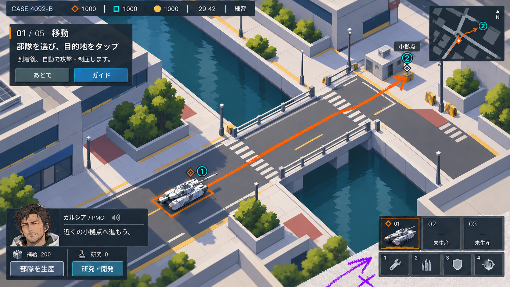
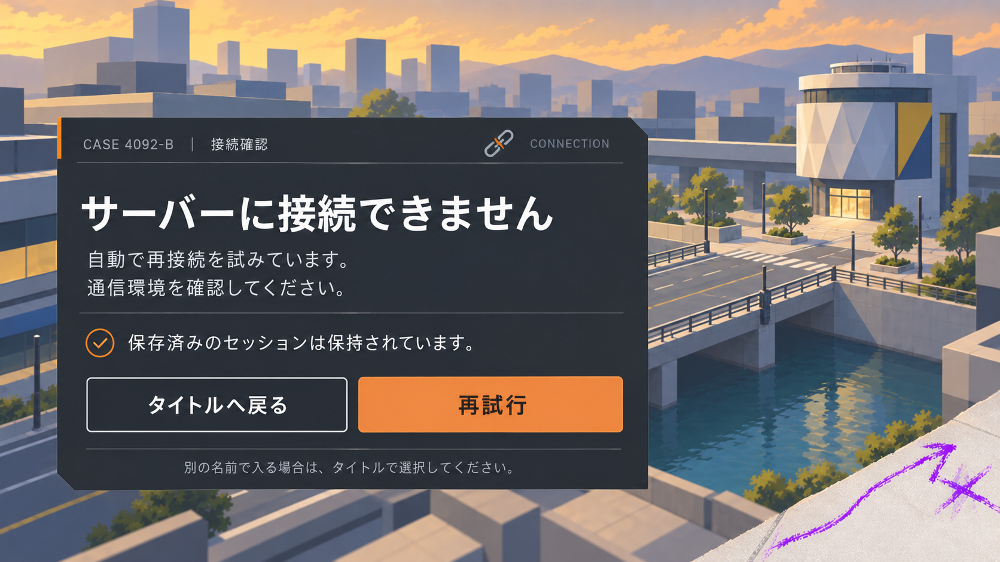
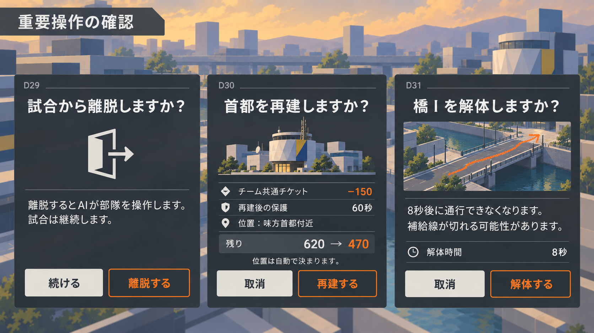
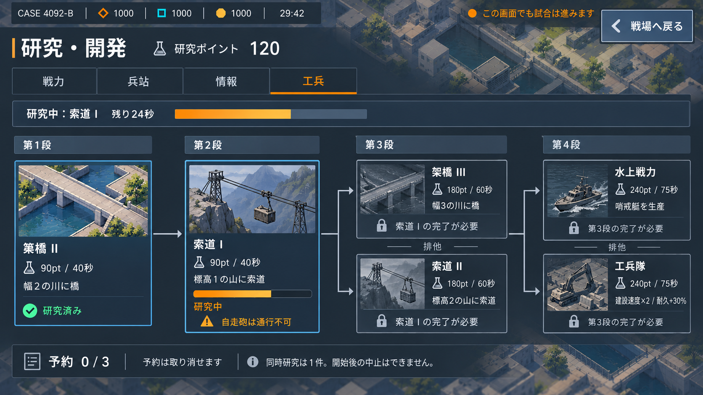
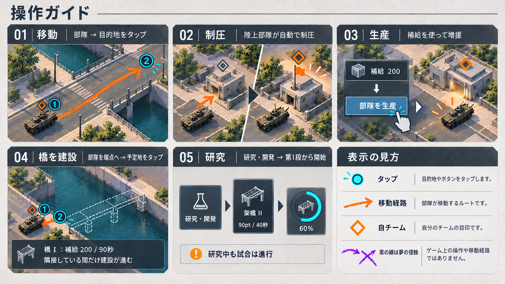
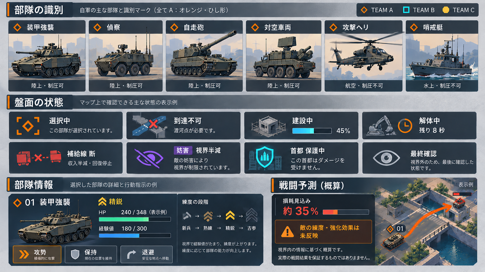
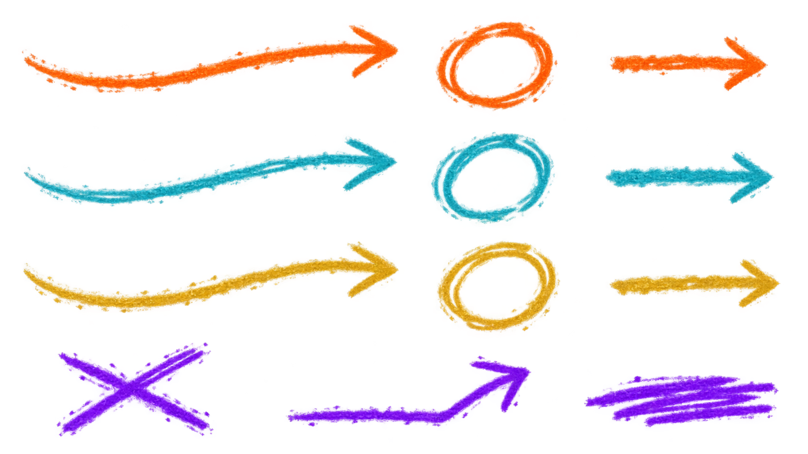

# P0向け 2Dデザイン・先行制作一式

最新修正: [白基調UIと試験施設の空気感を取り入れたRevision 06](revision-06/README.md)。前案の暗色パネルと丸いボタンを改め、白・薄灰の面と控えめな凹凸に整理した方向確認用の1枚。他の画面・図解の挿絵には改定前の表現が残っている。

今後の画面制作で参照する共通ルールは[UIデザイン方針](../UIデザイン方針.md)に整理した。

2026-10-05。[デザイン基準](../デザイン基準.md)と[制作優先度](../../制作優先度.md)に基づく画面・アセットのデザイン案。制作にはimagegenの組み込みツールを使用。画像内のUIはデザイン検討用で、ゲームへの反映は未実施。

メイン画面は指導者の通信窓を常設し、空や地平線を外した俯瞰へ修正。マップは大きな舗装面・建物・植栽の塊で整理する。兵器は成立した構造と縮尺を保ちつつ直線的な近未来の形と幾何学迷彩へ変更。移動線はクレヨンモチーフ。仮タイトルは大きく表示しない。

## 制作物

| デザイン | 対象 | 内容 |
| --- | --- | --- |
| [導入付き試合画面](revision-04/01-main-angular-stage-final.png) | S05 / S08 / D41 | 近未来兵器と簡略化した街路。俯瞰とガルシアの通信窓、段階案内、部隊選択、生産・研究、クレヨンの移動経路を維持。 |
| [接続エラー](02-connection-error.png) | S02 / D42 | 再試行とタイトルへの復帰、保存済みセッション保持の説明。背景は抽象化した都市。 |
| [重要操作の確認](03-critical-confirmations.png) | D29 / D30 / D31 | 離脱・再建・橋I解体の比較シート。共有チケット150、保護60秒、解体8秒を表示。 |
| [研究画面](04-research-screen.png) | S05a | 4分野、工兵の4段、排他・前提条件、研究進捗、予約0/3。研究画面でも試合が進むと明示。 |
| [操作図解](05-tutorial-diagrams-final.png) | S08 / D41 | 移動・制圧・生産・橋・研究の5段階と表示の凡例。未建設の橋を渡る経路は描かない。 |
| [兵種・状態表示](06-units-and-status-final.png) | S05 / D21 / D24 等 | 兵種6種、選択・到達不可・建設・解体・補給線断・妨害・保護・最終確認、練度、概算の予測。 |
| [透過クレヨン素材](07-crayon-route-assets.png) | 移動経路 / D15 | オレンジ・シアン・黄の経路/リング、紫の×・曲がった矢印・検閲線。12要素の透明PNGシート。 |

## 画面・素材のプレビュー

### 導入付き試合画面

空・地平線を外した俯瞰。ガルシアの通信窓を常設し、段階案内、部隊選択、生産・研究、移動経路を配置。

### 接続エラー

再試行とタイトルへの復帰、保存済みセッション保持の説明。背景は抽象化した都市。

### 重要操作の確認

離脱・再建・橋I解体の比較シート。共有チケット150、保護60秒、解体8秒を表示。

### 研究画面

4分野、工兵の4段、排他・前提条件、研究進捗、予約0/3。研究画面でも試合が進むと明示。

### 操作図解

移動・制圧・生産・橋・研究の5段階と表示の凡例。未建設の橋を渡る経路は描かない。

### 兵種・状態表示

兵種6種、選択・到達不可・建設・解体・補給線断・妨害・保護・最終確認、練度、概算の予測。

### 透過クレヨン素材

オレンジ・シアン・黄の経路/リング、紫の×・曲がった矢印・検閲線。12要素の透明PNGシート。

## 仕様との照合

- 再建は共有チケット150を消費し、再建後60秒保護。確認シートの位置表示は存命味方首都がある例。味方首都がない場合は元の首都に近い陸地へ自動再建し、ユーザーが座標を選ぶ仕様にはしない。
- 橋Iは建設に補給200・90秒、解体8秒。建設は部隊が端点へ隣接している間に進む。
- 工兵研究のポイント・時間・前提・排他を現行定数と照合。例は架橋II研究済み・索道I研究中で、後段は前提未完了のためロック。予約は0/3。ポイントは開始時に消費することも実装時に補助説明へ含める。
- 補給線断は収入半減・回復停止。「最終確認」は視界外の対象の最後に確認した状態。周辺一帯を首都保護が守る表示にはしない。
- 戦闘予測は概算、敵の練度・強化効果は未反映。損耗35%はレイアウトの表示例であり、実際の計算結果ではない。HP等の例も実装ではスナップショットから表示する。
- 6兵種は形と名称で区別。兵器のサムネイルは2Dデザイン案で、現行3D模型の置き換えは未実施。

## 実装へ渡す際の扱い

画面のPNGをそのまま全面UIとして貼るものではない。文字、ボタン、数値、進捗、状態タグ、通信窓、盤面は別要素で構成する。日本語文言は上記仕様と元の機能仕様を正とし、画像内の文字の細部に依存しない。

`07-crayon-route-assets.png` は実際に透過を持つ素材シート。アルファ形式と余白の透明性を確認済み。要素の切り出し、経路に沿った描画方法、縮小時の線幅調整は実装段階に行う。現行4陣営モードのD用三角形・経路色は、この3陣営の素材例とは別に追加が必要。

接続エラー・確認ダイアログ・段階チュートリアルは新規UIの提案。表示だけで機能があると扱わず、対応する通信や状態遷移を実装してから利用する。再接続中・AI代行・陥落待機などの全状態差分、設定・選択画面の改善は今後の制作対象。P0全体の完了を意味しない。

実機のタップ領域、可読性、重なり、描画・入力応答は未検証。実装時は44px以上のタップ領域、横持ちの画面比率、セーフエリアを確認する。

## 履歴・再現資料

[生成プロンプト一式](prompts.md)に初稿と修正の指示を保存。

この表に記載した画像を今回の完成版とする。同じフォルダの `01-tutorial-hud.png`、`01-tutorial-hud-final.png`、`05-tutorial-diagrams.png`、`06-units-and-status.png` は修正前の比較資料。過去の `../p0-2d/` は未採用の美術方向による検討案。
