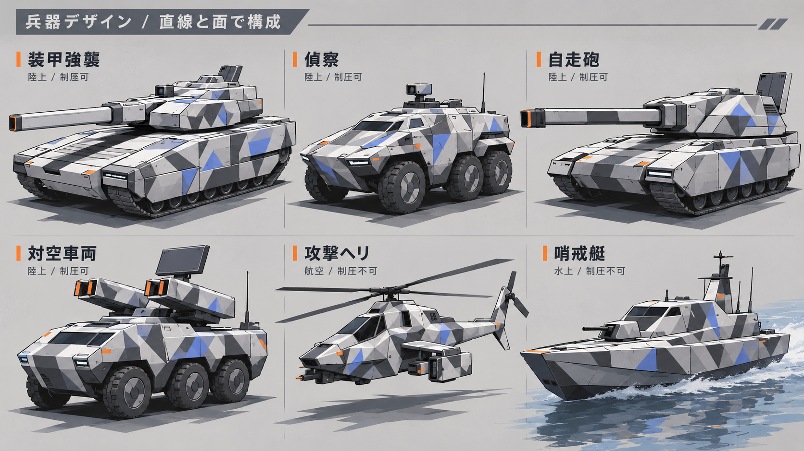

# Revision 04：直線的な近未来兵器とマップの抽象度

2026-10-05。ユーザーの追加参照に合わせ、兵器とメイン画面の表現を改定した2Dデザイン案。imagegenの組み込みツールを使用。ゲームへの反映は未実施。

## 制作物

- [メイン画面の修正版](01-main-angular-stage-final.png)：兵器の形と配色、街の舗装・植栽・水面の密度を見直し。俯瞰、ガルシアの通信窓、クレヨン移動線を維持。
- [兵器6種のデザイン比較](02-angular-unit-designs.png)：装甲強襲、偵察、自走砲、対空車両、攻撃ヘリ、哨戒艇。

## 方針

現代兵器を忠実に再現する方針から、成立する構造と兵種のシルエットを保った近未来の造形へ変更。直線・装甲面・低い砲塔・角形の砲身カバー・まとまった側面装甲を軸にし、細かな装備や継ぎ目は削る。白・灰・濃灰と控えめな青の大きな幾何学迷彩を用い、自然の軍用迷彩とは区別する。

マップは街路のゲームステージとして、大きな舗装面、窓帯、橋、植栽の塊で構成。材質と奥行きは残し、配管、屋上設備、個別の葉、細かな水面反射などの描き込みを抑える。参照画像固有のキャラクター、UI、標章は転用しない。

兵器比較シートは形の設計資料。メイン画面の縮小表示では厳密な装甲形や迷彩の見え方に差があり、3Dモデルを制作する際は比較シートの主要な形と小画面での識別性を両方確認する。

今回の修正はメイン画面と兵器6種。既存の操作図解・研究・状態表示・接続背景の挿絵は改定前の表現が含まれ、次の反映対象。UIの配置や仕様の資料として引き続き参照する。

初稿 `01-main-angular-stage.png` は比較用に保存。[生成プロンプト](prompts.md)に参照の役割と修正指示を記録。

