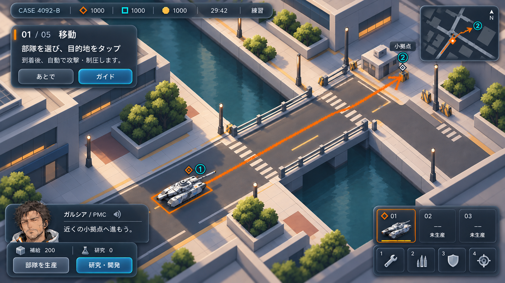

# Revision 05: ニューモーフィズムの検討案

2026-10-07。メイン画面のUIとマップに、浅い凹凸と柔らかな陰影を加えた方向確認用の2Dデザイン案。ゲームへの反映は未実施。

UIは暗いグラファイトブルーの面に、浮き出し・押し込みの浅い影と細い縁の光を加える。文字と重要操作は高いコントラストを維持し、タップ可能なボタンや選択状態を明確にする。

マップは道路を浅く沈んだ面、建物・橋・拠点をわずかに盛り上がった面として整理する。都市の縮尺と俯瞰、兵器の見やすさ、クレヨンの移動線はRevision 04の方針を引き継ぐ。画面全体を柔らかい凹凸で覆うと玩具的に見えやすいため、立体感は控えめに調整する。

## 生成指示

[prompts.md](prompts.md) に保存。
