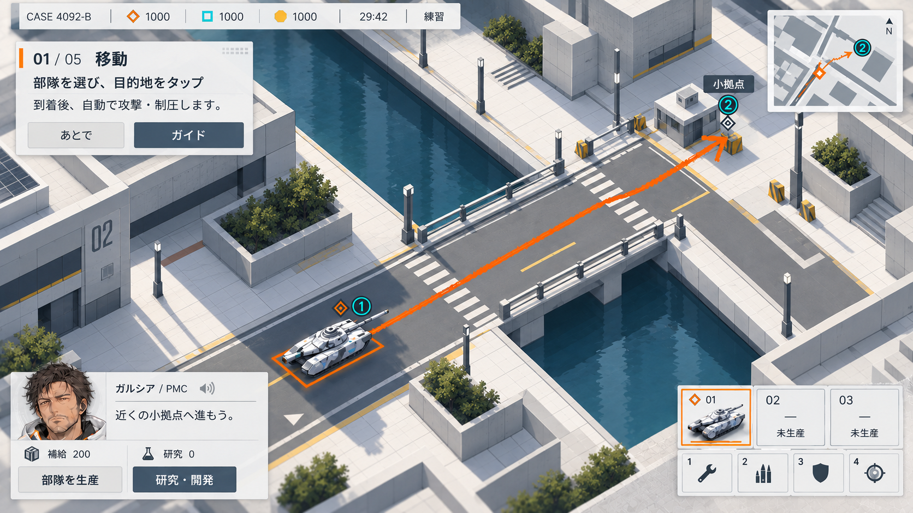

# Revision 06: 白基調のニューモーフィズム案

2026-10-07。白い試験施設を思わせる無機質で精密な空気感と、白基調のニューモーフィズムUIを組み合わせたメイン画面の方向確認用デザイン案。ゲームへの反映は未実施。

UIは磁器のような白・薄灰の面、控えめな凹凸、短く柔らかな影、細い冷灰色の境界で構成する。文字は濃色で明瞭にし、シアンは技術状態、オレンジは選択やクレヨン経路に絞る。丸く膨らむボタン、濃色のガラス風パネル、強い発光を避ける。

マップは簡略化した街路を、明るい建築面と落ち着いたグレーの道路で構成する。建物・橋・道路を大きな面と浅い段差で読み分け、操作対象の縮尺と俯瞰を維持する。施設のような直線的で精密な空気感を加えるが、現実の建物の微細な汚れや設備は描き込まない。

## 生成指示

[prompts.md](prompts.md) に保存。
