# UIモック 検討メモ

UIモック作成(2026-10-09)での検討と決定を1つにまとめたファイル。モック一式とこのメモは `mockups/` に置き、`docs/` には置かない。

## 1. 概要

ゲームとしては動かない、見た目だけの静的モック。現行の画面(S01〜S06)と、`画面とダイアログ一覧.md` の9〜10章にある将来の画面・主なダイアログを作った。画面は49枚(ドラマパート6枚を含む)。

- 置き場所: `mockups/ui/`。`index.html` を開くと全画面をサムネイルで一覧できる(各サムネイルのクリックで原寸)
- 基準のサイズ: スマホ横持ち 900×420(CSS px)。撮影は 2倍(1800×840)
- 画像アセット: `artwork/` の画像は使っていない。立ち絵・バストアップ・案件バナー・紋章・商品画像・3D盤面は、斜線と対角線のプレースホルダ(英字キー + 何が入るか・比率)で示した
- 撮影: `node tools/capture/mock.mjs [ファイル名の一部]` → `mockups/screens/`。一覧の再生成は `node mockups/ui/build-index.mjs`

## 2. デザインの方針

`UIコンセプト.md` の4層構造を、そのままUIの規則にした。

| 要素 | 規則 |
| --- | --- |
| 面 | マットホワイトと明るい灰色。パネルは半透明のガラス面と細い罫線。四隅に図面のトンボ(L字の目印) |
| 文字 | 英字の見出しは Space Grotesk、番号や公文書IDは JetBrains Mono、日本語は Noto Sans JP。小さい英字の見出し(字間を広げる)と太い数字で階層を付ける |
| 公文書 | CASE NO や文書番号に黒い左縁、判定の印(斜めの枠文字)、警告縞 |
| 主ボタン | 黒地 + 角の切り欠き + 左端の警告縞 + 英字の大見出し(DEPLOY、決定、ロビーへ戻る) |
| チーム | 色と記号を必ず併記(A 橙・菱形 / B シアン・四角 / C 金・六角 / D 紫・三角)。現地勢力は灰緑 |
| 紫クレヨン | 世界で唯一の手描きの線。SVG の線に揺らぎのフィルタをかけて表現。通常画面では1か所だけ、終盤(D15)・断章・ガチャ★3 など限られた場面で増える |
| 暗い面 | 夢の演出(MVP、ガチャ、レベルアップ、カットイン、縦持ち案内)だけ暗転させる |

共通部品は `mockups/ui/shared.css`(トークン・パネル・ボタン・タグ・プレースホルダなど)と `mockups/ui/hud.css`(試合HUD)にまとめた。

## 3. 画面一覧

### 起動・導入

| 画面 | 内容 | ファイル |
| --- | --- | --- |
| S01 タイトル | 潜行許可申請の書類パネル1枚。コールサイン入力、「ゲストで潜行」、受理待ちの印 | [s01_title](screens/s01_title.png) |
| S02 再接続中 | 照合の3段階(済/再試行中/待ち)と自動再試行、「別の名前で入る」 | [s02_connecting](screens/s02_connecting.png) |
| S07 アカウント/ログイン | Apple・Google・ゲスト、地域と遅延、生年月、規約同意と未成年の上限 | [s07_login](screens/s07_login.png) |
| S08 導入 + D41 | 暗転の中で部隊チップだけを照らし、指導者の吹き出しで操作を案内(STEP 3/8) | [s08_tutorial](screens/s08_tutorial.png) |
| S28 メンテナンス/強制更新 | 停止中の印と時間帯、強制更新のカード | [s28_maintenance](screens/s28_maintenance.png) |
| D12 縦持ちオーバーレイ | 回転の線画と「横持ちにしてください」 | [d12_portrait](screens/d12_portrait.png) |
| D42 接続エラー | 警告縞、再試行の進捗、エラーコード、タイトルへ/再試行 | [d42_conn_error](screens/d42_conn_error.png) |

### ホーム・試合前

| 画面 | 内容 | ファイル |
| --- | --- | --- |
| S09 ホーム | 指導者の立ち絵を画面の左半分に大きく出す。左端のレールで表示する指導者(文明)を選ぶと、名前・台詞・文明色と、全面の背景(文明ごとの背景画像)が切り替わる。右列に案件、報せ、ランク、各画面への導線、DEPLOY(`?civ=int` などで初期表示を変えられる) | [s09_home](screens/s09_home.png) |
| S10 マッチング | 4モード、パーティ3枠、持ち込みルール、レーダー風の待機表示 | [s10_matching](screens/s10_matching.png) |
| S04 選択 1/2 所属 | 所属を選ぶページ。指導者の立ち絵を中央に大きく出し、背景は選択中の文明の色に切り替える。左に6文明(Lv つき)、右に係数・作戦指令・文明Lv。「前回の装備で決定」で2ページ目を飛ばせる | [s04_pick_civ](screens/s04_pick_civ.png) |
| S04b 選択 2/2 装備 | アドオンを選ぶページ。左に選んだ指導者を残し、上に4枠、下に8枚のカード(永続/使い切りの絞り込み、ロック・在庫なし)。時間切れは今の選択で自動決定 | [s04b_pick_addon](screens/s04b_pick_addon.png) |

### 試合

| 画面 | 内容 | ファイル |
| --- | --- | --- |
| S05 試合HUD | チケットバー(色+記号)、タイマー、ミニマップ、通信コンソール、作戦指令、資源、合図、部隊セレクター、アドオン | [s05_match_hud](screens/s05_match_hud.png) |
| S05a 研究画面 | 上部を残した全画面。4分岐×4段、状態の出し分け、排他、予約列 | [s05a_research](screens/s05a_research.png) |
| S05 + D04 + D24 | 拠点情報ポップと、ドラッグ中の戦闘予測 | [s05b_base_popup](screens/s05b_base_popup.png) |
| S05 + D21 | 部隊ポップ: 練度の記章、経験値バー、態勢ボタン | [s05c_squad_popup](screens/s05c_squad_popup.png) |
| S05 + D02 | BASE パネル: 生産/防御施設/強化タブ、生産キュー、維持費 | [s05d_base_panel](screens/s05d_base_panel.png) |
| S05 + D47 | 指導者カットイン: 通信窓の横に出す 296×64 の小さな帯。暗転なし・タップを奪わない・約1.8秒で自動で閉じる。重なったら1行の予告に積み、制圧地点は盤面とミニマップのリングで示す | [s05e_cutin](screens/s05e_cutin.png) |
| S05 終盤 + D15 + D48 | 紫クレヨンが四隅・ミニマップ・チケットを侵蝕、中央水門開放の警告 | [s05f_late_erosion](screens/s05f_late_erosion.png) |
| S05 + D32 + D03 | 他チームの共闘合図への返答と、送信先チーム選択 | [s05g_signal](screens/s05g_signal.png) |
| S05 + D29 | 「離脱届」形式の確認モーダル | [s05h_leave_confirm](screens/s05h_leave_confirm.png) |

### 試合後

| 画面 | 内容 | ファイル |
| --- | --- | --- |
| S11 MVP | 全身立ち絵、白抜きの MVP、分野別の活躍、称賛 | [s11_mvp](screens/s11_mvp.png) |
| S06 リザルト | #1 をクレヨンで丸囲み、スコア表、練度、チケット推移、断章、報酬 | [s06_result](screens/s06_result.png) |
| D35 レベルアップ/開放演出 | 7 → 8 の大数字、開放物4枚 | [d35_levelup](screens/d35_levelup.png) |

### 育成・収集

| 画面 | 内容 | ファイル |
| --- | --- | --- |
| S13 文明研究 一覧 | 6文明の縦長カード、Lv、XP、次の開放 | [s13_civ_research](screens/s13_civ_research.png) |
| S13 文明詳細 | 永続アドオン5種、断章、衣装とボイス | [s13b_civ_detail](screens/s13b_civ_detail.png) |
| S14 指導者/衣装 | 文明切替、全身の立ち絵、衣装4種、ボイス一覧 | [s14_leader](screens/s14_leader.png) |
| S29 装備庫(新規ID) | 使い切り3種の在庫ゲージ、今日のドロップ残り | [s29_armory](screens/s29_armory.png) |
| S20 物語 | 章一覧とノベル表示、黒塗りの検閲とクレヨンの × | [s20_story](screens/s20_story.png) |

### ショップ・パス

| 画面 | 内容 | ファイル |
| --- | --- | --- |
| S15 ショップ | カテゴリ、ピックアップ、商品6枠、法定表記、未成年の月間上限 | [s15_shop](screens/s15_shop.png) |
| D33 購入の確認 | 内訳、支払い後の残高、上限への影響 | [d33_purchase](screens/d33_purchase.png) |
| S16 ガチャ結果 | 暗い演出面に10枠、★3 の発光、重複の変換 | [s16_gacha](screens/s16_gacha.png) |
| S17 バトルパス | 無料/上位の2段、受取状態、横スクロール | [s17_battle_pass](screens/s17_battle_pass.png) |
| S19 イベント/シーズン | キービジュアル、参加条件、特別ルール、進捗 | [s19_event](screens/s19_event.png) |

### 記録・その他

| 画面 | 内容 | ファイル |
| --- | --- | --- |
| S12 ランク/レート | 紋章、レート推移グラフ、報酬ラダー | [s12_rank](screens/s12_rank.png) |
| S21 戦績 | 履歴一覧と選択中の試合の詳報、チケット推移 | [s21_history](screens/s21_history.png) |
| S22 観戦/リプレイ | 視点切替、イベントログ、タイムライン、再生速度 | [s22_spectate](screens/s22_spectate.png) |
| S26 プロフィール | 成績、称号、使用文明のドーナツ、称賛・通報・組まない | [s26_profile](screens/s26_profile.png) |
| S27 ランキング | 表彰台と順位表、自分の行を固定 | [s27_ranking](screens/s27_ranking.png) |
| S25 お知らせ | 公文書書式の本文、承認の印、余白のクレヨン | [s25_news](screens/s25_news.png) |
| S23 設定 | カテゴリ、スライダー、トグル、DANGER 帯 | [s23_settings](screens/s23_settings.png) |
| S24 通報/ブロック管理 | 枠 4/10、期限バー、通報履歴の判定印 | [s24_block_list](screens/s24_block_list.png) |

S09 は左端のレールで表示する指導者を切り替えられる。文明別の表示例は [INT](screens/s09b_home_int.png) と [SOC](screens/s09c_home_soc.png)。

## 4. フィードバックによる改訂(2026-10-09)


| 指摘 | 対応 |
| --- | --- |
| カットインが大きく、展開の速い試合では邪魔 | 画面を横切る大きな帯をやめ、通信窓の横の小さな帯(296×64)にした。暗転と入力のブロックをなくし、表示は約1.8秒 |
| ホームのキャラクターをもっと大きく、文明ごとに背景を切り替える | 立ち絵を左半分いっぱいに拡大。左端のレールで表示する指導者を選ぶと、背景・文明色・名前・台詞が切り替わる(PMC / INT / SOC の3枚を撮影) |
| 文明選択でもキャラクターを大きく。2ページでもよい | 「1/2 所属 → 2/2 装備」の2ページに分けた。1ページに詰めるとアドオン8枚の説明が読めない大きさになるため。慣れた人向けに「前回の装備で決定」で1ページで終えられる |

- 2ページにしたので、選択時間は現行の30秒から45秒程度に延ばす想定でモックの残り時間を付けている(仕様は未変更)

## 5. ドラマパート

物語をキャラクターの会話で見せる「ドラマパート」を、後から台本を足すだけで作れるように、画面の部品と台本の形を決めておく。見た目だけの静的モック(`mockups/ui/s30*.html`、共通部品は `mockups/ui/drama.css`)。画像はすべてプレースホルダ。

### 5.1 どこで使うか

| 使う場所 | 内容 | 主な見せ方 |
| --- | --- | --- |
| S20 物語 | 文明ごとの断章(文明 Lv で開放)、メインの章 | 現実の会話 + 夢 |
| S08 導入 | 指導者の案内とチュートリアルの前後 | 無線 |
| S19 イベント / 案件の開始 | 案件の事情説明、作戦前ブリーフィング | 無線(盤面を背景に) |
| シーズン開始 | シーズンの出来事の短い物語(`世界観設定.md` の「立ち絵とテキストによる短い物語」) | 現実の会話 |
| S06 リザルト後 | 断章が開いたときの短い場面 | 現実の会話 / 夢 |

試合中には出さない(試合中の会話は通信窓の字幕と小さなカットインだけ)。

### 5.2 3つの見せ方

世界観の「現実の制度」と「少女の夢」の対比を、メッセージ窓の種類で分ける。

| 見せ方 | 使う場面 | メッセージ窓 | 名札 | 背景 |
| --- | --- | --- | --- | --- |
| 現実の会話 | 管制室、施設、会議 | 白い公文書の窓 | 黒、左縁に文明色 | 現実の背景画(マットホワイト) |
| 無線 | 作戦前・現場との通信 | 黒い通信窓、右縁にシアン | シアン | 盤面・作戦図。話者は左の通信枠で光る |
| 夢 | 少女の場面、侵蝕 | 出さない。言葉を手書き風の文字で画面に直接書く | 出さない(ログでは UNKNOWN) | 暗い紫。作戦図の紙と線 |

#### S30 現実の会話

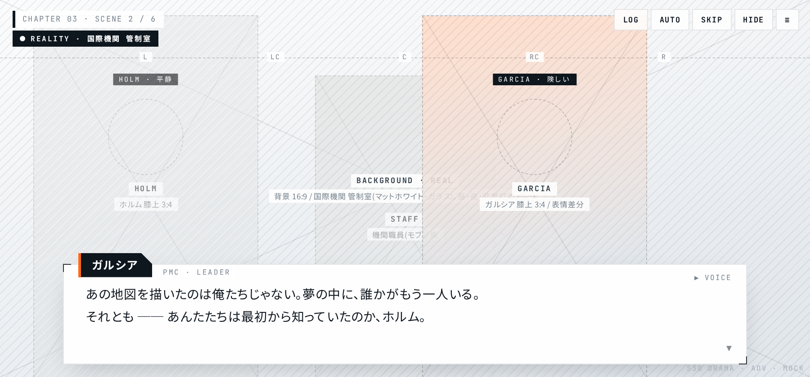

- 立ち位置は5点(L / LC / C / RC / R)と、奥に小さく置く「far」。立ち絵は膝上 3:4、画面の高さの96%
- 話していない人物は彩度と不透明度を下げる。話者が替わると明るさだけが切り替わる
- 左上に章と場面の番号、現実か夢かの札。右上に LOG / AUTO / SKIP / HIDE / メニュー
- 窓の右上の VOICE でボイスを再生し直す

#### S30b 選択肢

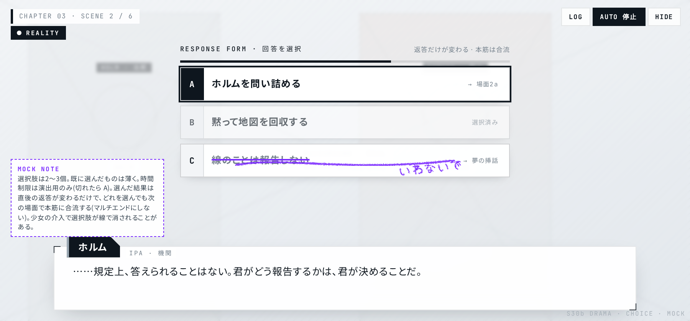

- 回答用紙の形で2〜3個。選んだことのあるものは薄く、分岐の影響を右上に小さく出す
- 時間制限は演出用だけ(切れたら最初の選択肢)。表示中は AUTO を止める
- 選んだ結果で変わるのは直後の返答(数行〜短い挿話)だけ。どれを選んでも次の場面で本筋に合流する(マルチエンドにしない)
- 少女の介入: 選択肢が紫の線で消され、別の言葉が書き足される。選ぶと短い夢の挿話を挟んでから合流する、といった使い方を想定

#### S30c 無線ブリーフィング

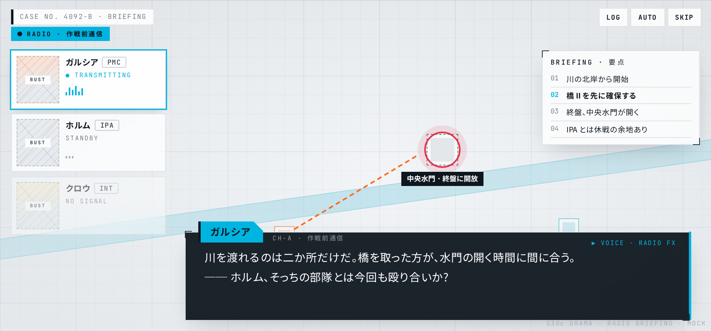

- 背景は盤面の図。話の内容に合わせて地点のリングや進路の矢印を出す
- 話者は左の通信枠(バストアップ)で示し、送信中はシアンの枠と波形。待機中・圏外も表示する
- 右に要点のリスト。今の話題の行を強調する
- バストアップだけで作れるので制作費が軽く、イベントや導入に向く

#### S30d 夢(少女)

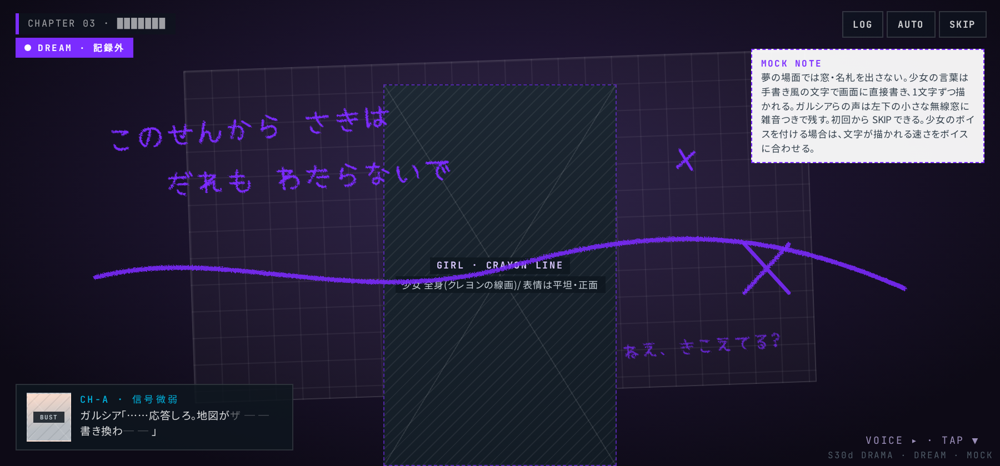

- 窓と名札を出さない。少女の言葉は手書き風の文字で画面に直接、1文字ずつ書く
- 現実側の人物の声は、左下の小さな無線窓に雑音つきで残す
- 初回から SKIP できる(夢の場面も例外にしない)。少女は平坦な表情で正面を見る線画(`UIコンセプト.md` の規定どおり)
- 少女にボイスを付ける可能性があるので、行ごとにボイスを付けられる形にしておく。付けた場合は文字が描かれる速さをボイスに合わせ、無い場合は文字だけで成り立つ

#### S30e バックログ

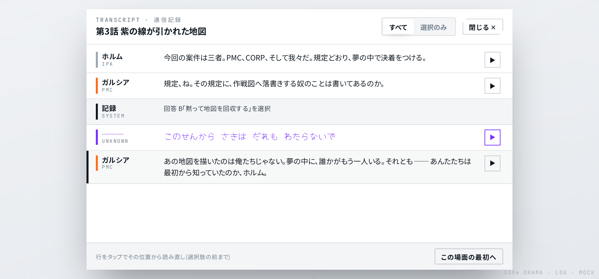

- 話者、本文、ボイスの再生。選択の記録は灰色の行で残す。少女の言葉は紫の手書き風で、話者は「───」。ボイスが付いた行だけ再生ボタンを出す(少女も同じ)
- 行をタップすると、その位置から読み直せる(選択肢より前には戻らない)

#### S30f 章扉

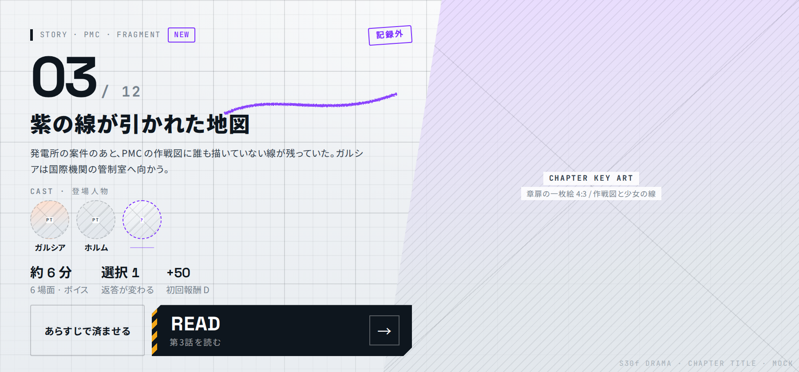

- 章番号を大きく、題名、あらすじ、登場人物、所要時間、選択の数、初回報酬
- 「あらすじで済ませる」を置き、物語を読まない人も報酬と開放を受け取れるようにする

### 5.3 演出の部品

台本から呼べる演出の一覧。どれも画像の差し替えと CSS の切替だけで済むものに絞る。

| 部品 | 内容 |
| --- | --- |
| 背景 | 差し替え、フェード、時間帯の差分(昼・夜・非常灯) |
| 立ち絵 | 登場・退場(フェード / スライド)、立ち位置の移動、表情の差分、奥に下げる(far) |
| 話者の強調 | 話者以外を暗くする。複数人の同時発言も可 |
| 窓の種類 | 現実 / 無線 / 夢 / ナレーション(名札なし) |
| 一枚絵 | 全面の一枚絵。上下に帯を入れて字幕を出す |
| 黒塗り | 本文の一部を検閲の黒で塗る(機関の秘密) |
| 少女の侵蝕 | 画面にクレヨンの線・×・言葉を書き込む。選択肢を消す |
| 揺れ・暗転 | 画面の揺れ、暗転、白転 |
| 盤面の指示 | 無線の見せ方で、地点のリング・矢印・ラベルを出す |
| ボイス・効果音 | 行ごとのボイス、無線の雑音、効果音 |

### 5.4 台本の形(案)

企画やライターが表計算ソフトで書き、そのまま読み込める1行1命令の形を想定する。

```
# 第3話 場面2  国際機関 管制室
bg      control_room  day
mode    real
show    holm     L    calm
show    garcia   RC   grim
show    staff    C    far
say     garcia   あの地図を描いたのは俺たちじゃない。夢の中に、誰かがもう一人いる。   vo=g03_021
say     garcia   それとも ── あんたたちは最初から知っていたのか、ホルム。         vo=g03_022
expr    holm     silent
choice  q03_2    A:ホルムを問い詰める>s2a  B:黙って地図を回収する>s2b  C:線のことは報告しない>d1
girl    strike   C   いわないで
# s2a / s2b / d1 は数行の返答だけ。最後に join s3 で本筋へ合流する
```

- `say` の本文は1行が窓の2行(全角40字×2程度)に収まる長さにする
- マルチエンドにしない。分岐は `join` で必ず本筋へ戻す。選択の結果は会話の履歴に残すだけで、後の章の展開は変えない
- 文明ごとの断章は、同じ形で文明の指導者が主役になるだけ
- `say` にはボイス番号を付けられる(少女の `girl say` も同じ)。無ければ文字だけで進む

### 5.5 立ち絵の共用

立ち絵はある程度共用する。指導者ごと・衣装ごとに縦長の原画を1枚作り、画面ごとに切り出し方を変える。

| 使う場所 | 切り出し | 表情 |
| --- | --- | --- |
| S09 ホーム | 膝上〜全身(大) | 基本の表情 |
| S04 選択 1/2 所属 | 膝上(大) | 基本の表情 |
| S04b 選択 2/2 装備 | 腰上 | 基本の表情 |
| S30 ドラマ(現実) | 膝上 3:4 | 差分あり |
| S30c 無線、試合中の通信窓 | 胸から上 | 差分あり |
| S14 指導者 / 衣装 | 全身 | 基本の表情 |

- 表情の差分は顔の部分だけ重ねる形にして、ホームなどでも同じ素材を使えるようにする
- 衣装を変えるとドラマの立ち絵も替わる(衣装が物語の中にも出る)。物語の都合で衣装を固定したい場面だけ、台本で指定する
- 共用しにくいのは、章扉や一枚絵、少女の線画、カットインの横長の絵

### 5.6 決まったこと(2026-10-09)

| 項目 | 決定 |
| --- | --- |
| 少女の声 | 付ける可能性がある。行ごとにボイスを付けられる形にしておき、無くても成り立つようにする |
| 分岐 | マルチエンドにしない。選択で変わるのは直後の返答だけで、本筋に合流する |
| SKIP | 初回からすべての場面で SKIP できる |
| 立ち絵 | ある程度共用する(5章) |

## 6. 決定事項のまとめ

| 日付 | 項目 | 決定 |
| --- | --- | --- |
| 2026-10-09 | 画像アセット | `artwork/` の画像は使わず、プレースホルダで置き換える |
| 2026-10-09 | カットイン | 小さな帯(296×64)。暗転なし・入力を奪わない・約1.8秒 |
| 2026-10-09 | ホーム | 立ち絵を大きく。表示する指導者(文明)ごとに背景を切り替える |
| 2026-10-09 | 文明選択 | 2ページ(所属 → 装備)。「前回の装備で決定」で1ページでも終えられる |
| 2026-10-09 | 少女の声 | 付ける可能性がある。無くても成り立つ形にする |
| 2026-10-09 | ドラマの分岐 | マルチエンドにしない。返答だけ変わり本筋に合流する |
| 2026-10-09 | ドラマの SKIP | 初回からすべての場面で SKIP できる |
| 2026-10-09 | 立ち絵 | ある程度共用する(5.5) |
| 2026-10-09 | 置き場所 | モックの検討・決定はこのファイル1つにまとめ、`docs/` に置かない |
| 2026-10-09 | UXプロトタイプ | 静的モックとは別に `mockups/ux/` に、遷移とダイアログをつないだ操作確認用のものを作る |

未決: 選択時間を30秒から45秒程度に延ばすか(2ページ化に伴う。仕様は未変更)、物語で衣装を固定する場面の扱い。

## 7. 課題と補足


- 中身の少ない画面(S24 の規則欄、S29 のカード中段など)は余白が多い
- S05 派生の試合画面(S05b〜S05h、S08)は、作成時点の `s05_match_hud.html` の中身を複製している。HUD を直しても派生画面には自動で反映されない
- D33 と D42 は、背景に別の画面(ショップ / ホーム)を iframe で読み込んでいる
- D22 態勢ポップは単独のモックを作らず、D21 部隊ポップの態勢ボタンで代用した
- S14 と S16 の衣装名「現実の制服」「夢の姿」は、`UIコンセプト.md` の二面性(Version A/B)から付けた仮の名前
- S29 装備庫は新しく付けたID。現行 S03 ロビーの装備庫タブを独立させたもの
- クラン(S18、D44)は試作の方針で作らないため対象外
- モックは静止画として作ったので、操作やアニメーションは入っていない

## 8. UXプロトタイプ(操作の確認用)

ゲームとしては動かないが、画面遷移・ダイアログ・タイマーなどをつないで操作の流れを確かめられるもの。`mockups/ui/` の静的モックはそのまま残し、別に `mockups/ux/` を作った(見た目は ui の CSS を読み込んで共用)。

- 開き方: `mockups/ux/index.html` をブラウザで開く(サーバー不要、file:// で動く)。900×420 の端末枠がウィンドウに合わせて拡大縮小される
- 右上の SCREENS で全32画面へ直接移動できる。`?s=<画面id>` で任意の画面から始められる(`?shot` で SCREENS ボタンを隠す)。ESC で最前面のダイアログを閉じる
- 構成: `core.js`(画面遷移・ダイアログ・トースト・タイマー・状態)、`data.js`(文明・アドオン)、`screens/*.js`(flow / match / after / meta / shop / drama)。画面は `data-go` などの属性を書くだけで遷移がつながる

### 8.1 通しの流れ

```
タイトル → 接続中(自動)→ ホーム → [DEPLOY] マッチング(約4秒で成立)→ 案件成立 → 選択 1/2 所属 → 2/2 装備
  → 決定(または「前回の装備で決定」/ 45秒の時間切れ)→ 試合HUD → [DEV: 試合終了] MVP → リザルト(レベルアップ演出)→ ホーム
ホーム → 文明研究 / 指導者 / 装備庫 / パス / ショップ / 物語(章扉 → ドラマ)/ お知らせ / 設定 / プロフィール / ランク / 案件
```

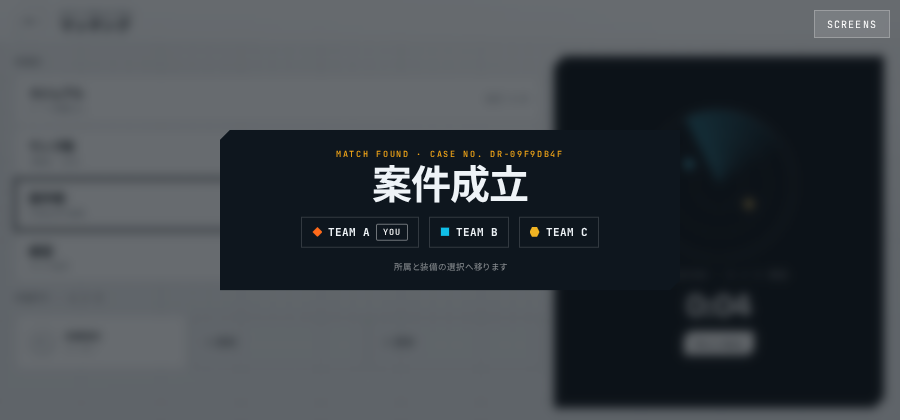

### 8.2 遷移とダイアログの出し方

| 種類 | 使う場面 | 動き |
| --- | --- | --- |
| 横スライド | 通常の画面遷移(戻るは逆向き) | 0.34秒 |
| フェード | タイトル・接続・ホームへの復帰 | 0.3秒 |
| 下から | マッチ成立 → 選択画面 | 0.36秒 |
| 潜行(ぼかし + 拡大) | 選択の決定 → 試合 | 0.6秒 |
| モーダル(中央・暗幕) | 確認(離脱・購入・削除)、マッチ成立、レベルアップ | 暗幕タップで閉じる(確認系は閉じない) |
| シート(下から) | モード選択 | 暗幕タップで閉じる |
| ポップ(吹き出し・暗幕なし) | 拠点・部隊・敵の情報、態勢 | 外をタップで閉じる。試合は止めない |
| トースト | 結果の通知、ロックの理由 | 2.2秒で消える |
| ヒント帯 | 位置指定を待つ操作(作戦指令・合図・目的地) | 盤面タップで確定 |

### 8.3 試合HUD でできること

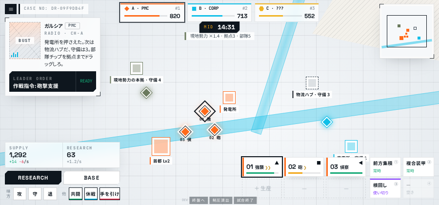

| 操作 | 結果 |
| --- | --- |
| 拠点をタップ | D04 拠点ポップ(首都: 集結点・強化 / 自拠点: 強化・向かう / 他: 目的地にする) |
| 空き地をタップ → 部隊チップをタップ | 目的地を先に指定してから部隊を送る(8秒で解除) |
| 部隊チップ: タップ / 再タップ / 長押し | 選択 / D21 部隊ポップ / D22 態勢ポップ |
| 部隊チップを盤面へドラッグ | 経路のプレビュー、敵や拠点の上で D24 戦闘予測、離すと移動。HUD の上で離すと取り消し |
| 移動先の拠点に着く | 約2.6秒で制圧 → 小さなカットイン D47(1.8秒、操作を止めない) |
| 敵トークンをタップ | D25 敵部隊ポップ |
| BASE | D02 パネル(生産 → 生産中チップ → 完成、防御施設の配置、首都の強化) |
| RESEARCH | 研究画面(上部のチケットと時間は残る。研究開始・予約3つまで・取消) |
| 作戦指令 | D26 ヒント → 盤面タップで効果円と再使用待ち(文明によって即時・チーム指定) |
| 味方合図 / 他チーム合図 | D07 ヒント → マーカー / D03 送信先 → トースト |
| 開始12秒後 | D32 他チームからの合図(返答または8秒で自動で閉じる) |
| ミニマップをタップ | 盤面が動く |
| 左上の ≡ | D29 離脱の確認 → ホーム |
| 下端の DEV | 終盤へ(紫侵蝕 + 中央水門の警告)/ 制圧演出 / 試合終了 |

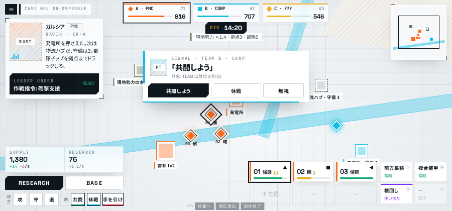

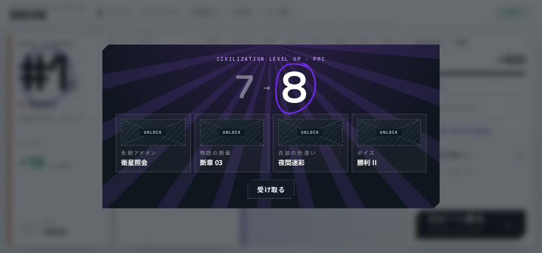

### 8.4 試合外とドラマでできること(主なもの)

| 画面 | 操作 |
| --- | --- |
| ホーム | 左のレールで指導者と背景が切り替わる。モード選択のシート、DEPLOY |
| 選択 1/2・2/2 | 文明の切替で立ち絵と背景が替わる。アドオンは4枠・使い切り2枠の制限とロック理由をトーストで出す。45秒の時間切れで自動決定 |
| 指導者 | 衣装の装備、ボイス試聴、「ホームに表示」でホームの指導者を変更 |
| パス | 受け取り、まとめて受け取り、上位の購入(購入確認) |
| ショップ → ガチャ | 購入確認(支払い後の残高、足りなければ赤)→ カードを1枚ずつめくる。★3 はクレヨン演出 |
| お知らせ | 開くとホームの未読バッジが消える |
| 設定 | スライダー・トグルが動く。データ削除は「削除」と入力するまで押せない。接続エラー(D42)・メンテナンスの表示 |
| 戦績 → 観戦 | 再生・一時停止、速度 ×1〜×8、視点切替、タイムラインのシーク |
| 物語 → 章扉 → ドラマ | 5.4 の台本形式を読んで進む。タップで文字送り、AUTO、SKIP(初回から可・選択肢で止まる)、HIDE、LOG。無線 → 現実 → 選択肢(C はクレヨンで消され夢の挿話へ)→ 合流 → 夢 の順に見られる。「あらすじで済ませる」でも既読と報酬 |

### 8.5 プロトタイプの制限

- 盤面のドラッグでのパン、ピンチでのズームは無い(ミニマップのタップのみ)
- ドラッグと長押しは合成したポインターイベントでしか確かめていない。実機のタッチでは未確認
- 物語の台本が全部あるのは PMC の第3話だけ。他の章と他文明は2行の仮台本
- 戦績の自チームの色が実際のチームと合っていない(常に C の金色)
- D32 の合図と D48 の警告が同時に出ると近い位置に並ぶ
- 夢の場面の「DREAM · 記録外」の札が章番号の札と少し重なる

## 9. 3Dアセットの試作(2026-10-09)

コードで作れるアセットの試しとして、大拠点「中央水門」の詳細版とビューアを作った。画像ファイルは使っていない。

- ファイル: `mockups/3d/floodgate.js`(モデル)、`mockups/3d/viewer.html`(ビューア。ブラウザで開く。three.js 0.170 をCDNから読み込むのでネット接続が要る)
- 作り方: `packages/client/src/game/models.ts` と同じ方針(白・明灰・暗の Lambert、チーム色はアクセントだけ、ジオメトリとマテリアルを共有、輪郭線で図面風)。`THREE` を import に置き換えれば models.ts へ移せる形にしてある
- 大きさ: 制圧圏 r=110(`config.ts` の grand.radius)× 表示倍率 1.5。ビューアでは部隊トークン(装甲強襲)を横に置いて比べられる
- 規模: 約1,000 三角形、描画呼び出し約57、マテリアル12。係留柱は InstancedMesh でまとめている

| 部品 | 内容 |
| --- | --- |
| 台座 | 八角の台座、足元の暗い帯、両岸のテラス |
| 水路 | 床と両岸の壁、係留柱16本、上流と下流の水面(流れ線のテクスチャが動く) |
| 門 | 両側の塔(門扉の溝、チーム色の帯)、機械室、ガントリー2本、巻き上げ機、ワイヤ |
| 門扉 | 横桁つきの門扉と下端の警告縞。上下に動く |
| 付属 | 警告灯4つ、操作室とアンテナ(チーム色の屋根帯)、予備の門扉の架台 |
| 制圧圏 | 地面の点線リング(流れる)と薄い円盤。所有チームの色になる |

状態は「閉 → 開放(5秒で門扉が上がり、警告灯が点滅し、上流と下流の水位がそろう)→ 開(水が速く流れる)→ 閉鎖」。所有は中立・A〜D・現地勢力で切り替えられる。ビューアにはゲームと同じ仰角55°の「ゲーム視点」と、正面・側面・真上のカメラ、輪郭線・制圧圏・ワイヤーフレーム・自動回転の切替、三角形数などの表示がある。

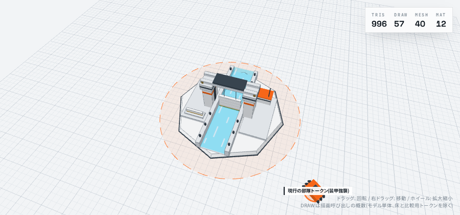

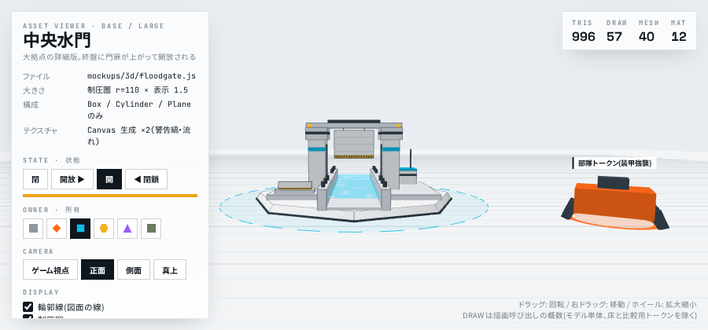

未確認: 実機(スマホ)での描画負荷。ゲームの盤面にはまだ組み込んでいない(D48「中央水門 開放」の演出と組み合わせる想定)。

### 9.1 部隊アセット「装甲強襲・装軌案」(2026-10-09)

ビューアは中央水門と共用で、左上のボタンで切り替える(`viewer.html?asset=tank`)。ファイルは `mockups/3d/tank.js`。

初版は参考画像(直線の多い近未来の主力戦車の線画)に寄せたが、「古めかしい」との指摘で v2 に作り直した。

| 指摘 | v2 での対応 |
| --- | --- |
| 姿勢を低く | 車体上面 7.3、砲塔の高さ 3.4(初版の約6割)。上部車体を履帯の上まで広げ、側面は上へ行くほど内側に倒す(ステルス艦の面構成) |
| レールガン戦車、マズルブレーキなし、砲身は平たく縦長の長方形 | 幅1.5 × 高さ3.2 の角断面。上下2本のレールの間が水色に光る。先端は面取りだけでマズルブレーキなし。射撃は「充電(0.6秒で光が強まる)→ 光の筋 + 小さな後退」 |
| SFっぽく、ステルス巡洋艦のような | 断面をつないだ多面体(loft)で、大きな平面と鋭い車首にした。ボルトや取っ手などの細かい部品をやめ、チーム色の細い光る線(側面の折れ線、砲塔、砲身)で見せる。後部に面一のスリットとコンデンサ |
| 無限軌道の描画が雑 | 履板を1枚ずつ(片側 約70枚、InstancedMesh で1回の描画)起動輪と誘導輪の周りに並べ、走行で回る。外側に滑り止めの突起。転輪6つ + 起動輪 + 誘導輪 |

- 光る線: 当初は直方体を手で置いていたため、車体の幅が変わる所で線が浮いていた(ユーザー指摘)。車体・砲塔の断面の同じ頂点を順に結んだ折れ線に沿わせる方式(`edgeStrip`)に直し、折れ目から外れないようにした
- 修正(ユーザー指摘): 履帯の回る向きが逆だった(下側が前へ動いていた)。走行中は下側が車体に対して後ろへ動くように直し、速さを転輪の周速にそろえた
- 修正(ユーザー指摘): 砲塔の根元が太すぎた。防盾を 幅4.8×高さ3.8 → 3.0×3.0、付け根の覆いを短く細くし、砲身も 幅1.5×高さ3.2 → 1.1×2.6 に細くした(平たく縦長の比率は維持)
- ベースプレート: 車体と砲身がすべて収まるよう、原点(部隊の位置)から最も遠い頂点までの距離 + 余白で円の半径を自動で決める(`fitPlate`)。v2 では内径 約34・外径 約37(表示倍率 2.0 で約74)。現行トークンのリング(外径38)より大きいので、盤面に入れるときは部隊同士の間隔や当たり判定の表示と合わせて見直す
- 塗りは3種: 「ステルス」(黒鉛色の車体にチーム色の光る線。既定)、「チーム色」(現行トークンと同じ考え方)、「白 + 線」(UIの白基調に合わせた版)
- 規模: 約5,000 三角形(うち履帯が約3,400)、描画呼び出し約74、マテリアル13。ゲームに入れるときは同じマテリアルの部品をまとめ、盤面の距離では履帯を1枚の帯に置き換える(LOD)前提

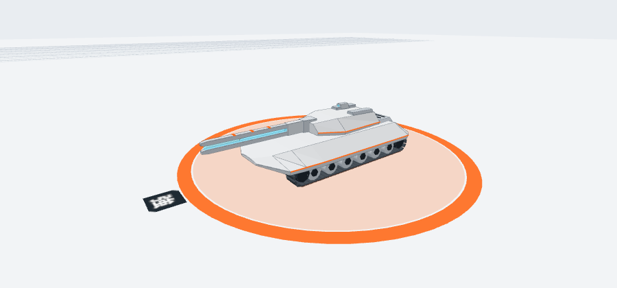

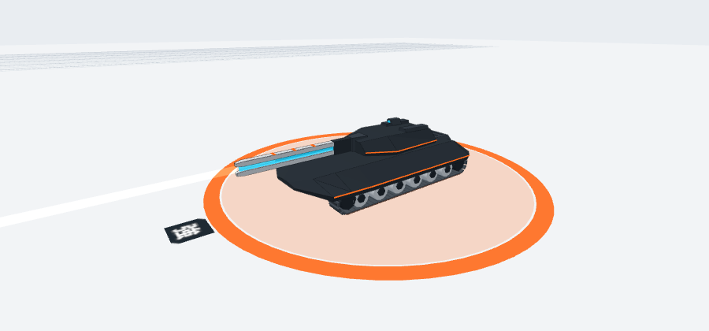

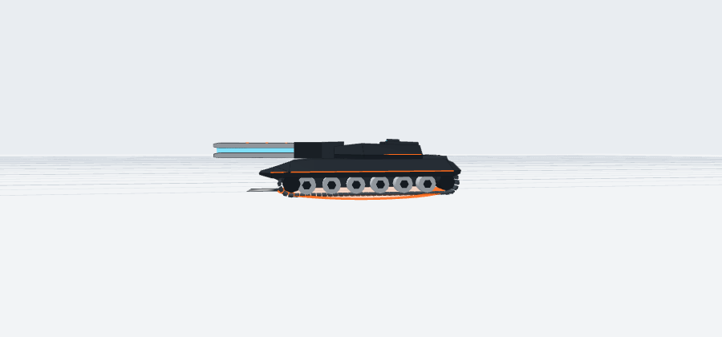

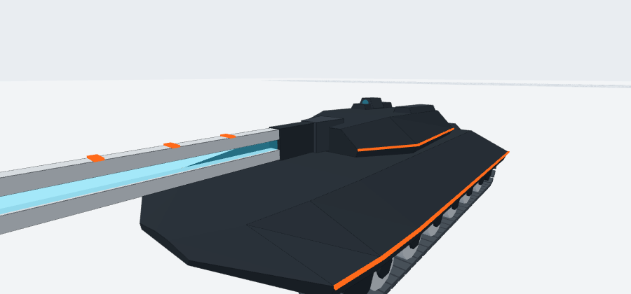

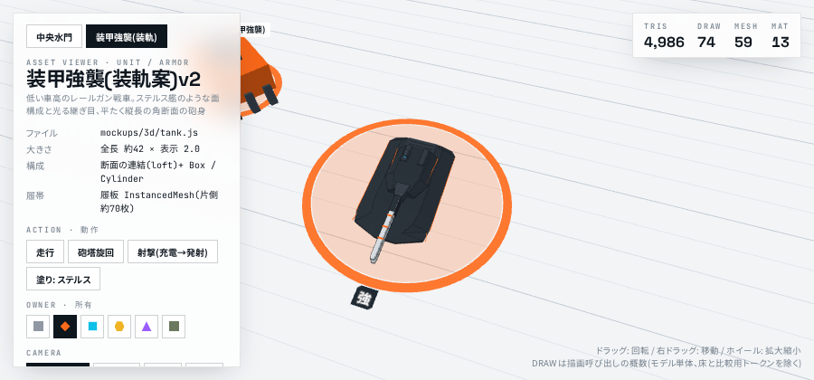

課題: 仕様書では装甲強襲は「6本脚の多脚機」なので、装軌にするか、別の部隊種(例: 重戦車)として足すかは要判断。黒鉛色の「ステルス」は白い盤面ではよく目立つが、チームの見分けは光る線とベースプレート頼みになる。

**v3 修正(ユーザー指摘、2026-10-16)**: 「レールガン戦車モチーフはそのままに、もう少しディテールを戦車っぽく、細かい装飾を足す」。v2 で減らした細部の部品を、実在の MBT にある装備に限って戻した。面構成と光る線はそのまま。

| 場所 | 足した装備 |
| --- | --- |
| 車体側面 | 分割サイドスカート 5 枚(前の 1 枚だけ厚い。車体より少し明るい色)。履帯の前後端の泥よけ |
| 車首 | 操縦手ハッチ(八角形)と潜望鏡 3 つ、V 字のスプラッシュガード、暗いガラスの前照灯 |
| 車体後部 | 排気ルーバー 2 つ、機関室ハッチの継ぎ目、燃料給油口 2 つ |
| 砲塔の屋根 | 車長ハッチと視察窓 4 つ、砲手照準器(右前)、パノラマ照準器(左、コンデンサの上)、固定の鞭型アンテナ 2 本、横風センサー |
| 砲塔の前側面 | 発煙弾発射機 4 連 ×2(前・外・上向き) |
| 砲塔後部 | 枠と網床のバスケット。中に幌の巻き物と収納箱 2 つ |
| 主砲 | レールを締めるクランプ 2 つ、砲口の基準センサー、同軸機銃(主砲の右) |

- センサーは SKILL の決まりに合わせ、光る水色のレンズをやめて暗いガラス(`M.glass`)にした
- 車体上の部品は砲塔の掃引範囲(バスケットの角で半径 約13)の外に置き、バスケットは機関室の台と給油口の上を通す。`check()` が隙間を返す: バスケット−台 0.41、バスケット−給油口 0.32、泥よけ−履帯 0.22 / 0.17、スカート−履帯 1.05、砲塔の掃引−操縦手ハッチ 1.52、砲身の下面−潜望鏡 0.49(すべて正で貫通なし)
- 規模: 5,034 → 6,282 三角形。描画呼び出し 33 とマテリアル 14 は変わらず(足した部品は全部 Lambert で焼かれる)

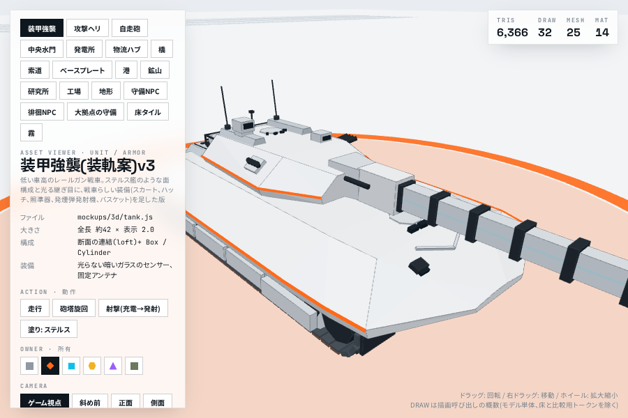

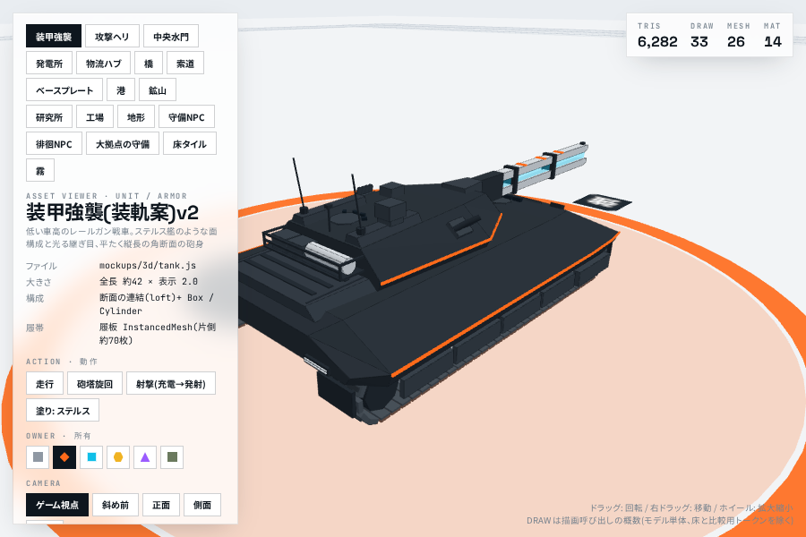

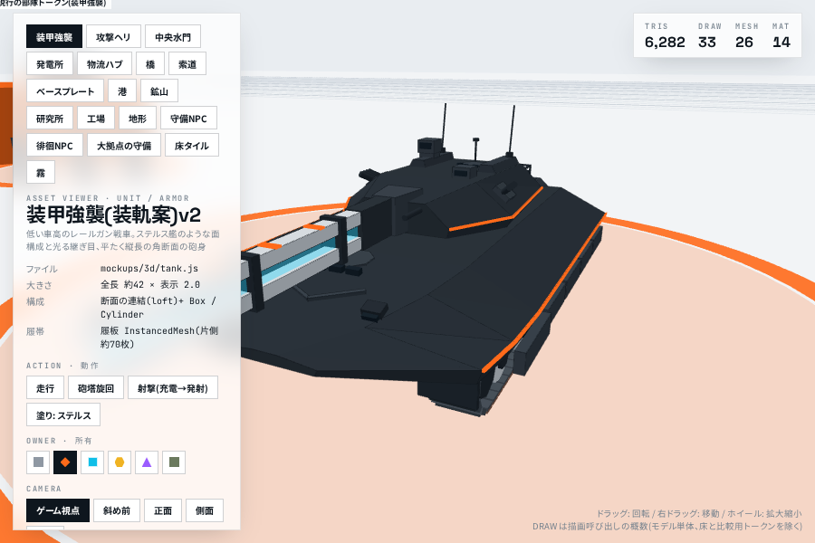

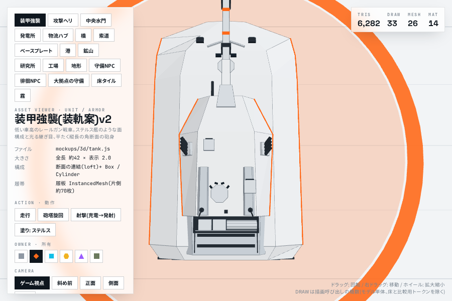

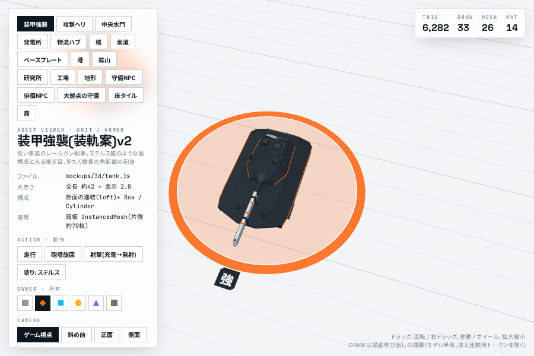

**発射演出(ユーザー指摘「もうちょっと派手に」→「アニメ・フィクションっぽすぎる。現実的なレールガン表現に」、2026-10-16)**: 一度、収束リング・長い光条・走る輪・水色の衝撃波で派手にしたが、現実の試射映像(砲口から噴き出すプラズマ炎と火花、弾体は一瞬で見えなくなる、あとに煙)に寄せて作り直した。

- 充電(0.6 秒): レールの間の光がわずかに強まるだけ。リングなどの演出は出さない
- 発射の瞬間: 白熱の閃光(0.16 秒)と、砲口から前へ噴き出して膨らむ橙のプラズマ炎 6 塊(0.3 秒)。弾体は短い光跡が 0.2 秒で遠ざかる(実際より遅くしても一瞬)
- 続いて: 電機子の破片の火花 28 個(前方の円錐に飛び、重力で落ち、冷えて暗い橙になる。0.7 秒)、レールの余熱(アークで熱くなった橙 → 0.5 秒で戻る)
- あと: 灰色の煙 8 塊が前へ流れながら膨らんで薄れる(1.6 秒)、砲口の爆風が真下の地面から巻き上げる砂塵(1.0 秒)。煙と砂塵は車体の座標に置くので、砲塔が回っても出た場所に残る
- 反動: 後退 1.8 と、車首がわずかに上がって減衰する車体の揺れ(0.025 rad)
- 明るい盤面で白く飛ばないよう、加算合成は閃光の芯と光跡だけ。炎・火花・煙・砂塵は通常合成
- 演出の部品は非表示で作り、撃っている間だけ描画される。待機中の描画呼び出しは 33 のまま、発射中は最大 39

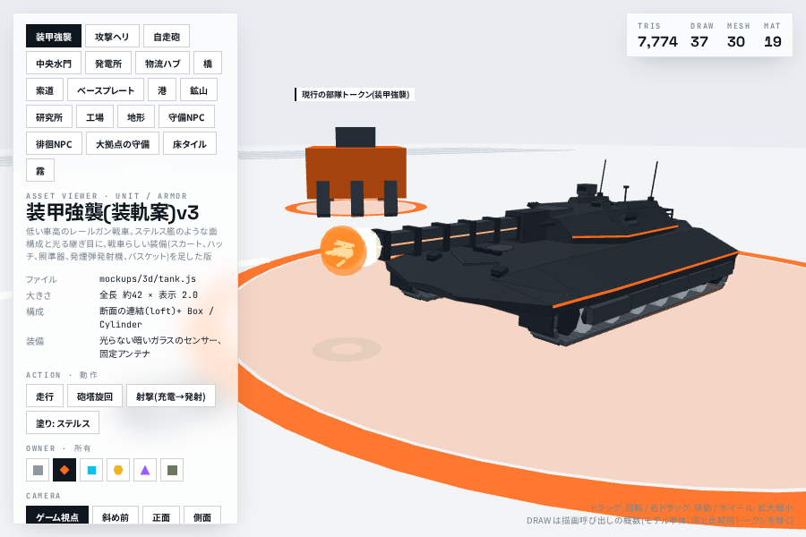

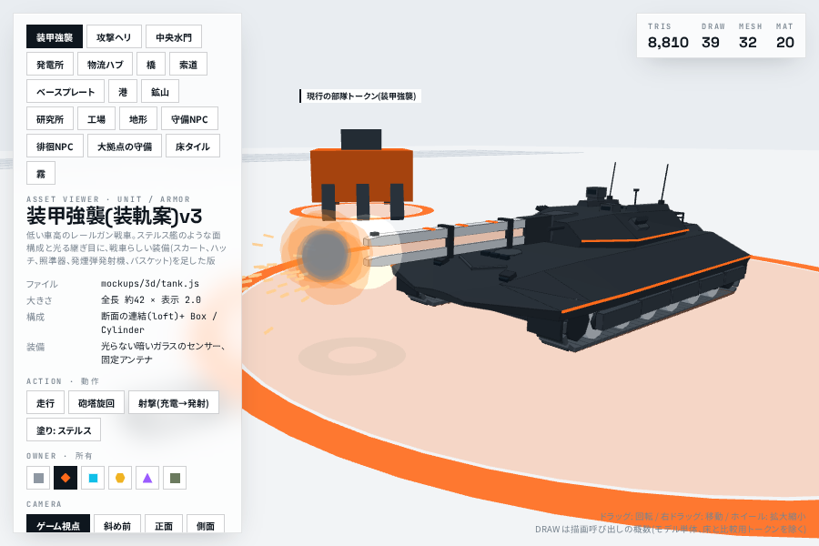

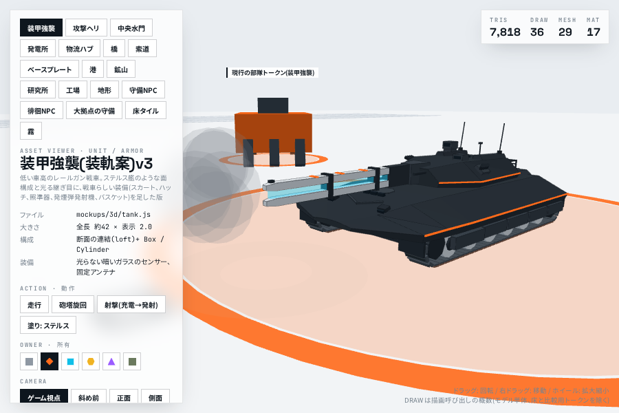

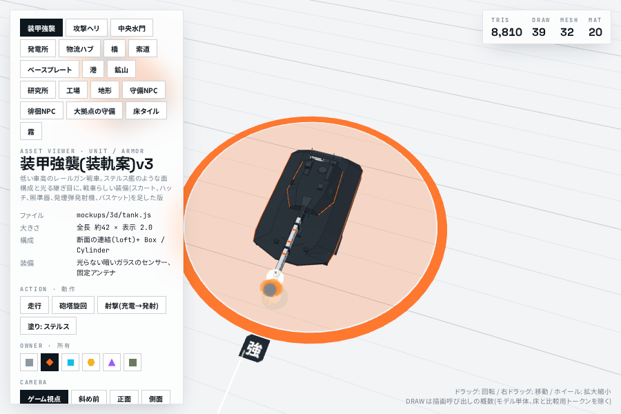

**主砲のリアル化(ユーザー指摘「レールガンももうちょっとリアル寄りに」、2026-10-16)**: v2 の「上下 2 本のむき出しのレールと、その間の光る隙間」をやめた。実在の試作レールガン(BAE、防衛装備庁)は、レールを絶縁材と拘束材で包んだ角断面の筐体で、外からレールは見えず、等間隔の拘束クランプと角形の砲口が特徴。これに合わせて、角断面の密閉筐体(幅 1.5 × 高さ 2.2、砲口へわずかに細くなる)、拘束クランプ 6、角形の口金と長方形の暗い砲口、尾部の給電部の筐体、砲塔から尾部へ入る給電導管 2 本にした。側面の継ぎ目(レールの高さ)は待機中は暗く、充電中と発射直後だけ光る。砲身上のチーム色の帯 3 本は外した。

- 修正(ユーザー指摘「先端がチカチカしている」): 側面の光る継ぎ目の帯が筐体の面とほぼ同一面(差 0.02)で、深度の取り合いでちらついていた。帯を面から 0.06 はみ出させた。あわせて口金の内側に埋まっていた長方形の砲口を口金の面から 0.08 出した
- 修正 2 回目(ユーザー指摘「砲身先端がテクスチャのせいかチカチカする」、2026-10-16): 筒(loft)の先端の面が口金の前面と同じ平面(z = 27)にあり、別メッシュどうし(hull2 と light)で深度の取り合いになっていた。筒を口金の中(0.3 手前)で終えて端面を隠した。あわせて、0.23 浮いていた長方形の砲口を口金に埋めて面から 0.08 だけ出し、継ぎ目の帯を 0.1 × 0.16 → 0.16 × 0.24 に太くした(ゲーム視点で 1 画素未満の細さだと点滅して見える)。ヘッドレスのソフトウェア描画では取り合いが再現しない(深度が同じとき常に同じ側が勝つ)ので、実機での確認待ち

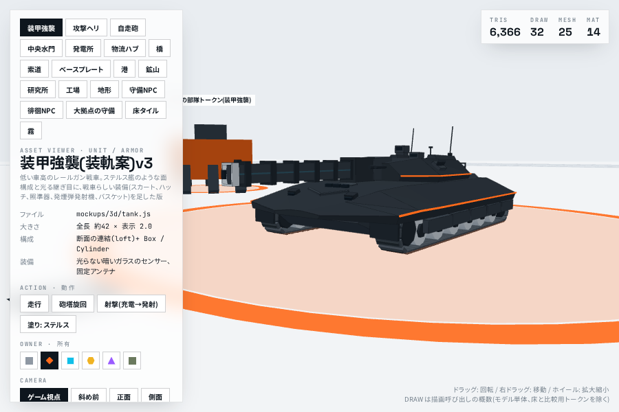

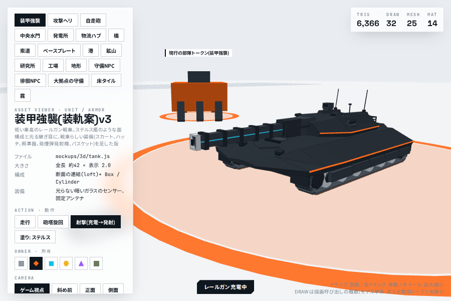

**発射演出のリアル版(ユーザー「限りなくリアルに寄せられるか(発砲炎・煙)」「既存のものは残して」、2026-10-16)**: 既定のデフォルメ版はそのまま残し、ビューアの「演出: デフォルメ / リアル」で切り替える(`setFxStyle("real")`)。実写の砲撃・レールガン試射映像の構成を、Canvas 生成のやわらかいスプライト(`U.puffTexture` / `U.glowTexture`。common.js に置いた)で置いた。板の角が見えず、ゲーム視点(仰角 55°)から見ても形が崩れない。

- 閃光: 2〜3 フレーム(0.08 秒)の白熱の芯(加算合成はこれだけ)と、同じ瞬間に車体を照らす点光源(0.14 秒。three の点光源は物理単位なので 120000 cd。暗い車体を温かく照らすにはこの桁が要る)
- 火球: 砲口から前へ伸びる 8 塊(0.34 秒)。砲口側は白熱、先端ほど橙。膨らみながら前へ進み、冷えて煤けた暗赤になって消える。燃えるガスなので不透明(通常合成)
- 火花: 56 個。頭は点(Points)、尾は直前の位置への線(LineSegments)で、重力で落ち、空気抵抗で減速し、地面で跳ねる(反発 0.3)。白 → 橙 → 暗赤に冷える(0.45〜1.1 秒)
- 煙: 30 枚が砲口の少し前から出て前へ流れ、浮力で上がりながら膨らんで薄れる(2.5〜4.2 秒)。1 枚は薄く(0.4)、重なりで濃さを出す。撃った直後は閃光に照らされた暖色、すぐ灰色、薄れると明るい灰
- 残り煙: 砲口から細く立ちのぼる 5 枚(0.3 秒後から、2 秒)
- 砂塵: 砲口の真下より少し前の地面から、前方へ放射状に広がる 24 枚(1.8〜3 秒)
- 反動、車体の揺れ、レールの余熱はデフォルメ版と共通。煙・砂塵・火花は車体の座標に置くので、砲塔が回っても出た場所に残る
- 数値は tank.js の `RF` にまとめた(各要素の長さ、速さ、抵抗、重力、光の強さ)
- 規模: 待機中は 32 のまま。発射中はスプライト 1 枚 = 1 描画呼び出しなので最大 96(`U.stats` がスプライトも数えるようにした)。デフォルメ版の最大 39 より重い
- 追記(2026-10-16): 粒は 9.23 でビルボードの列にまとめ(発射中 37)、9.24 で共通のエミッタ `U.muzzleFx` に移した(発射中 28)。数値は tank.js の `RF` のまま

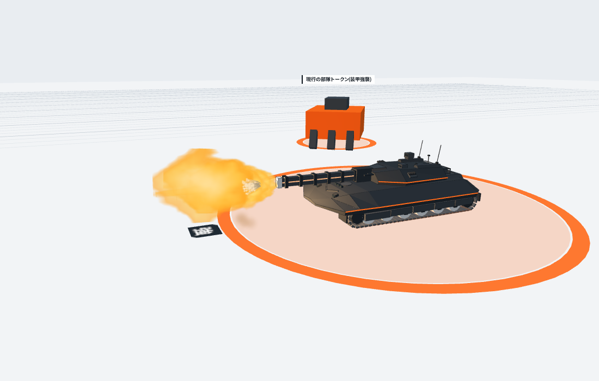

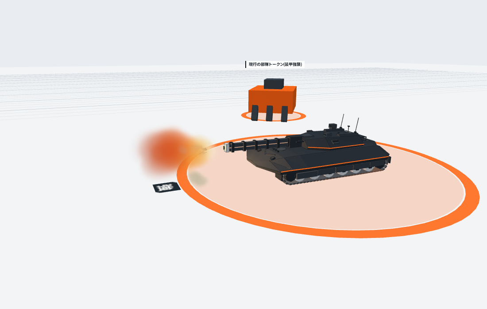

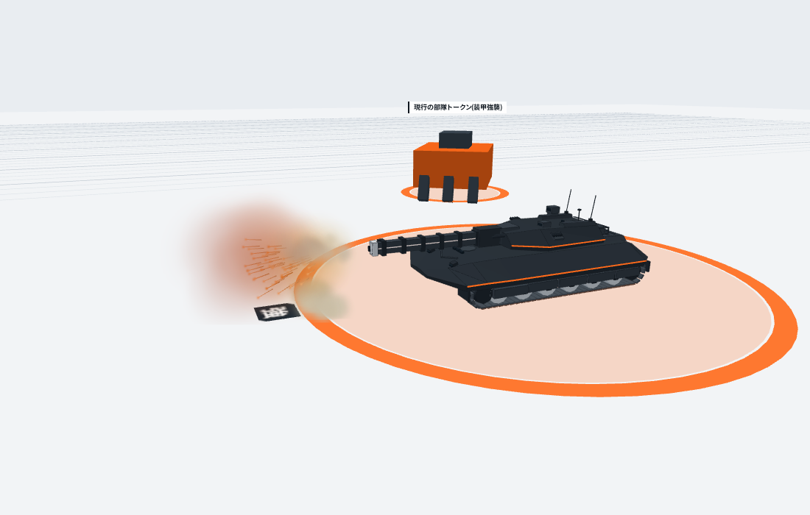

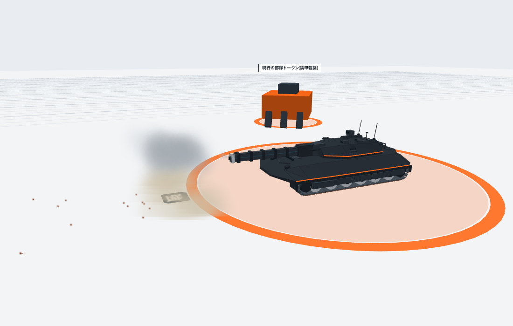

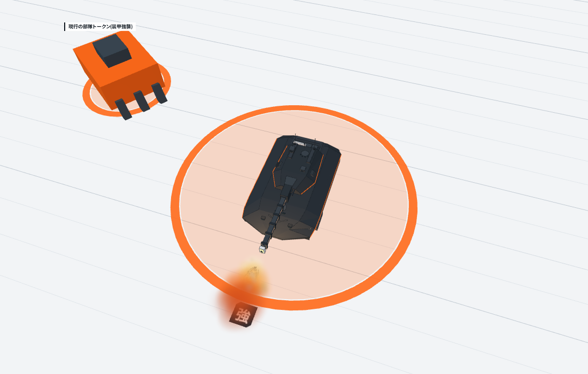

課題(リアル版をゲームに入れるなら):
- 描画呼び出し: 全スプライトを 1 つの Points(頂点ごとの大きさ・色・回転のシェーダー)にまとめれば 3〜4 回に落ちる
- 煙は板を重ねたものなので、真横から寄ると丸い塊が並んで見える。ゲーム視点では目立たない
- 煙が車体に重なる境目は硬い(ソフトパーティクルは深度テクスチャが要るので見送り)。砲口の前に出して避けている
- 画面の揺れは演出側ではなくゲームのカメラで出すもの。未着手

### 9.2 部隊アセット「攻撃ヘリ」(2026-10-09)

装甲強襲 v2 と同じ方向性(低く鋭い面構成のステルス機、細部を減らし光る線で見せる)。ファイルは `mockups/3d/heli.js`、ビューアは `viewer.html?asset=heli`。共通の処理(断面の連結、光る線、記号板、統計)は `mockups/3d/common.js` に切り出した。

- 形: 側面が上へ行くほど内側に倒れる多面体の胴体、縦列複座の暗いガラスの風防(中央の桟が光る)、機関の背、細くなる尾部ブーム、後退した垂直尾翼に内蔵したファン(フェネストロン)、水平尾翼、短い翼と武装ポッド4つ、機首下の観測装置と機関砲、4枚ローター
- ゲームと同じく高度 20(表示で 40)に浮かび、地面の影とベースプレートが位置を示す。リングはローターの円まで囲む
- 動作: ローターと尾部ファンの回転(回ると薄い円盤が見える)、浮遊の上下、前進で前傾と左右のバンク、着陸/離陸(高度とローター回転が変わり、影の濃さと大きさも変わる)、ミサイル発射(ポッドから順に、炎と白い航跡)
- 塗りは装甲強襲と同じ3種(ステルス / チーム色 / 白 + 線)
- 修正(ユーザー指摘): 風防の上の青い線が浮いていた。高さの変わる風防に直線の棒を置いていたためで、風防の天面の中心線に沿う折れ線(`edgeStrip` に点を返す関数を渡せるようにした)に直した
- 規模: 約1,000 三角形、描画呼び出し約57、マテリアル14

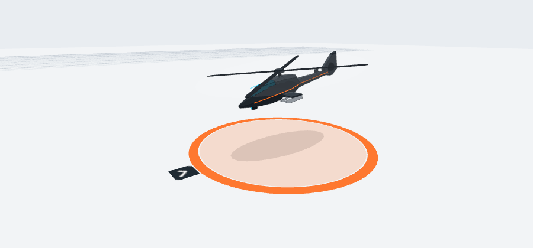

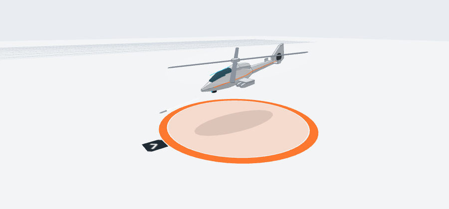

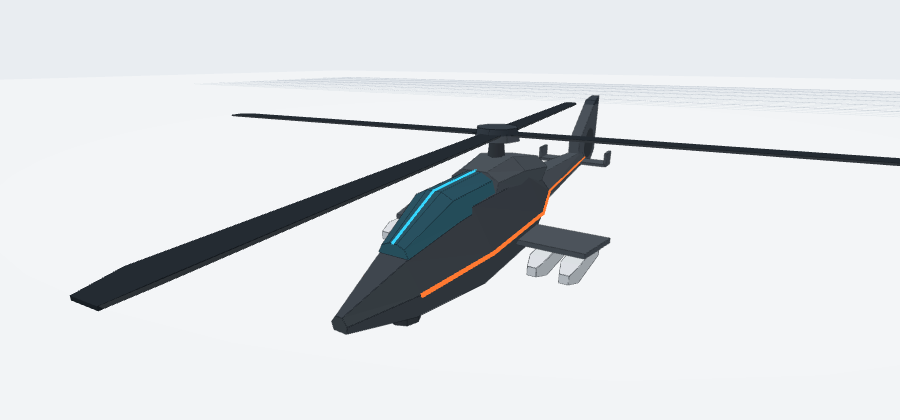

**v2 修正(ユーザー指摘「装甲強襲と同じ方向でディテールを増して現実的な兵器的に。攻撃はミサイルとガトリング的な機関砲の 2 パターン」、2026-10-16)**: 実在の攻撃ヘリ(AH-64 / RAH-66)にある装備に限って足した。面構成と光る線はそのまま。センサーのレンズと風防の桟は光らせない。

| 場所 | 足した装備 |
| --- | --- |
| 機首下 | 旋回砲塔に 3 砲身の回転機関砲(火薬式、20mm 級)と締め具。照準・暗視センサーの箱(暗いガラスの窓 2 つ)。上下のワイヤーカッター、ピトー管 |
| 胴体の両脇 | エンジンナセル(前に吸気口、後ろに上向きの排気の赤外線抑制器、点検パネルの継ぎ目) |
| ローター | 固定側・回転側のスワッシュプレート、ハブのキャップ、ブレードグリップ 4、ピッチリンク 4 |
| 脚 | 固定の主脚 2(支柱 + 斜めの支え + 車輪)と尾輪。着陸の高さを 3.3 → 5.3 にして車輪で接地する |
| 翼下 | 内側のパイロンにロケット弾ポッド(7 連の筒の口)、外側のパイロンに対戦車ミサイルの 4 連ラック(梁・中央の柱・吊り板)。翼端に常灯の航法灯(左赤・右緑) |
| その他 | 風防の中央の桟と前席・後席の間の横枠(暗い色)、ブレードアンテナ 2(ブーム上と腹) |

- 攻撃 2 種。**ミサイル**: ラックの 8 発から順に 1 発ずつ撃つ。撃った弾はラックから消え(InstancedMesh のスケール 0)、6 秒で装填し直す(ビューアで繰り返すための便宜)。発射直後は遅く、モーターで加速し、灰白色の煙の航跡が伸びて薄れる。**機関砲**: 砲身の回転が立ち上がってから撃ち始め、閃光は発射ごとに明滅(回転機関砲の実際の見え方)、曳光弾は数発に 1 発が飛び、薬莢は砲塔の右へ排出されて重力で落ちながら回る。射撃中は機体がわずかに震える
- **レールガンのガトリングは作らなかった。** 実在のレールガンは 1 発ごとに数 MJ のパルス電源(数十トンのコンデンサ)を要し、レールの電極侵食で数十〜数百発ごとに交換が必要になる。ガトリングの多砲身化は砲身の発熱を分散する仕組みで、レールガンの制約(電源の容量と充電時間、レールの寿命)には効かない。ヘリに載せる電源も現実には存在しない。よって現実寄りの表現では「火薬式の回転機関砲 + 対戦車ミサイル」が妥当。装甲強襲のレールガンは車両規模の電源を前提にした近未来の設定として残す
- 曳光弾と薬莢はトークンの座標に置き、機体の上下や前傾に引きずられない。`check()` が隙間を返す: 砲身−センサー 0.61、接地時の車輪 0.25、ミサイル下端 1.6、砲の受け 1.15、ブレード−排気口 1.99(すべて正)
- 修正(ユーザー指摘「ミサイルをもっと実際のヘルファイアっぽく。横についてる箱が邪魔」): ミサイルを AGM-114 の形にした。丸い暗色のシーカードーム、黄(実弾頭)・茶(実モーター)の識別帯、ドームの後ろの小さな 4 枚フィン、後端のクリップドデルタ 4 枚(X 配置)、吊り金具 2 つ。色は頂点色で 1 ジオメトリ(ラックは InstancedMesh のまま)。ラックは暗い中央の柱と吊り板をやめ、M299 のような細い明るい縦長の枠と四隅の小さなレールにし、ミサイルは吊り金具を枠へ向けて掛ける。パイロンは箱から前後を尖らせた板状に
- 規模: 約1,000 → 6,226 三角形(ミサイル 8 発のフィンとドームで増えた)。描画呼び出し 23(焼いた後、待機中)。機関砲射撃中 +4(閃光 2、曳光弾、薬莢)、飛ぶミサイル 1 発につき +3

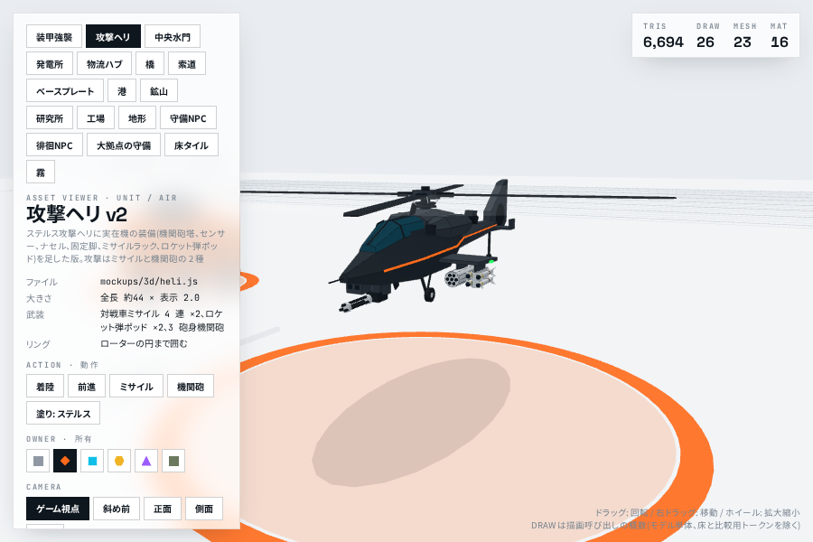

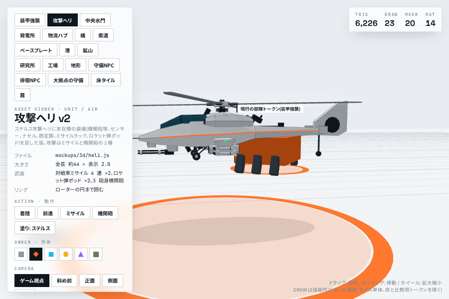

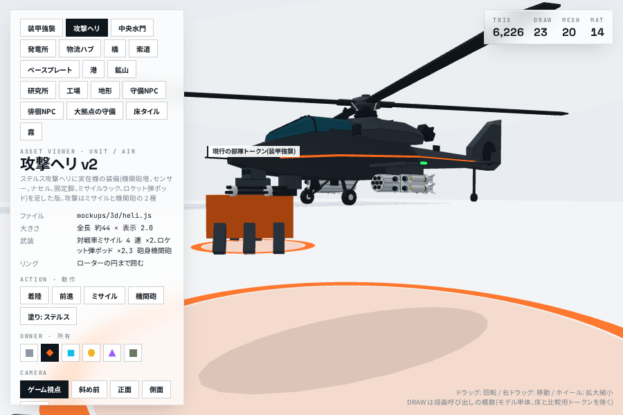

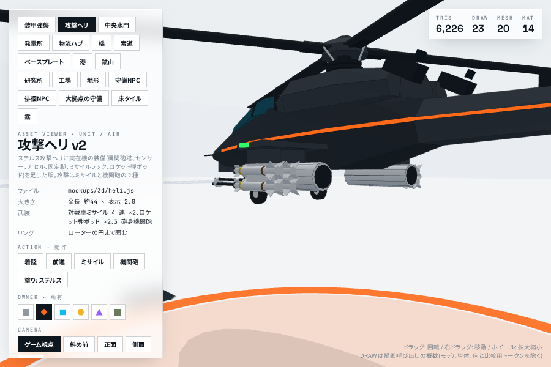

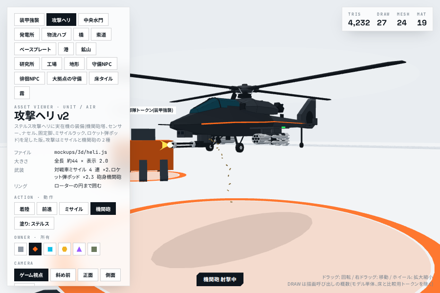

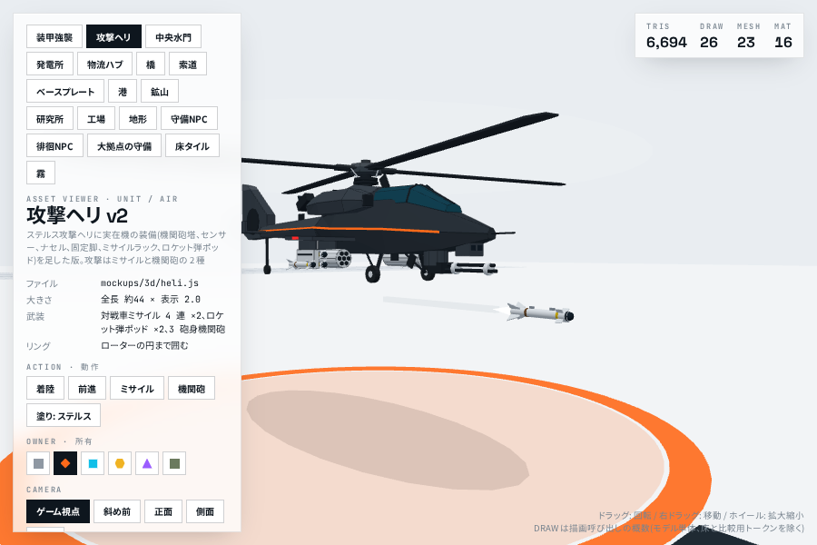

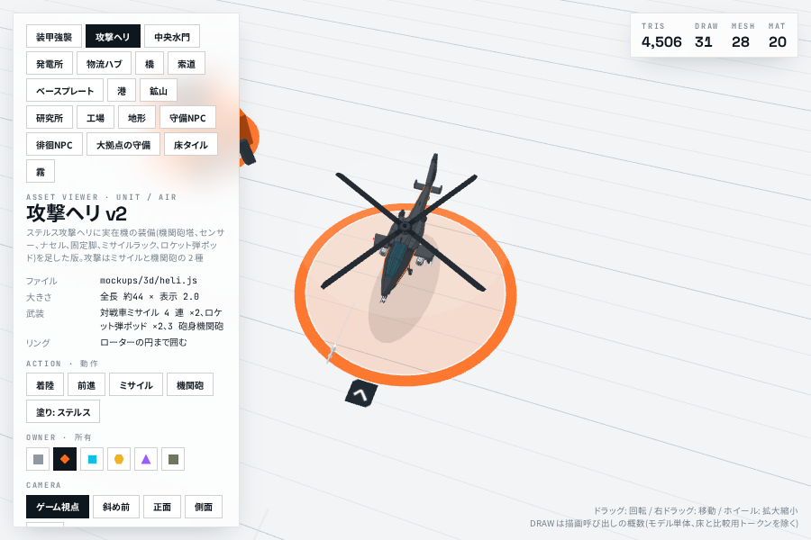

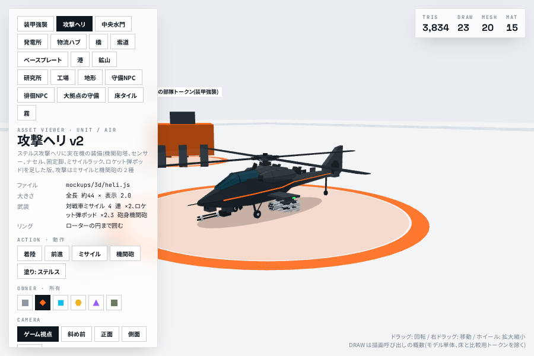

### 9.3 拠点アセット「発電所(原子力)」(2026-10-09)

中央水門と同じ建築模型の方針(白・明灰・暗、チーム色はアクセントだけ、輪郭線)。ファイルは `mockups/3d/plant.js`、ビューアは `viewer.html?asset=plant`。

- 大きさ: 制圧圏 r=75(`config.ts` の mid.radius)× 表示倍率 1.5。現行の「小拠点(冷却塔)」を詳しくした位置づけ
- 部品: 双曲線の冷却塔2基(大小、16分割で面を見せる。上端の縁がチーム色)、格納容器(円筒 + 多面体のドーム、チーム色の帯、放射能の標識)、付属建屋、タービン建屋(片流れ屋根と搬入口)と格納容器をつなぐ配管、排気筒(頂部の警告灯)、変電設備と送電鉄塔2基・電線
- 状態: 稼働(冷却塔から湯気が上がり、格納容器の足元が青く脈打つ、警告灯はゆっくり点滅)/ 停止(湯気と光が消える)/ 警報(湯気が増え、警告灯が速く点滅)
- 湯気は低ポリの球 52個を InstancedMesh 1つで描き、風で少し流れながら膨らんで消える
- 規模: 約2,700 三角形、描画呼び出し約64、マテリアル16

修正(ユーザー指摘):

| 指摘 | 対応 |
| --- | --- |
| 冷却塔の中が見える | 内側の面をやめ、縁の少し下にふたを張って中を見せない |
| 電線の終端の箱(変電設備)が冷却塔と重なる | 変電設備を冷却塔・格納容器と重ならない手前(+z)の区画へ移し、変電設備 → 鉄塔1 → 台座の外の鉄塔2 の順に電線をつないだ |
| 配管がつながっていない | 配管をタービン建屋の壁から格納容器の中まで通し、両端にフランジ、途中に支柱を付けた |
| 放射能の標識の下が切れて白くなる | 格納容器の壁は下へ行くほど太るため、平らな標識の下側が壁に埋まっていた。壁より外に台座を置き、その上に貼った |

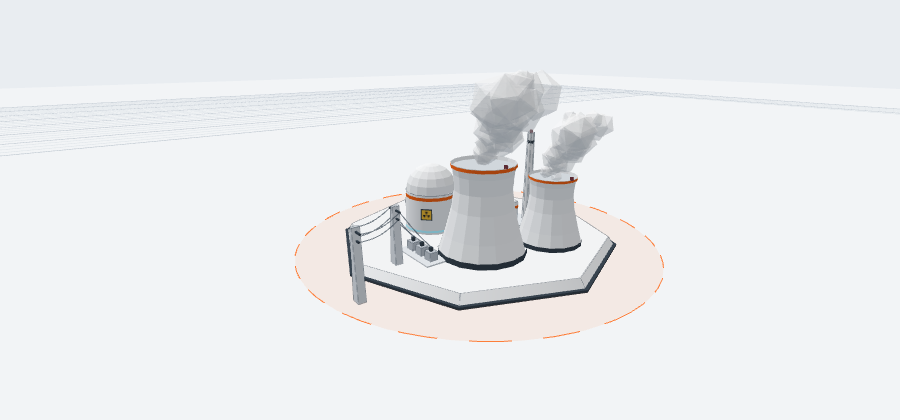

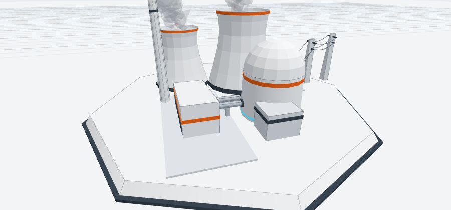

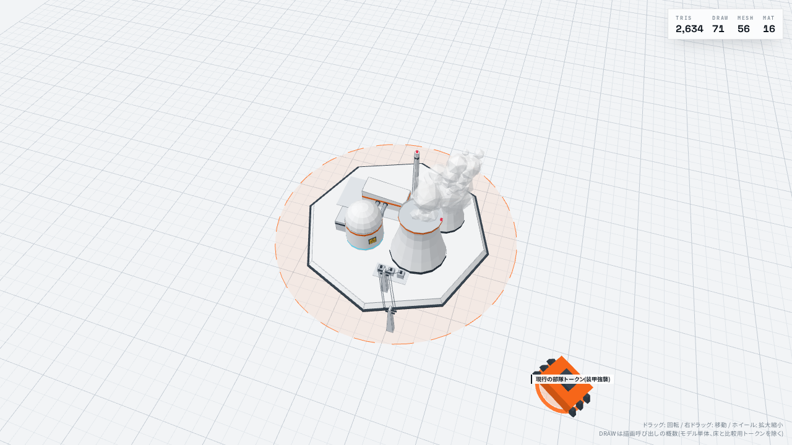

課題: 送電鉄塔の2基目は台座の外の地面に立てている(電線が拠点の外へ出ていく見せ方)ので、盤面に置くと隣の地形と重なる可能性がある。原子力という題材の扱い(制圧・破壊の演出をどこまで見せるか)は、世界観とレーティングの観点で要確認。

### 9.4 アセット一覧からの制作キュー(2026-10-09)

`docs/アセット一覧.md` の 3D アセットのうち優先度「高」で、`mockups/3d/` にまだ無いものを1つずつ作る。全体の進み具合とこれからやることは `mockups/3d/進捗.md`、作り方の手順はスキル `mockups/3d/.claude/skills/3d-asset/SKILL.md` にまとめた。現行で「完成」とあるものも作り直しの対象とする。

| 順 | アセット | 一覧の節 | 状態 |
| --- | --- | --- | --- |
| 1 | 中規模拠点: 物流ハブ | 8.4 | 試作済み(9.5) |
| 2 | 渡河点: 橋 I/II/III + 建設中・破壊 | 8.4 | 試作済み(9.6) |
| 3 | 渡河点: 索道 I/II | 8.4 | 試作済み(9.7) |
| 4 | ベースプレート(選択・交戦・損傷) | 8.5 | 試作済み(9.8、クレヨン表現) |
| 5〜10 | 首都(文明別 ×6: PMC / CORP / SOC / IPA / FND / INT) | 8.4 | 保留(組織の設定が固まってから。一度作ったものは破棄) |
| 11〜12 | 小拠点のバリエーション: 港、鉱山 | 8.4 | 試作済み(9.9) |
| 13〜14 | 中規模拠点のバリエーション: 研究所、工場 | 8.4 | 試作済み(9.10) |
| 15 | 地形: 川(等級別の幅)と山(標高等級) | 8.6 | 試作済み(9.11) |
| 16 | 守備NPC(S / M / L) | 8.5 | 試作済み(9.12) |
| 17 | 徘徊NPC(現地勢力、成長段階 3) | 8.5 | 試作済み(9.13) |
| 18 | 大拠点の守備(ボス、中央水門を守る大型機) | 8.5 | 試作済み(9.14) |
| 19 | 床タイルのセット(港湾・都市・鉱区) | 8.6 | 試作済み(9.15) |
| 20 | 霧(背の高い模型が突き抜けない方式) | 8.6 | 試作済み(9.16) |
| — | 部隊トークン(文明別 6 × 3) | 8.5 | 保留(首都と同じく、組織の設定が固まってから) |

優先度「高」を一巡したあと、優先度「中」の3Dアセットを 16 から順に作る(ユーザー指示 2026-10-09)。

レビューでの決定(ユーザー指示 2026-10-09):

- 施設(拠点・渡河点)は部隊より大きいものを想定している。施設はすべて今の倍くらいの大きさで見せてよい。ビューアの表示倍率を拠点は 1.5 → 3.0 にし、渡河点は断面(幅・高さ)を 2 倍にした。制圧圏のリングも同じ倍率で描いているので、ゲームに入れるときは当たり判定の半径も合わせて見直す
- 高さ(霧の平面を突き抜ける、ラベルにかかる)は当面気にしない
- ベースプレートは SF 風ではなく、クレヨンで描いたような表現にする(SF の模型とのアンバランスさを見せる)。部隊の種類は書かない

### 9.5 拠点アセット「物流ハブ」(2026-10-09)

中規模拠点の詳細版。ファイルは `mockups/3d/hub.js`、ビューアは `viewer.html?asset=hub`。

- 大きさ: 制圧圏 r=75(mid.radius)× 表示倍率 3.0(施設は現行の倍)。台座は角を落とした長方形(112×92)
- 部品: 台座の大半がコンテナヤード(2ブロック × 6列 × 6ベイ、0〜3段。波板のテクスチャ)、ブロックごとの門型クレーン2基(レール走行。脚4本、桁2本、横行するトロリーと吊り下げの運転室、吊具とワイヤ)、右の帯に空コンテナ置き場(2〜4段)と管制棟、四隅の照明塔。トラックと道路は置かない
- チーム色: クレーンの桁の帯、一部のコンテナ、管制棟の帯、制圧圏
- 動き(稼働): クレーンごとに4か所のうち1か所が空いていて、隣の場所からコンテナを1つ運んで空きを埋める。3つのコンテナが順に回るので、2基で6つのコンテナが動き続ける(1回の積み替え 約13秒、2基は時間をずらす)。動いているあいだはクレーンの回転灯が点滅、照明塔が点く。停止では止まる
- 描画の工夫: 積んであるコンテナは色ごとに1つのジオメトリへまとめた(`common.js` の `U.merge`)。約2,870 三角形、描画呼び出し約128、マテリアル16

修正(ユーザー指摘):

| 指摘 | 対応 |
| --- | --- |
| トレーラーが構内を1周する動きがカクつく | トレーラーを動かすのをやめ、クレーンがヤードの中で積み替える表現にした |
| トラックと道路は省いてよい。コンテナの領域を広げ、動くコンテナを増やす | トラック・道路・ゲート・倉庫をなくし、台座を広げてヤードを2ブロックにした。クレーン2基で6つのコンテナが動く |

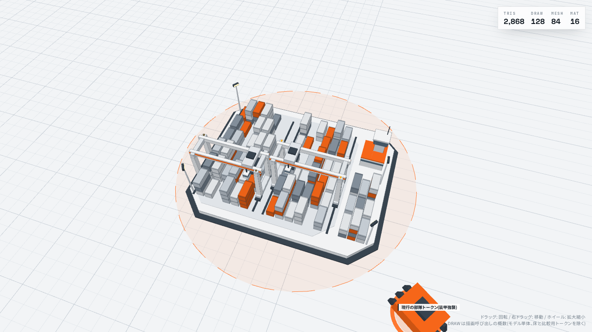

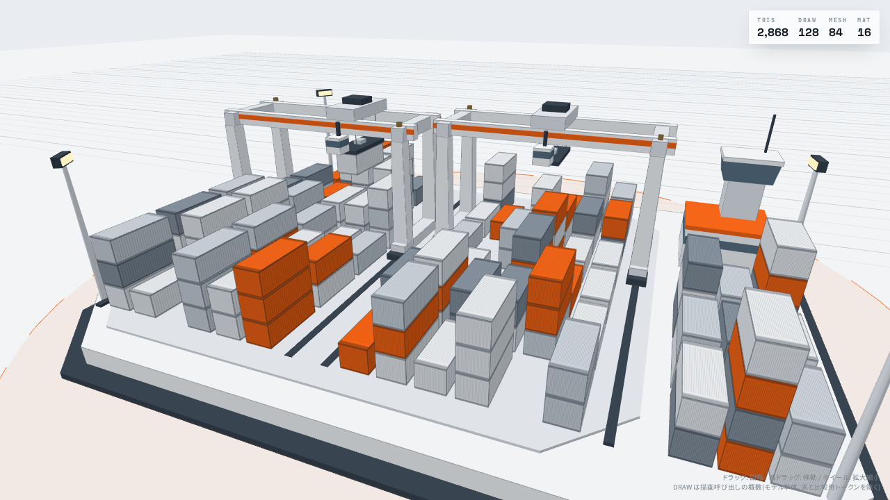

### 9.6 渡河点アセット「橋」(2026-10-09)

ファイルは `mockups/3d/bridge.js`、ビューアは `viewer.html?asset=bridge`。確認用に川(半透明シアン)と両岸を付けている。

- 等級が上がるほど広い川を渡れる(ユーザー指示)。長さ = 端点間の距離で、等級ごとに上限がある: I 160 / II 240 / III 320(川幅 1 / 2 / 3 セルの両岸の陸セルの中心どうし。9.11 の決定で I を 190 から 160 に変更)。ビューアの「長さ −/+」で伸び縮みを確認できる
- 長さに合わせて組み直す: 区間は約 18 ごと(偶数)、橋脚は等級ごとの径間の上限(I 60 / II 110)を超えないように区間の継ぎ目へ置く。III は長さ 300 を超えると主塔が2本になる
- 外観: I = 桁橋、II = トラス橋(ワーレントラス、上弦材がチーム色)、III = 斜張橋(逆Y字の主塔、扇形のケーブル)。共通で欄干の手すりがチーム色、両岸に橋台と取り付けの坂
- 大きさ: 幅は現行の式(30 + 8 × 等級)の 2 倍、高さも 2 倍(施設は部隊より大きく)。制圧圏も 2 倍で描いている
- 状態: 完成 / 建設中(両岸から1区間ずつ上から降りて架かり、未完成の区間は半透明 + 点線の輪郭 + 足場。III は主塔が先に伸び、ケーブルは最後。10秒)/ 破壊(中央の2区間が落ちて川にがれき、隣の区間が外側を支点に垂れ下がる)
- 規模: I 約1,300 / II 約2,900 / III 約2,400 三角形、描画呼び出し 90〜170(区間ごとにマテリアル別へまとめている)

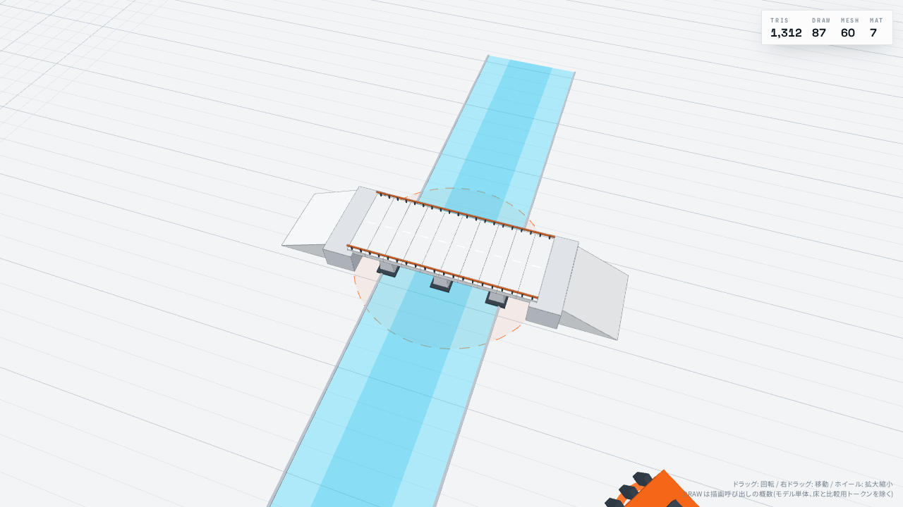


課題: III の長い橋は描画呼び出しが 170 前後になる。盤面に置くときは完成状態の区間をまとめて1つにする。

### 9.7 渡河点アセット「索道」(2026-10-09)

ファイルは `mockups/3d/ropeway.js`、ビューアは `viewer.html?asset=ropeway`。索道は山塊をまたぐ渡河点(攻城部隊は通れない)なので、確認用に低ポリの山(現行の山と同じ色の四角錐)を付けている。

- 部隊を運べる重量物用の索道(ユーザー指示: ゴンドラより大型の機材を動かすイメージ)
- 搬器: 2本の支持索に載る台車(車輪4つずつ)→ 台車の内側から下で広がる吊り材 → 荷台(104 × 60、部隊1体が載る。縁の手すりがチーム色、前後に跳ね上げた渡り板と警告色の縁)。荷台には仮の部隊を載せている
- 等級: I = 単線(搬器1台が駅と駅を行き来。山頂に門型の支柱1基)/ II = 複線(線を2本並べ、搬器2台が上りと下りですれ違う。高い頂2つに3本脚の支柱2基)
- 駅: 床と外側の坂、門型の骨組みと屋根(縁がチーム色)、支持索の定着台。駅の前に低い門型の受け台があり、搬器は駅から受け台までは水平に進んでから山へ上がる(屋根に当たらない)
- 支柱の高さは山の形から決める: 山の高さを四角錐の式で求め、搬器の荷台の底が山肌から 5 以上離れるまで支柱を上げる。脚はそれぞれの位置の山肌まで伸ばし、基礎を置く
- 動き: 駅で 6 秒止まる → ゆっくり動き出し(5次のイージング)、山を越え、ゆっくり止まる(片道 15 秒)。荷台は加速と逆へ振れ、止まってからしばらく揺れが残る
- 大きさ: 駅の中心どうし I 520 / II 600 × 表示倍率 1(山を受け台の内側に収めるために長くした)。制圧圏は 2 倍で描いている
- 状態: 完成 / 建設中(支柱が伸び → ケーブルの予定線が点線で流れる → ケーブルを張り → 搬器が付く。10秒)/ 破壊(支柱が途中で折れて頭が倒れ、ケーブルが受け台から垂れ、搬器が斜面に落ちる)
- 規模: I 約4,600 三角形・描画呼び出し 115、II 約9,300・203

修正(ユーザー指摘):

| 指摘 | 対応 |
| --- | --- |
| ゴンドラではなく、部隊を運べる大型の機材に | 支持索2本の重量物用の搬器にし、荷台に部隊1体を載せた |
| 搬器が山と建物を貫通することがある | 山の高さを式で求めて支柱の高さを決め、山は受け台にいる搬器の前端より内側に収めた。駅の前は水平に進むので、駅の屋根にも当たらない(荷台の底と山肌の最小の間隔: I 5.4 / II 5.7) |
| 間の柱が宙に浮いている | 支柱の脚をそれぞれの位置の山肌まで伸ばした |
| 移動がリニア | 動き始めと止まりにイージングを付け、荷台の揺れを足した |


課題: ゲームの山はセルの集まりなので、支柱の高さを決めるときは実際の地形の高さ(セルの四角錐)で同じ計算をする。II は描画呼び出しが 200 を超えるので、支柱と搬器の部品をまとめる。

### 9.8 部隊アセット「ベースプレート」(2026-10-09)

ファイルは `mockups/3d/plate.js`、ビューアは `viewer.html?asset=plate`(装甲強襲 v2 を載せて表示。「部隊」ボタンで外せる)。

- 表現: 地面にクレヨンで描いたような手描き(ユーザー指示: SF の模型とのアンバランスさを見せる)。紫侵蝕と同じ作り方で、粒状の点を線に沿って重ね、紙目で抜いてかすれさせる
- 構成: 平面1枚 + Canvas 512px。線は3枚の描き分けを順に切り替えて震わせる(ラインボイル。通常 0.25 秒ごと、交戦中は 0.08 秒ごと)
  - チーム色の輪(太い1周 + ずれて重なる細い2周目。閉じきらずに少し行き過ぎる)、内側は斜線の塗り
  - 後縁にチームのシンボル(墨色の輪郭 + チーム色のぐるぐる。所有を変えると形も変わる)と練度の山形(金色、0〜3本)
  - 部隊の種類は書かない(ユーザー指示)
- 状態:
  - 通常: 輪と塗りだけ
  - 選択: 墨色のぐるぐる(2周あまり、外へ広がる)と4つのはね
  - 交戦: 赤いギザギザの輪と、橙のはじける線。耐久の弧(黄)
  - 損傷: 輪の一部がこすれて消え、墨色の×の引っかき傷、耐久の弧(赤)。部隊からクレヨンでぐるぐる描いた煙(スプライト)が上がる
- 耐久の弧は減ったときだけ描く(全快の部隊に輪を足さない)
- 規模: 平面1枚(2 三角形)、描画呼び出し 1(+ 損傷時の煙 7)。状態や所有が変わったときだけ描き直す(3枚 × 512px)


課題: 部隊が多いときの描き直しの負荷(所有・状態ごとにテクスチャを共有すれば部隊数に比例しない)。クレヨンの線が盤面の霧(紙)や床タイルの上で読めるかを盤面で確認する。


### 9.9 拠点アセット「港」「鉱山」(小拠点のバリエーション、2026-10-09)

どちらも制圧圏 r=60(small.radius)× 表示倍率 3.0(施設は現行の倍)。チーム色は帯・クレーン・制圧圏などのアクセントだけ。稼働 / 停止の状態を持つ。

港: `mockups/3d/port.js`、ビューアは `viewer.html?asset=port`。

- 前(+z)が水面(確認用)。陸側の台座の前の辺が岸壁(防舷材、係船柱、警告線)、右に突堤と灯台(チーム色の帯、灯室が点滅)
- 岸壁を走るレール上の旋回式の荷役クレーン(門型の台、旋回する機械室、ジブ、吊具)。コンテナ置き場と係留した貨物船のあいだで、水面側を回ってコンテナを積み下ろす。ジブの仰角を届く距離に合わせて変える
- 貨物船(舷の帯がチーム色、船橋、船倉のふたと積んだコンテナ)はゆっくり上下と横揺れ。陸側に倉庫、事務所と回るレーダー、油槽2基、照明柱
- 約1,740 三角形、描画呼び出し約90


修正(ユーザー指摘): 積み荷を物流ハブと同じコンテナ(11 × 4.2 × 4.4、波板のテクスチャ)にした。灯台の光の帯は描かず、灯室の点滅だけにした。
修正(ユーザー指摘 2回目): 貨物船を 1.5 倍に大きくした(全長 約90。コンテナは標準の寸法のまま、船倉のふたの上に2列 × 2か所、1〜2段)。船に合わせて突堤を右へ寄せ、吊り上げの高さを上げた。

鉱山: `mockups/3d/mine.js`、ビューアは `viewer.html?asset=mine`。

- 台座を厚くして、八角の露天掘りの穴を段々(テラス2段 + 底)に掘り下げた(穴あきの押し出し)。縁に警告柵
- 立坑の櫓(4本脚の塔と後ろの支え、頂の滑車2つ)。滑車は巻上げ機の方を向けて立て、後ろの支えより内側に並べて軸受けに載せる。かごが立坑を上下し、滑車がかごの速さで回る。後ろに巻上げ機の建屋とワイヤ
- 立坑の脇のホッパーから選鉱場の上へ斜めのコンベヤ。鉱石(InstancedMesh)が流れる。選鉱場(段の屋根、チーム色の帯)、サイロ2基、鉱石の山3つ、照明柱
- 約2,550 三角形、描画呼び出し約78


修正(ユーザー指摘): 露天掘りの底の黄色い箱(掘削機)をなくした。櫓の斜めの支えと滑車が重なっていたので、滑車の向きを巻上げ機側(面を yz)に変えて支えの内側に並べ、支えは台の下で終わるようにした。
修正(ユーザー指摘 2回目): 斜めの支えの足が巻上げ機の建屋を貫いていたので、足を櫓と建屋のあいだに置いた。

課題: 港は水面に面している前提なので、ゲームでは川(または海)に接する小拠点にだけ使う。どの小拠点を港・鉱山・発電所にするかの割り当て(地形から決めるか、マップで指定するか)は未定。

### 9.10 拠点アセット「研究所」「工場」(中規模拠点のバリエーション、2026-10-09)

どちらも制圧圏 r=75(mid.radius)× 表示倍率 3.0(施設は現行の倍)。台座は物流ハブと同じ角を落とした長方形。稼働 / 停止の状態を持つ。

研究所: `mockups/3d/lab.js`、ビューアは `viewer.html?asset=lab`。

- 左に半分埋めた円形の加速器(上面にチーム色の線、点検口)。光の粒がチーム色の尾を引いて回る(停止で消える)。奥に接する細長い入射棟と電源室、前側をまたぐ検出器棟、輪の中の円筒の制御棟
- 右に巨大なパラボラの電波望遠鏡(鏡の直径42、拠点でいちばん大きい構造物)。円形のレールを走る2本の A 字の塔で鏡を挟み、塔の頂部の軸で鏡が上下に回る。鏡の裏に放射状の骨組み、焦点の受信器を4本脚で支える
  - 稼働中: ゆっくり空をなぞる(仰角 40〜70°、方位もゆっくり動く)
  - 停止: 方位はそのまま、鏡を真上へ向けて休める(1秒に約15°まで。初版は真下にしたが、レビューで真上に変更)
  - 鏡が回る範囲(軸から半径 21.5 の球)の外に塔と軸受けを置いた。鏡がいちばん下がっても床から 8.5 上、塔の内側まで 1.5 の余裕
- 奥に3階建ての研究棟(窓の帯と縦の庇、屋上の空調機)、左手前に変電設備(変圧器3基、開閉所、柵)
- 点滅する灯と透けるガラスは使わない。動くのは加速器の光の粒と望遠鏡だけ
- 約7,900 三角形、描画呼び出し約71


工場: `mockups/3d/factory.js`、ビューアは `viewer.html?asset=factory`。

- のこぎり屋根の生産棟(前向きの面がガラス、チーム色の帯)。組み立ては屋内で行う想定で、外には見せない
- 搬出口2つ: 開口の枠、両脇のガイドレール、上の巻き取り箱(警告縞)、閉じたシャッター。前に舗装と扉ごとの区画線
- 出荷の動きは入れない(レビューで決定。出荷を見せるなら出てくる車両の質も上げる必要があり、手間に見合わない。シャッターの開閉と斜路も外した)。動くのは煙と照明だけ
- 右奥にボイラー棟と煙突2本(帯がチーム色、煙)、貯蔵タンク2基と配管ラック(タンク → 生産棟の側面)、右手前に2階建ての事務棟、左手前に鋼材置き場(コイルと板)
- 約3,300 三角形、描画呼び出し約86


作り直しの経緯(レビュー 2026-10-09): 1回目は研究所にガラスのアトリウム・点滅する灯・小さなパラボラ3基(停止しても向きが変わらず、皿が台を突き抜けていた)、工場に屋外の溶接ライン・床下へ潜る昇降台・壁を突き抜けるシャッターがあり、「安っぽい」「リアリティがない」との指摘で作り直した。以後の拠点アセットでも、点滅で動きを足さない、実在の施設で成り立つ動きにする、部品どうしの貫通を確認する、を守る。

### 9.11 地形「川・山」(2026-10-09)

ファイルは `mockups/3d/terrain.js`、ビューアは `viewer.html?asset=terrain`(見本の配置「合流」「等級の比較」と「ランダム ▶」を切り替え)。盤面は 20 × 14 セル(1600 × 1120)。

- 地形はデータで渡す: 盤面のセル数と、川(等級つきの折れ線、向き = 下流)・山(等級つきの稜線と幅)を何本でも。`t.setLayout({ cols, rows, rivers: [{ cls, path }], mountains: [{ cls, path, width }] })`
  - データ → ゲームと同じ 80 四方のセル(陸 / 川 / 山)→ 見た目、の順に作る。セルはそのまま通行判定に使える。川の中心線が通るセルは必ず川にする(細い川がセルの間をすり抜けて途切れない)
  - 川どうしの合流、川と山の組み合わせも同じ仕組みで作れる。「ランダム ▶」は川 1〜3本(端から端へ蛇行)と山 1〜2(川から離す)を乱数で置く確認用
- 川の等級でメリハリを付けた(レビューで I と II の差が分かりにくいと指摘):

| 等級 | 幅(セル) | 深さ | 岸 |
| --- | --- | --- | --- |
| I 小川 | 1列(半幅 40) | 浅い | 土のなだらかな岸(明るい色) |
| II 川 | 2列(半幅 80) | 中くらい | コンクリートの護岸(灰色、急な斜面) |
| III 大河 | 3列(半幅 120) | 深い(川底が濃く見える) | 護岸 + 両岸の堤防(白い盛り土、頂に線) |

- 水面は中央水門・港と共通の水(`common.js` の `U.waterMaterial`): 半透明のシアンに白い流れの線。線は川ごとの折れ線に沿って並び、下流へ流れる。川底の色は深いほど青みの灰になり、水を通して深さが分かる
- 山: 稜線のまわりの山セルを広めにぼかした値を高さの元にし(裾はなだらか、中ほどが高い)、峰の高さを低い周波数のノイズで変える。等高線ごとに厚み 6 の板を積んだ等高線模型。板の上面は高いほど明るい(段彩)。標高等級 I は頂およそ 80、II はおよそ 140。川の近くは削る
- 盤面全体で約 7〜10 万三角形(格子の高さ面と水面が大半)、描画呼び出し 8〜10


ゲームとの差(地形を任意に置けるようにするには):

- 今のゲームはサーバーの `map.ts` が `TERRAIN_LAYOUT`(環状の川・放射状の川・山塊を数式で)から地形のセルを作っていて、置き場所は固定。渡河点の位置も同じ数式から決めている
- 任意に置くには、マップを「川の折れ線・山の稜線・渡河点の予定地」のデータとして持ち、サーバーはそこからセル(通行判定)を、クライアントはこの見本と同じ手順で見た目を作る形にする。今の数式の配置は、そのデータを作る1つの生成器として残せる
- 渡河点(橋の等級 = 渡れる川の幅)は、川の等級から自動で決めるか、データで指定する

川幅の決定(ユーザー指示 2026-10-09): 川の幅は I 1セル / II 2セル / III 3セル とする。合わせて次を直した。

- ゲーム(`packages/server/src/map.ts` の `TERRAIN_LAYOUT`): 環状の川(等級 I)を 660〜780(1.5セル)から 680〜760(1セル)に。II(半幅 80 = 2セル)と III(半幅 120 = 3セル)はもともと合っていたので変えていない
- 1セル幅の川は、セルの並びで斜めにしかつながらない所ができ、船が通れなくなる。地形を作ったあとに、斜めの間の陸セルを1つ川にして上下左右でつながるようにした(陸の部隊は角抜け禁止なので、もともと越えられない)。5つのシードで、環の川が山塊で区切られた3区間それぞれ4方向につながること、幅の中央値が約1セルであることを確認。既存のテスト 54件は通る
- 見本: 地形の III の半幅を 130 → 120 に、橋の長さの上限を I 190 → 160 に(II 240、III 320 は同じ)。橋の確認用の川も共通の水にした

課題:

- 格子の間隔 10 のまま 3200 四方のマップ全体を作ると、高さ面が約 10 万頂点になる。ゲームに入れるときは、川のまわりだけ細かい格子にするか、間隔を 20 にする
- 霧の平面(y=2.5)より川底と水面が低くなる。霧の方式(8.6「霧」)と合わせて決める
- 索道の見本(`ropeway.js`)の山は四角錐のまま。この等高線模型に合わせるかは未定

水の表現の統一(レビュー 2026-10-09): 初版の川は独自のシェーダ(深さのぼかし + 光沢)で「スライム」「冷えピタ」のように見えた。中央水門と見え方をそろえるよう指摘があり、水面を `common.js` の共通の水にまとめた。中央水門(`floodgate.js`)・港(`port.js`)・川(`terrain.js`)が同じテクスチャと不透明度を使う。線の大きさは表示倍率 1 で 36 × 72 を1枚とし、施設(表示倍率 3)と地形(倍率 1)で同じ大きさに見えるようにした。港は以前の2色の水面をこれ1枚に替え、ゆっくり漂わせている

### 9.12 守備NPC(2026-10-09)

ファイルは `mockups/3d/guard.js`、ビューアは `viewer.html?asset=guard`(S / M / L、固定 / 移動、待機 / 交戦 / 撃破を切り替え)。

決定(ユーザー指示 2026-10-09):

- 固定型と移動型の両方を作る
- 多脚は使わない(設定どおり)。移動型は履帯かタイヤ
- 単なる大きさ違いにしない。等級ごとに武装と車両を変える。デザインは SF 寄り
- S は軽機関銃(MINIMI 風)に四角い計算機ユニットを付けて自動化改造したもの、M は CIWS、L はゲパルト風の対空砲塔
- 移動型は S がジープに軽機関銃、M がピックアップに CIWS、L がゲパルト風
- CIWS の機関砲の上(レドーム)はちゃんと楕円に、上に長く。回るアンテナは付けない
- レーザーの照準線は安っぽく見えるので付けない
- S の移動型はハンビー、M の移動型は装輪の機動戦闘車(レドームなし)

| 等級 | 武装 | 固定型 | 移動型 |
| --- | --- | --- | --- |
| S 小拠点 | 軽機関銃 + 後付けの計算機ユニット(四角い箱、放熱板、前面のセンサーの窓、配線、短いアンテナ)。支柱の上の旋回サーボと揺架、弾薬箱 | コンクリートの床と土のうの輪(前は1段低い) | ハンビー(装甲型)の屋根の銃塔リングと防弾板。武装は車体に合わせて 0.75 倍 |
| M 中規模 | 固定: CIWS(下が円筒・上が縦に長い楕円のなめらかなレドーム、横に電子光学照準器、回転銃身の機関砲、弾倉)/ 移動: 低い角ばった砲塔に回転銃身の機関砲(レドームなし。横の電子光学センサーの箱、発煙弾の筒) | 八角の台座 | 8輪の機動戦闘車 |
| L 大拠点 | 対空砲塔(ゲパルト風): 角ばった砲塔、両脇の機関砲2門(砲耳で俯仰、給弾路)、正面の追尾レーダー(円盤と給電部)、後ろの固定のレーダーパネル(回らない) | 斜めの壁の六角の装甲台座と四隅のアンカー | 履帯の車体(前が斜めの装甲、側面のスカート、履板が回る) |

- ハンビー: 車輪の間は暗い駆動部、扉の部分は下まで、前後は車輪の上だけの外板(車輪の上に黒いフェンダー)。広く平たいボンネットと通気口、縦の溝の格子と前照灯、太いバンパーと牽引フック、ほぼ垂直の2枚の風防、厚い扉と小さな角窓と扉の継ぎ目、ミラー、運転室より低い後部、後ろの角の棒のアンテナ
- 機動戦闘車: 一つながりの車体に見えるよう、下の V 字の車体と車輪の上へ張り出す上部を同じ外装色にし、上部の下面を斜めにした。前は低い楔形の装甲、前左に操縦席のハッチと潜望鏡、前右にエンジンの格子、側面の収納箱、後ろの扉と尾灯、泥よけ、前照灯の囲い、牽引フック
- 待機: 武装が左右を見回す
- 交戦:S は短い連射、M は銃身の束が回り始めてから連射、L は左右交互に撃つ(砲身が反動で下がる)。砲口の炎と橙の弾の筋
- 撃破: 武装がうなだれて傾き、煙が上がる(M はレドームが傾いて沈む。移動型は車体も傾く)
- 照準のセンサー(レビュー 2026-10-09 で赤い目をやめ、現実の兵器に寄せた): 光らない電子光学センサー(大きい丸 = 熱線映像、横の角 = テレビ、小さい丸 = レーザー測距の暗いガラスの窓)とレーダー
  - S: 後付けの計算機ユニットの前面にセンサーの窓 / M 固定: CIWS のレドームの横に電子光学照準器の箱(実物と同じく側面) / M 移動: 砲塔の横のセンサー箱 / L: 正面の円盤は追尾レーダー(中央に給電部)


- 移動型は拠点のまわりを巡回し(楕円の道筋。タイヤ・履帯は進んだ距離だけ回る)、交戦・撃破で止まる。武装は車体の向きに関係なく標的を追う
- 中立の機械なので、チーム色は使わない(白い外装、灰色の機構、中立色の帯。S の弾薬箱と土のうだけ別の色)
- 大きさ: 部隊と同じ表示倍率 2.0 に、全体の倍率 S 1.6(ハンビーは 1.15。M・L の車両より小さく)/ M 1.3 / L 1.3
- 約1,100〜3,100 三角形、描画呼び出し 31〜120(ハンビーは小さな部品が多い。ゲームに入れるときは部品をまとめる)


課題: 現行のゲームでは守備NPCは拠点のまわりを周回する六角柱3つ。拠点ごとに固定型と移動型を何体置くか、守備 HP をどう割り振るかは未定

経緯: 初版は多脚(三脚・4脚・6脚)の固定機、2版は同じ CIWS 砲塔の大きさ違い(卵形のレドーム、L に回るレーダー)、3版はレーザーの照準線つきで S の移動型がジープ、M の移動型がピックアップに CIWS だった。4版のハンビーは簡素すぎ、機動戦闘車は細い台に幅広の板を被せただけに見えた。指摘を受けて上の形に作り直した

### 9.13 徘徊NPC(現地勢力)(2026-10-09)

ファイルは `mockups/3d/raider.js`、ビューアは `viewer.html?asset=raider`(段階 1 / 2 / 3、移動 / 交戦 / 撃破を切り替え)。

決定(ユーザー指示 2026-10-09): もっと現地勢力らしく。地形の走破性を込みで大径のタイヤを履かせ、観光バスやサイバートラック・テスラのような民間の車両に「無理やり」武装したイメージ。成長段階で車両の種類と数を変える(大きさ違いにしない)。

| 段階 | 編成 | 車両 |
| --- | --- | --- |
| 1 | 1台 | 角ばったステンレスの電動ピックアップ(サイバートラック風): 低い鼻先から屋根の頂点、頂点から荷台のカバーへの一直線の三角の横顔、前の横一本の灯、車体の断面に沿う風防と横の窓。荷台のカバーに重機関銃(防盾、冷却の太い銃身、弾薬箱)を溶接 |
| 2 | 2台 | 丸みのある白い電動SUV(テスラ風): なめらかな横顔、車体の断面に沿う黒いガラスの屋根と横の窓、前の横一文字の灯。屋根のキャリアにロケットの箱を留め具で縛り付ける + ピックアップ |
| 3 | 4台 | 観光バス: 白い車体と色の帯、大きな窓の帯、荷物入れの扉。風防に鉄板を打ち付けてのぞき窓、横の窓の一部も鉄板でふさぐ。屋根の前に土のうの銃座と連装機関砲、後ろにロケットの箱、空調の箱、3軸(後ろの2軸はタイヤの直径より離す)+ SUV + ピックアップ2台 |

- 足回り: どの車両も大径のオフロードタイヤ(太い溝のブロック、深いホイール)と車高を上げる支柱・ショック。ゲームの現地勢力の部隊は地形を無視して進むので、その走破性を見た目で示す(初版のホバー化はやめた)
- 色: 民間の塗装(ステンレス、白、観光バスの橙と青緑の帯)を残し、現地勢力の灰緑の溶接した鉄板とスプレーの継ぎ当て、錆の色、警告縞のバンパー、燃料缶、防水布で寄せ集めらしさを出す。チーム色は使わない
- 移動: 楕円の道筋を先頭に続いて進む(隊列の間隔は車体の長さ + 10。曲がり角でも詰まらないよう、道筋の上の道のりで後ろの位置を決める)。悪路で車体が揺れる
- 交戦: 止まって撃つ。機関銃と連装機関砲(左右交互)は短い連射を繰り返し、砲口の炎と弾の筋。ロケットは箱を起こしてから 4 発ずつの斉射(0.35 秒おき、3 秒の装填)、煙を引いて弧を描いて飛ぶ。SUV とバスの箱はそれぞれの間合いで撃つ
- 撃破: 傾いて沈み、煙を上げる
- 約3,300〜11,300 三角形、描画呼び出し 64〜300(段階3は部品が多い。ゲームに入れるときは車両ごとに部品をまとめる)


課題: ゲームでは現地勢力の部隊は種類(強襲・対空・攻城・攻撃ヘリ)ごとに出る。成長段階(`npcMul`)と部隊の種類のどちらで車両を変えるか、1部隊を隊列で見せるか1台で見せるかは未定。攻撃ヘリ(終盤)の現地勢力版は未作成

経緯: 初版はホバー化した軍用の改造車両(テクニカル、装甲トラック、ロケット車)だったが、現地勢力らしさが足りないとの指摘で、民間の車両を無理やり武装した形に作り直した

修正(レビュー 2026-10-09): ロケットの箱が撃っていなかった(発射の処理が旧版の車両名を探していた)、SUV の前照灯がずれて屋根の橙の帯が浮き、黒い窓が車体に刺さって見えた、バスの後ろの2軸のタイヤが重なり、荷物入れの扉が帯と重なってちらついた。段階1のピックアップの横の窓も車体に刺さって見えた。それぞれ直した(窓とガラスの屋根は、その位置の車体の断面に沿わせて作る)

### 9.14 大拠点の守備(ボス)(2026-10-09)

ファイルは `mockups/3d/boss.js`、ビューアは `viewer.html?asset=boss`(待機 / 交戦 / 損傷 / 撃破を切り替え)。

方針(ユーザー指示 2026-10-09): 中央水門を守る役なので、艦の兵器を陸に据えた要塞砲塔にする。近接防御は CIWS ではなく東側の兵器(AK-630M-2 風)に。

- 台座: 八角の装甲の台座(斜めの壁、帯、四隅のアンカー)と甲板、後ろの左右の張り出し
- 主砲: 角ばった連装砲塔(AK-130 風)。前が斜めの砲塔、側面の照準器の箱、防盾から長い砲身 2 本。左右交互に撃ち(3 秒ごと)、砲身が後座して戻る。大きな発射炎と太い弾の筋
- 近接防御(AK-630M-2 風)× 2: 後ろの左右の張り出しの上の低い角ばった砲塔から、6 本銃身の機関砲が上下 2 門出る。銃身の束が回り始めてから連射。射界は外側と前後だけ(内側の主砲塔の方へは向かない)
- 垂直発射のミサイル区画(2 列 × 4): 主砲塔を前へ寄せ(後ろの角の回る半径 約13)、区画はその外の後ろ側に置いた。甲板より一段高い縁、升目の枠、列の間の排気口(格子)、縁の警告縞。蓋は縁と補強の筋つきで、外側の辺の蝶番で横へ開いて立つ(隣の升目や後ろの列をふさがない)。5 秒ごとに蓋が開き、ミサイルが真上へ出て(排気口から煙)標的の方向へ曲がる
  - 初版は蓋が後ろへ開いて立ち、主砲塔の旋回の範囲に入っていた(レビュー 2026-10-09)
- 射撃管制: 後ろの柱の上の旋回する箱。上に平たい箱形の覆いに入ったレーダー(俯仰する。回り続けない)、側面に電子光学照準器(熱線映像・テレビ・レーザー測距の暗いガラスの窓。光らない)。標的の方向を向く
  - 皿形のレーダーと赤い目はノイズになるのでやめた(レビュー 2026-10-09)。今の東側の兵器は赤外線投光器(赤く見えた昔の暗視)ではなく、熱線映像やレーザー測距を使うので、窓は光らない暗いガラスにした
- 損傷: 左の近接防御が止まって傾き、そこから煙。撃破: 砲身が垂れ、砲塔が傾き、レーダーがうなだれ、主砲と甲板から黒い煙
- 中立の機械なので、チーム色は使わない(守備NPCと同じ白い外装、灰色の機構、中立色の帯)
- 大きさ: 表示倍率 3.2(部隊の 1.6 倍)。台座の差し渡しは約 186
- 約4,400 三角形、描画呼び出し約100


課題: 中央水門(`floodgate.js`)のどこに据えるか(水門の前の島か、水門の上か)、水門が開く演出(D41)との順番は未定。ゲームの大拠点の守備 HP(2500)を損傷・撃破の段階にどう対応させるかも未定

### 9.15 床タイルのセット(2026-10-09)

ファイルは `mockups/3d/floor.js`、ビューアは `viewer.html?asset=floor`(港湾 / 都市 / 鉱区、セルの格子の表示を切り替え)。見本の盤面は 16 × 12 セル(1280 × 960)。

- 作り方: 盤面の陸に貼る幾何学のタイルを Canvas で描いた 1 枚のテクスチャにする(1 セル = 128 px)。板 1 枚なので盤面全体で描画呼び出し 1 回。柄はゲームのセル(80 四方)にそろえ、決まった乱数で毎回同じ配置
- 色: 白・明灰・スレートを基本に、テーマごとに差し色(港湾の黄色の通路線、鉱区の警告縞)

| テーマ | 柄 |
| --- | --- |
| 港湾 | 大判のコンクリート板(1 セルに 2 × 4 枚、色むらと目地)、コンテナを置く区画(スレートの面に白い角の印)、黄色の通路線と止まれの線、排水溝の格子、係留の金具 |
| 都市 | 四角の舗石(1 セルに 4 × 4 枚)、スレートの道路の帯(白い破線、縁石、交差点の横断歩道)、同心円の舗石の円形の広場、マンホール |
| 鉱区 | 三角形の敷き板(白・明灰・スレート)、砂利の面(点描)、縞鋼板の区画と警告縞の縁、運搬路のわだち |


課題: 3200 四方のマップ全体を 1 セル 128 px で描くと 5120 px 四方になり、テクスチャとして大きすぎる。ゲームでは、テーマごとに数セル分の柄を繰り返しの小さなテクスチャにし、道路・区画などの配置は地形のデータ(9.11)から重ねる形にする。地形(川の岸、山)との境目の扱いも未定

### 9.16 霧(探索状態)の見せ方(2026-10-09)

ファイルは `mockups/3d/fog.js`、ビューアは `viewer.html?asset=fog`(新方式(マスク)/ クレヨン(塗りつぶし)/ 現行(平面)を切り替え、探索をやり直す)。

- 現行の問題: 高さ 2.5 の紙の平面 1 枚を探索状態で透かしている。施設は表示倍率 3 で背が高く、山も等高線模型で高くなったので、未探索の場所でも平面を突き抜けて見える(川は意図して霧より上に描いている)
- 新方式「マスク」: 霧の判定を模型の側でする。すべての材質(Lambert / Basic / 線)に共通の処理を足し(`onBeforeCompile`)、ピクセルの世界の xz で探索グリッド(DataTexture、なめらかに補間)を引く
  - 未探索: 描かない(高さに関係なく消える)。盤面の下と周りの製図用紙が見える
  - 探索済み: 色を抜いて紙の色に寄せる(記憶の中の姿)。動いているものもそのまま見えるので、ゲームでは探索済みの場所の部隊は別に隠す
  - 可視: そのまま
  - 境目: ノイズでずらした破いた紙のようなぎざぎざと、鉛筆の線
  - 透明な面の並び順や平面の高さに頼らないので、模型の高さを気にしなくてよくなる(9.4 の「高さは当面気にしない」の前提がここで解ける)
- クレヨン(塗りつぶし)(ユーザー指示 2026-10-09、マスクと並べて残す): 「実際には何かがあるが、クレヨンで塗りつぶされていて見えない」表現。目(レンズ)の一部を平面的に塗られたようなイメージで、塗りと盤面の位置関係は固定。模型の凹凸には左右されない
  - 作り(7 回目、2026-10-09): 画面全体の板 1 枚で塗る。未探索かどうかは模型のピクセルごとに判定する(マスク方式と同じ判定を別に 1 回、半分の解像度の描画先に描いて画面大のマスクにする。霧の処理のない物 = 盤面の外の紙・背景は「その先の地面が盤面の周辺 2〜3 セル以内なら未探索、それより遠くと地平線の上(空)は塗らない」)。塗りはマスクの外へぎざぎざにはみ出し、縁は線のあるところだけ、中は紙ごと埋める
  - 柄は共通の 1 枚(太いクレヨンの線: 幅の中に細い線を何本も並べ、とぎれとぎれ、端はぎざぎざ、行ごとに長さ・傾き・たわみが違う。主の右上がりの線と交差する線を重ねる)。断片の先の地面の点を揺らした多角形の区画(セルの大きさ。遠くほど 2 倍ずつ大きく)に割り当て、「区画の中心が映る点・カメラの方位角・中心の奥行きの縮尺(基準の距離の 0.5〜1.5 倍で止める)」で画面の位置を盤面の座標に直して柄を引く。パン・ズーム・回転・傾けても柄はその場所に留まり、真上では区画の継ぎ目は見えない。低く傾けると継ぎ目で線がずれるので、隣の区画の柄と混ぜて塗り重ねに見せる
  - 探索されたセルの塗りは 0.4 秒かけてぎざぎざの縁から削れて消える。探索済みの場所はマスクと同じ(紙の色に寄せる)。色は灰色(紫のクレヨンは侵蝕などの特別な表現なので霧には使わない)
  - 経緯: 1 回目は筆跡を模型の面に沿わせた(マットを貼ったように見えた)、2 回目は画面に固定した(見る場所で塗りが動く、隠し方が弱い、模型の凹凸が横から見える、と指摘)、3 回目は塊ごとの絵柄(雲や石のように見えた)。共通の柄を盤面の座標で引く形にし、4 回目で「クレヨンの線」感が足りないと指摘を受け、太い線を 1 本ずつ見せる柄にした。5 回目で傾けたときに柄がずれると指摘を受け、柄の基準を盤面の原点から塊ごとの位置に変えた
  - 6 回目: 真横近くまで倒して回すと線が急に回転・拡大した。原因は柄の向きと縮尺を「盤面の x 方向 100 単位の線が映る長さと向き」から出していたことで、線が奥を向くと長さが 0 に近づき向きも定まらない。縮尺は奥行き(カメラからの距離)、向きはカメラの方位角から出すようにした。真横で回したときに「柄が回らず横に流れるだけ」にはできない(真上で盤面と一緒に 1 回転する以上、どの高さでも 1 周で柄は 1 回転する)ので、その回転を水平角に比例して均等に配った
  - 7 回目: 「見えない部分はマップの外も含めて全部クレヨンで、凹凸に左右されない平面的な塗り」の指示で、セルごとの板(中身を包む大きさで手前に置く)をやめ、上の「画面全体の板 1 枚 + ピクセルごとの判定」に作り直した。途中で「空は塗らない」「どこまでも塗ると画面がうるさいのでマップの周辺程度に」の指示を受けて範囲を絞った。比較は `screens/3d_fog_crayon_turn_el80/55/30/8.png`(上段: 6 回目の板方式、下段: 7 回目。高さ 80/55/30/8° × 水平 0〜90°)
  - 残る限界: 真横近く(8°)では、地面に貼った区画が画面上で潰れて継ぎ目が目立つ(ゲームのカメラの角度では出ない)。毎フレーム場面をもう 1 回描くので描画回数が 2 倍になる(ゲームに入れるときは、マスクを低い解像度にするか、本描画と同時に別の出力先へ書く)
- 見本: 地形の盤面(9.11、合流)に発電所・研究所(表示倍率 2)と守備NPC(M・L)を置き、自陣の発電所の視界(300)と、盤面を回る斥候の視界(240)で探索が進む


課題:

- ゲームに入れるときは、`render.ts` の全マテリアル(共有のもの)に同じ処理を足し、霧の平面をやめて、マップの外と盤面の下に紙を敷く。材質ごとにシェーダーが 1 回作り直される
- 探索済みの場所の部隊・弾・煙は、今と同じく可視セルでなければ出さない(マスクは見た目だけ)。ミニマップは今の 2D の霧のまま
- 霧テクスチャ(8.3「製図用紙と消しゴム痕」)の描き直しは別に行う


### 9.17 全アセットの横断レビュー(品質・性能)(2026-10-09)

`mockups/3d/` の 18 アセット(common.js と viewer.html を含む約 4,600 行)をコードで読み、ビューアの中で全アセット × 全状態(68 通り)を生成して測った。測定はヘッドレス Chrome(swiftshader のソフトウェア描画)で、`renderer.info` の実測値。描画時間の絶対値は当てにならないので載せず、描画呼び出し・三角形・頂点・テクスチャ・CPU 時間だけを使う。コンソールのエラーは全状態でゼロ。`check()` を持つ研究所(dishLow 8.49 / towerGap 1.5)と索道(余裕 I 5.4 / II 5.7)はどちらも基準を満たす。

#### 実測(代表の状態。描画呼び出しは輪郭線を含む実数、「うち線」は輪郭線の LineSegments の数)

| アセット | 状態 | 生成 ms | update ms/フレーム | 描画呼び出し | うち輪郭線 | 三角形 | 頂点 | ジオメトリ | テクスチャ KB |
| --- | --- | --- | --- | --- | --- | --- | --- | --- | --- |
| floodgate | open | 3.5 | 0.00 | 57 | 15 | 996 | 1.2k | 42 | 68 |
| tank | 走行+旋回 | 8.5 | 0.04 | **80** | 15 | 5,226 | 2.0k | 49 | 16 |
| heli | 飛行+ミサイル4 | 5.8 | 0.00 | 61(+ミサイル 1 発につき 3) | 16 | 1,326 | 2.2k | 49→55 | 16 |
| plant | run | 4.9 | 0.01 | 71 | 13 | 2,634 | 2.5k | 64 | 16 |
| hub | run | 11.2 | 0.02 | **128** | 41 | 2,868 | 12.1k | 128 | 16 |
| bridge | I / II / III(320) | 6.7 | 0.00 | 72 / 121 / **172** | 29 / 41 / 62 | 1.1k / 2.9k / 2.5k | 4.7k / 13k / 10k | 105 / 166 / 225 | 32 |
| ropeway | I / II | 24.6(II へ切替 105) | 0.00 | 131 / **241** | 64 / 104 | 4.7k / 9.6k | 18.9k / **37.6k** | 192 / 308 | 0 |
| plate | 各状態 | **103** | 0.00 | 1(+載せた部隊) | 0 | 2 | — | 1 | **1,232(3 枚で 3 MB)** |
| port | run | 5.3 | 0.00 | 97 | 29 | 1,708 | 4.8k | 97 | 48 |
| mine | run | 5.7 | 0.01 | 78 | 19 | 2,562 | 5.3k | 78 | 0 |
| lab | run | 10.1 | 0.00 | 71 | 16 | 7,880 | 10.2k | 71 | 0 |
| factory | run | 4.6 | 0.02 | 86 | 24 | 3,320 | 6.7k | 86 | 0 |
| terrain | 合流 / ランダム | **274**(ランダム 30〜190) | 0.00 | 11 | 2 | **99k** | **152k** | 10 | 32 |
| guard | M 固定 / M 移動 / S 移動 / L 移動 | 5.2 | 0.02〜0.04 | 36 / 98 / **119** / 66 | 9 / 24 / 26 / 17 | 2.8k / 2.5k / 2.2k / 2.9k | 3.2k / 5.4k / 4.9k / 3.4k | 39 / 101 / 122 / 71 | 0 |
| raider | 段階 1 / 2 / 3 | 6.6 | 0.03 / 0.05 / 0.11 | 63 / 124 / **310** | 13 / 25 / 69 | 3.3k / 5.9k / 11.4k | 5.1k / 11.6k / 25.3k | 90 / 148 / 335 | 4 |
| boss | engaged | 8.2 | 0.04〜0.07 | **135** | 47 | 5,264 | 9.9k | 175 | 4 |
| floor | 各テーマ | 1.9(テーマ切替 2〜8) | 0.00 | 3 | 0 | 26 | — | 4 | **12,288** |
| fog | mask / crayon | **322** | 0.07 | 315 / 315 × 2 パス | 68 | 119k | 172k | 287 | **8,769〜9,019** |


#### A. 直すべきもの(コードの誤り・漏れ)

| # | 対象 | 内容 | 直し方 |
| --- | --- | --- | --- |
| A1 | floodgate / plant / hub / bridge / ropeway / port / mine / lab / factory | 制圧圏の点線を流す `M.ring.dashOffset -= dt * 8`(bridge の `ghostEdge`、ropeway の `ghost` も同じ)は **three r0.170 の `LineDashedMaterial` に `dashOffset` が無い**ので何もしていない(CDN のビルドを grep して確認。`refreshUniformsDash` が送るのは dashSize / totalSize / scale だけ)。点線は止まったまま | `onBeforeCompile` で `uniform float dashOffset` を足して `vLineDistance` に加える(霧と同じやり方)か、流す演出をやめて行を消す |
| A2 | plate | `setState` / `setRank` / `setTeam` のたびに 512px の Canvas 3 枚を描き直す。実測 **100〜760 ms**(選択 658、練度 763。`crayon()` が 1.4px ごとに fillRect 5 回、紙目 2,600 回 × 3 枚)。部隊を選ぶたびにゲームが止まる。テクスチャも 1 部隊 3 MB | 描き分けを「層」に分けて共有する: チーム色の輪 + 斜線(チームごとに 1 枚)、状態の輪(状態ごと 1 枚)、練度(枚数ごと 1 枚)を起動時に 1 回だけ描いてアトラスにし、部隊は板 2〜3 枚を重ねる。耐久の弧だけ小さな個別テクスチャか弧のジオメトリ。クレヨンの線は `drawImage` のスタンプ(ブラシ 1 枚)にして fillRect の数を 1/5 に |
| A3 | heli | `fire()` が 1 発ごとに `Mesh` + `BoxGeometry` + `material.clone()` を作り、消えたあと dispose しない。実測で GPU ジオメトリが 49 → 55 に増えたまま戻らない | raider / boss と同じく弾のプールにする(`rk` / `mis` の作り) |
| A4 | bridge / ropeway / guard / raider / terrain | `build()` で古い部品の geometry は dispose するが、`U.adder` の輪郭線キャッシュ(`Map<geo, EdgesGeometry>`)が古い geo と EdgesGeometry を抱えたまま増え続ける。`U.zone` の ring / disc も remove するだけで dispose しない | `U.adder` にキャッシュを空にする `reset()` を付けて `build()` の先頭で呼ぶ。EdgesGeometry と zone の geometry も dispose |
| A5 | common.js `U.merge` | `pos.push(...array)` はスプレッドの上限(V8 で約 12.5 万要素 = 約 4.2 万頂点)を超えると `RangeError`。今の盤面(20 × 14)の等高線の層は 1 層あたり数千頂点で通るが、盤面を 40 × 40 にして山を増やすと 1 層が上限に近づく | 長さを先に足して `Float32Array` に `set` で詰める(スプレッドをやめる) |
| A6 | boss | `update` のたびに `mt.clone()` と `new THREE.Quaternion()` を作る(guard / raider は事前確保している) | guard と同じく `inv` / `rq` を外で確保 |

#### B. 性能(組み込み前に決めること)

- **B1 部隊・NPC の描画呼び出しが多すぎる。** 施設は 1 マップに十数個だが、部隊と NPC は数十体が同時に映る。tank 80、heli 61、guard 36〜119、raider 段階 3 は 310。部隊 20 + 守備 10 + 徘徊 3 隊 + 施設 10 で、ざっと 20×80 + 10×100 + 3×300 + 10×100 ≈ **4,500 呼び出し**。スマホの目安(300〜600)の 10 倍。SKILL.md の「1 体 100 前後」は施設の目安としては良いが、部隊・NPC は **10 前後**を目標にする
- **B2 輪郭線が描画呼び出しの 25〜45% を占める**(hub 41/128、bridge III 62/172、ropeway II 104/241、raider 3 69/310、boss 47/135)。`add()` が部品ごとに `LineSegments` を 1 つ足しているため。動かない部品の輪郭線はアセットごとに 1 つの `LineSegments` にまとめられる(各 `EdgesGeometry` に部品の行列をかけて連結)。見た目は変わらない。これだけで 3 割減る


- **B3 白・明灰・中灰・暗の Lambert を 1 つにまとめる。** どのアセットも色違いの `MeshLambertMaterial` が 5〜8 個あり、同じ部品でも色ごとに別の描画になっている。`vertexColors: true` の Lambert 1 つにして、`U.merge` に色を焼き込めば、動かない部品は **メッシュ 1 + 輪郭線 1** になる。B2 と合わせると、施設は 10〜20、部隊は 8 前後(車体 1 + 輪郭線 1 + 履帯 Instanced 2 + 砲塔・砲身 2 + プレート + 記号板)まで落ちる見込み。テクスチャ付き(コンテナの波板、警告縞)とチーム色のアクセントだけ別に残す
- **B4 マテリアルとテクスチャがインスタンスごと。** 各アセットは生成のたびに自分用のマテリアル 12〜20 個と Canvas テクスチャ(水の流れ線、コンテナの波板、警告縞、記号板)を作る。ゲームで同じ施設を 10 個置くと 10 倍。`setTeam` がマテリアルの色を書き換える作りなので、共有すると全部の色が変わってしまう。組み込みでは「中立の共有マテリアル + チーム色ごとのアクセント用マテリアル(4 色 × 数種を起動時に作る)」に分け、生成時に選ぶ。`U.waterMaterial` の `flowTexture` も 1 枚を共有
- **B5 ropeway の支持索。** 1 線につき 2 本 × 121 分割の角材を merge(II で 480 個、約 11.5k 頂点)+ 建設中用の点線を別に持つ。II への切替が 105 ms。折れ線 1 本を `TubeGeometry`(放射 4 分割)か帯 1 枚にすれば 1/10
- **B6 terrain。** 99k 三角形 / 152k 頂点 / 等高線 16.6k 本、生成 274 ms(ランダム 30〜190 ms)。進捗.md の「格子 20」に加えて、水面の板が盤面全体(18k 頂点の半透明)なので川のセルの上だけに限る。配置替えのたびに全部作り直すのはゲームでは起きない想定なので生成時間は許容
- **B7 fog。** クレヨン方式は同じ場面を **もう 1 回描く**(マスク用。半分の解像度でも描画呼び出しは 2 倍)。マスク方式は 1 パス。性能だけで選ぶならマスク。柄のテクスチャが 1024² × 2 枚で 8.8 MB(alpha しか使っていない)→ 2 枚を R/G に詰めて 512² にすれば 1/8。`patchAll()` を毎フレーム走らせている(362 オブジェクトの traverse)のは、部品を作り直したときだけ呼ぶ
- **B8 update の CPU はどれも軽い**(最大 raider 段階 3 で 0.11 ms/フレーム)。ただし guard / raider / boss は毎フレーム `root.updateMatrixWorld(true)` を自分で呼んで、レンダラの分と二重に行列を更新している。弾の発射位置が要るときだけに限る
- B9 floor は 16 × 12 セルで 12 MB(進捗.md 済み)。plate は B/A2 のとおり

#### C. コードの作りと決まりごとの一貫性

- **C1 重複した部品。** `hazardTexture` が floodgate / raider / boss に 3 つ、`ribTexture` が hub / port に 2 つ、`flashAt` が guard / raider / boss に 3 つ、`stats()` が tank / floodgate に独自、tank は `loft` / `sym` / `signTexture` を自前で持ち、floodgate は `add` / 制圧圏も自前(common.js より先に作ったため)。SKILL.md の「共通の見え方は common.js に置く」に合わせて移す。tank / floodgate は `U.adder` / `U.zone` / `U.stats` に差し替える
- **C2 点滅の決まりごとが揃っていない。** 「点滅する灯で動きを出さない」(SKILL.md §1)に対して、floodgate(開閉中)、plant(稼働でゆっくり、警報で速く)、hub(クレーンの回転灯)、port(灯台、クレーンの回転灯)、mine(櫓の回転灯)が点滅する。lab / factory / guard / raider / boss は点滅なし。「機械が動いている間の回転灯・灯台は実在の動作なので可」と決めるか、全部やめるか、どちらかに揃える(ユーザーの判断)
- C3 煙・湯気の散らばりに `Math.random()`(plant / factory / guard / raider / boss / plate)。見た目だけなので問題はないが、`U.rng` と揃えると再現できる
- C4 看板や区画線を 0.02〜0.1 浮かせて重ねている(表示倍率 3 で 0.06〜0.3)。ゲームのカメラは near 10 / far 14000(`camera3d.ts`)で、距離 1,500 の深度の刻みは約 0.013 なので今のところ足りる。目安として **0.05 以上**を守る
- C5 `U.stats` の描画呼び出しは `renderer.info` とよく合う(hub 128/128、bridge III 167/172、raider 3 310/310)。ビューアの DRAW は信じてよい

#### D. 進め方(おすすめの順)

1. common.js に `U.bake(group)` を足す: 動かない部品を「頂点色つき Lambert 1 メッシュ + 輪郭線 1 本」に焼く(B2 + B3)。既存アセットは `add()` の呼び方を変えずに、最後に `bake` を呼ぶだけで減らせる。tank / hub / raider で効果を測ってから全部に
2. A2(plate の描き直し)。部隊を選ぶたびに止まるので、組み込み前に必ず
3. A1 / A3 / A4 / A5 / A6 の小さな修正と C1 の整理(半日)
4. B4 のマテリアル共有の設計を決めて `models.ts` へ移す。チーム色の扱いが決まらないと移せない
5. 霧は性能ならマスク(B7)。クレヨンを残すなら、マスク用の 2 回目の描画を「探索グリッドを地面に投影した板 + 模型の当たり箱」に置き換えて軽くする

#### 対応 1: 焼き込み `U.bake`(B2 + B3、2026-10-09)

common.js に `U.bake(THREE, root, { dynamic, live, also, instanced })` を足し、plate / terrain / floor / fog(自身の部品を持たない)を除く 14 アセットの最後で呼ぶようにした。動かない部品を所有者(いちばん近い dynamic の先祖)ごとに「頂点色つき Lambert 1 メッシュ(`U.vcLambert`、全アセット共有)+ 輪郭線 1 本」に焼き、色が変わるマテリアル(`live`: チーム色の accent、tank / heli の塗り)はマテリアルごとに 1 メッシュにする。flatShading の部品は面ごとの法線を焼いて同じ見え方にする。非表示の部分・InstancedMesh・Basic(灯)・透明・テクスチャ付きはそのまま。同じ中身のグループ(車輪)は `instanced` で InstancedMesh 1 つにし、回しても見た目が変わらないタイヤの縁の線は静的に焼く(guard / raider。tank の転輪とハブも InstancedMesh にした)。`U.merge` も typed array に直した(A5)。ビューアに「部品の焼き込み」の切替を足し(`U.noBake`)、焼く前と後を同じ条件(動き停止・同じカメラ)で撮って画素差を数えた。

| アセット(状態) | 描画呼び出し 前 → 後 | 画素差(24 階調超) |
| --- | --- | --- |
| floodgate(open) | 57 → 17 | 39 |
| tank(斜め前 / 白塗り) | 80 → 35 | 70 / 105 |
| heli | 61 → 29 | 3 |
| plant | 71 → 13 | 13 |
| hub | 128 → 49 | 3 |
| bridge I / II / III / III 破壊 / III 建設中 | 72 → 38 / 121 → 62 / 172 → 85 / 173 → 78 / 115 → 70 | 2 / 2 / 6 / 8 / 13 |
| ropeway I / II / II 破壊 / I 建設中 | 131 → 18 / 241 → 28 / 170 → 14 / 78 → 13 | 4 / 9 / 7 / 1 |
| port / mine / lab / factory | 97 → 40 / 78 → 16 / 71 → 17 / 86 → 9 | 4 / 4 / 3 / 3 |
| guard S 固定 / S 移動 / M 固定 / M 移動 / L 固定 / L 移動 | 42 → 7 / 119 → 8 / 36 → 10 / 98 → 9 / 47 → 15 / 66 → 15 | 0 / 8 / 1 / 7 / 0 / 5 |
| raider 段階 1 / 2 / 3 | 63 → 11 / 124 → 25 / 310 → 58 | 3 / 17 / 76 |
| boss | 133 → 50 | 12 |
| fog(マスク、場面全体) | 315 → 100 | 115 |

画素差は輪郭線の描画順が変わったことによるアンチエイリアスの差(900 × 560 のうち最大 115 画素)で、目では区別できない。update の CPU、生成時間は変わらない。残る描画呼び出しは動く部品(砲塔・クレーン・搬器・車輪)、灯(Basic)、透明(制圧圏・光)、テクスチャ付き(コンテナ・警告縞)で、これらは B4(マテリアル共有)と組み込み時の整理で減らす。heli の武装ポッド 4 つは発射位置に使うので Mesh のまま残した(位置だけの Object3D に置き換えればさらに 8 減る)。

#### 対応 2: ベースプレートを層に分けて共有(A2、2026-10-09)

`plate.js` を書き直した。絵を「変わり方」ごとの層に分け、起動時に 1 回だけ **白で**描いて全部隊で共有し、板の材質の色で染める(チーム色・墨・赤・橙・金)。層は透明度だけの RG テクスチャ(`alphaMap`。RGBA の半分)で、震えは層ごとに 3 枚。部隊ごとに持つのは板と、耐久の弧(帯の形にクレヨンの線のタイルを u 方向に貼る。黄 → 赤)だけで、**描き直しはしない**(状態・練度・チームの変更は板の表示切替と色の変更)。

| 層 | 色 | 大きさ | 枚数 |
| --- | --- | --- | --- |
| 輪 + 斜線(シンボルの周りの抜き込み) | チーム色 | 512² | 通常 / 損傷(輪の一部をこすって消した版)× 3 |
| 選択のぐるぐる | 墨 | 512² | 3 |
| 交戦のギザギザ / はじける線 | 赤 / 橙 | 512² | 3 + 3 |
| 損傷の引っかき傷 | 墨 | 512² | 3 |
| シンボルの輪郭 / 中のぐるぐる | 墨 / チーム色 | 128²(5 種) | 15 + 15 |
| 練度の山形 1〜3 | 金 | 128² | 9 |
| 耐久の弧の線のタイル | 黄 / 赤(材質) | 256 × 16 | 3 |

- 実測: 状態切替 100〜760 ms → **0.04 ms**。描画呼び出しは部隊 1 体で通常 3(輪・シンボル 2)、選択 4、交戦 6、損傷 5。共有テクスチャの合計 約 10 MB(部隊数に関係なく一定。前は 1 体 3 MB)。状態の層を 384px にすれば約 7 MB に減らせる
- 見た目: 同じ描き方(クレヨンの点、ゆがんだ輪、紙目)を層ごとに適用したので同じ。損傷で輪が消える場所は固定(前も乱数の種が固定だったので同じ)。耐久の弧は `setHp(0..1)` で直接も変えられる
- 画像: `screens/3d_plate_*.png` を撮り直した(9.8 の画像は新しい作りのもの)

#### 対応 3: 小さな修正と重複の整理(A1 / A3 / A4 / A6 / C1、2026-10-09)

- A1: `U.dashed(THREE, params)` を common.js に足した。`LineDashedMaterial` に `onBeforeCompile` で `dashOffset` の uniform を足し(`vLineDistance = scale * lineDistance + dashOffset`)、`mat.dashOffset` を書くと点線が流れる。9 ファイルの点線のマテリアルをこれに差し替えた(各ファイルの `dashOffset -= dt * 8` の行はそのまま効く)。霧の `patch()` は元の `onBeforeCompile` を呼んでから自分の処理を足すようにした。確認: 0.4 秒おきの 2 枚で制圧圏の点線の位置が変わる
- A3: heli のミサイルを 8 発のプールにした(撃つたびに Mesh / Geometry / material.clone を作らない)。20 発撃っても部品数は一定
- A4: `U.adder` に `add.reset()`(輪郭線のキャッシュを dispose して空にする)を足し、bridge / ropeway / guard / raider の `build()` の先頭で呼ぶ。bridge / ropeway の制圧圏の ring / disc も作り直すときに dispose
- A6: boss の毎フレームの `new Matrix4` / `new Quaternion` を事前確保に
- C1: `hazardTexture` ×3 → `U.hazardTexture(THREE, repeat)`、`ribTexture` ×2 → `U.ribTexture`、`flashAt` ×3 → `U.flashAt`。tank は自前の loft / sym / signTexture / edgeStrip / add / stats を、floodgate は自前の add / stats / 制圧圏を common.js のものに差し替えた(呼び方は薄い包みで残した)。変わらないテクスチャ(記号板・警告縞・波板)は 1 枚を全インスタンスで共有(B4 の一部。水の流れ線は offset を動かすので共有しない)
- 確認: 全アセット × 代表状態 30 通りを同じ条件で撮り、対応 1 の画像と比べて差はゼロ(tank だけ光る線の長さが共通版で 0.02 違い、48 画素)

#### 対応 4: 点滅の決まりごと(C2、2026-10-09 決定)

「動きの代わりに灯を点滅させて誤魔化さない。実在の設備が動作中に回す回転灯・警告灯(クレーンが動いている間、水門の開閉中、警報)と灯台は可。常時の灯は点滅させず常灯」に決めた(SKILL.md §1 を書き直し)。これに合わせて、発電所の稼働中のゆっくりした点滅(航空障害灯に当たる常時の灯)だけ常灯に変えた。警報の速い点滅、中央水門・物流ハブ・港・鉱山の動作中の回転灯、港の灯台はそのまま。

#### 対応 5: 霧のクレヨン方式を軽くする(B7、2026-10-09 決定: クレヨンを残す)

- 柄のテクスチャ: 1024² × 2 枚(RGBA、alpha しか使っていなかった)→ 1024 で描いてから 512 に縮め、2 枚の透明度を R / G に詰めた 1 枚(RG)。8.8 MB → 0.5 MB。シェーダーは `.a` → `.r` / `.g` に変えただけ
- マスク描き: 同じ場面をもう 1 回描く(描画呼び出し 2 倍)のをやめ、代わりの軽い場面を描く: 地形の地面と山は同じジオメトリを共有した Mesh、模型は当たり箱(生成時に `Box3` で測り、毎フレーム模型の行列に合わせる)。専用の小さなシェーダー(探索グリッドを引いて未探索なら R=1)。見本の場面で 98 回 → 7 回。各材質から `fogPass` の分岐を外した
- `patchAll()` の毎フレーム呼び出しをやめた(部品を作り直したときだけ呼ぶ)
- 見え方: 当たり箱は模型の外形より少し大きいが、塗りはもともと縁をぎざぎざに広げる(画面の高さの 4%)ので、その中に収まる。地面の投影は前と同じ。斥候の位置で探索の範囲が変わるため前後の画素比較はできないが、同じ条件の見本(発電所の視界が開き、研究所と山が塗られる)で確かめた


#### 対応 6: 索道の支持索と地形の水面(B5 / B6、2026-10-09)

- 索道: 支持索の分割を 120 → 48(1 区間 約 12)。支柱の高さの探索(4 ずつ上げて余裕 5 以上になる最初の高さ)を二分探索にして同じ答えを 6 回の評価で出す。II への切替 105 → 57 ms、三角形 9.4k → 6.0k。支柱の高さ(余裕 5.7)は同じで、近景でも見分けがつかない
- 地形: 水面の板を盤面全体から「地面を掘ったマス(四隅のどれかが陸より低い)」だけにした。頂点 18k → 7.2k、半透明の板が陸の下に敷かれなくなった。画素差ゼロ

#### 9.17 のまとめ(2026-10-09 終了時点)

対応 1〜6 で A1〜A6、B1〜B3、B5〜B7、C1〜C2 を片付けた。残りは B4(マテリアルの共有の設計)で、`models.ts` へ移すときに決める。描画呼び出しは施設 9〜50、部隊・NPC 7〜58、霧の場面 98 + マスク 7。ベースプレートの状態切替 0.04 ms、共有テクスチャ 約 10 MB。

### 9.18 部隊アセット「自走砲」(2026-10-16)

ユーザーの「この感じで(装甲強襲 v3・攻撃ヘリ v2 の方向性で)自走砲、対空砲、哨戒艇を 1 つずつ」の 1 つ目。ファイルは `mockups/3d/spg.js`、足回りは新しい共通部品 `mockups/3d/chassis.js`(tank.js の履帯・転輪・下部車体を切り出して引数化。tank.js 自体は了承済みの実装のまま)。ビューアは `viewer.html?asset=spg`。

**テーマの提案(3 種に共通)**: 同じ陣営の近未来装備ファミリーとして、(1) 陸の車両は装甲強襲と同じ装軌車体を共用する(実軍でも共通車体は普通)、(2) 外観は大きな平面の近未来ステルス寄り、光る線はチーム色の継ぎ目だけ、センサーは暗いガラス、レーダーは箱形の固定パネル、(3) 下敷きは実在兵器 1〜2 種(自走砲 = K9 / PzH 2000、対空車両 = ツングースカ / パーンツィリ系の砲 + ミサイル複合、哨戒艇 = ヴィスビュー / スクヨル級のステルス高速艇)、(4) 攻撃演出は実際の映像にある現象だけ(閃光・炎・煙・砂塵・反動)。

| 部位 | 内容 |
| --- | --- |
| 車体 | 装甲強襲と同じ寸法。機関室は前(右前に吸気スリット 4 と排気口、操縦手は左前にハッチと潜望鏡 2)。前照灯、サイドスカート 5 枚、泥よけ、後面に予備履帯 2 と牽引具 2 |
| 砲塔 | 車体後ろ寄り(旋回軸 z -5)の大きな楔形、高さ 5.6。後面に弾薬補給ハッチ(扉と蝶番)。屋根に車長・装填手ハッチと視察窓、パノラマ照準器、砲手照準器、換気ドーム、初速測定レーダー、アンテナ 2、バスケット(幌と箱)、発煙弾発射機 4 連 ×2 |
| 主砲 | 155mm 級 52 口径(砲身 29、マズルブレーキ込み 32.0)。防盾、砲耳の覆い、排煙器、砲身帯 4、2 室式マズルブレーキ。砲身は砲尾側 半径 0.85 → 砲口側 0.62 のテーパー(実物の比率より少し細め。見た目のバランス優先) |
| 固定具 | 車首の V 字の受け。走行時は砲身の下面を 0.03 下から支える。展開では先に前へ倒れ、そのあと砲身が 40° まで上がる。収納は逆順 |
| 射撃 | 展開完了後のみ(走行中は不可)。砲身だけが軸に沿って 2.6 後座し、ゆっくり復座(1.1 秒)。白熱の閃光、橙の炎 8 塊(半分はマズルブレーキから横へ)、砲口から前へ飛ぶ煙の輪(1.3 秒)、灰色の煙 12 塊(2.4 秒、車体の座標に残る)、車両の周りに広がる砂塵(1.4 秒)、車首が上がって減衰する揺れ。弾は見せない(実際も見えない) |

- 砲塔の旋回は展開中だけ(走行姿勢では砲身が固定具に載っている)
- `check()`: 砲身−固定具 0.03(載っている)、仰角時の防盾−屋根 0.65、防盾−砲耳の覆い 0.17、倒れた固定具−砲身 2.17、砲塔の掃引−操縦手ハッチ 2.94、スカート−履帯 1.05(すべて正)
- 修正(ユーザー指摘「砲身がすごく細く見える」): 初版は半径 0.55 で、縮尺に直すと外径 0.15m と実物の半分以下だった。実物の比率(半径 1.15 → 0.85)にすると今度は「太すぎる」との指摘で、見た目のバランスで中間の 0.85 → 0.62 にした。排煙器・砲身帯・マズルブレーキも同じ比率
- 規模: 6,728 三角形、描画呼び出し 31(待機中)、射撃中 +4、マテリアル 12


課題: ゲームでは自走砲は射程 150 の間接射撃。盤面の距離では 40° の砲身が目印になるが、「展開してから撃つ」をルールにするか(移動直後は撃てない)、見た目だけにするかは未定。砂塵は床タイルの色に合わせて調整が要る。

### 9.19 部隊アセット「哨戒艇」(2026-10-16)

9.18 の 3 種の依頼の 3 つ目(対空車両は作れなかったため保留)。ファイルは `mockups/3d/boat.js`、ビューアは `viewer.html?asset=boat`。初版の下敷きは多面体の船体のステルス高速艇(ヴィスビュー級など)で、下の修正でもがみ型に寄せ直した。以下の表は初版の内容。装甲強襲・自走砲と同じく大きな平面の近未来ステルス寄りで、光る線はチーム色の継ぎ目(甲板の縁、甲板室の屋根の縁)だけ。

| 部位 | 内容 |
| --- | --- |
| 船体 | 全長 約52、幅 約13。竜骨 → 喫水線の少し上の折れ目 → 内側に倒れて甲板の縁。鋭い船首、平らな船尾板に噴射口 2。喫水 2.4 |
| 甲板 | 係留柱 8(InstancedMesh)、ハッチ 2、船首の錨の凹み、係留索のリール 4、救命いかだの容器 4、船尾の搭載艇(明るい船体と暗い浮き袋)を吊る A フレーム、旗竿 |
| 上部構造 | 多面体の甲板室、傾いた艦橋の前面に暗いガラスの窓、側窓、扉 4、後面の排気グリル。一体型のマスト(角錐台)の頂に箱形の覆いのレーダー(回さない、四面に暗いガラスのパネル)、艦橋の上に電子光学センサー(暗いガラスの球)、鞭型アンテナ 2。航海灯(左舷赤・右舷緑・マスト灯白)は常灯 |
| 武装 | 船首の多面体の砲塔に単装砲 1 門。旋回、射撃は閃光・後座・煙 |
| 動き | 停泊中はゆっくり上下・横揺れ。航行で船首が上がり、揺れが小さくなり、水面の流れが速くなり、船首波と航跡(後ろへ開く V 字の白い泡)が出る |

- 水面は川と同じ `U.waterMaterial`(確認用の 120 × 70)。艇とベースプレートは川の水面 y = 3 に浮かぶ(一覧 8.5)
- 航跡はベースプレートより少し上に置き、プレートの色に沈ませない。船の揺れには引きずられない
- `check()`: 砲身−船首甲板 0.32、砲塔の掃引−艦橋 2.89、砲塔−甲板の縁 2.57、マストの根元−屋根の縁 1.97、いかだ−甲板室 1.3、いかだ−甲板の縁 1.15(すべて正)
- 規模: 2,388 三角形、描画呼び出し 19(停泊中)、航行中 +5(泡)、射撃中 +2〜3、マテリアル 13


**修正(ユーザー指摘「もうちょっともがみ型護衛艦っぽく」、2026-10-16)**: 下敷きをヴィスビュー級風からもがみ型に寄せ直した。全長・幅・API は同じ。

| 部位 | 変更 |
| --- | --- |
| 船体 | 乾舷を 0.4 高くした(甲板 y 3.0 → 3.4、船首 3.9 → 4.4) |
| 上部構造 | 甲板の上の別の甲板室をやめ、船体の側面と面一につながる一体の箱にした(根元は甲板の縁から 0.03 内側、側面は同じ傾き)。前は傾いた艦橋に横長の窓、後ろは格納庫の扉 |
| マスト | 角錐台と箱形のレーダーをやめ、細く高い八角柱の統合マスト(ユニコーン型)にした。上へ細くなり頂は丸く、暗いガラスのアンテナの帯 2。マスト灯は頂 |
| 煙突 | マストの後ろに上部構造と一体の低い台形、上に排気口 |
| 側面 | 扉、搭載艇の収納口(側面の凹み)、継ぎ目 |
| 後部 | 搭載艇・A フレーム・救命いかだを外し、飛行甲板(着艦の円と中心線)にした。旗竿は右舷の端 |
| 砲塔 | 前甲板の砲塔を一回り大きくし、砲身を 6 → 8 に伸ばした |

- `check()`: 砲口−船首甲板 0.1、砲塔の掃引−艦橋 3.39、砲塔−甲板の縁 2.27、マストの根元−屋根の縁 2.06、煙突−屋根の縁 1.75、煙突−マスト 0(接している)、上部構造の根元−甲板の縁 0.03(面一)
- 規模: 2,182 三角形、描画呼び出し 19(停泊中)

**修正(ユーザー指摘「横面をもうちょっと一体感、マストを控えめにして鋭角に」、2026-10-16)**

- 横面: 上部構造の側面を船体の側面(喫水線の上の折れ目 → 甲板の縁)と同じ傾きで延長し、同じ色(`M.hull`)にした。傾きの差は 0.001。側面の搭載艇の収納口(暗い大きな四角)と長い継ぎ目を外し、扉は面からわずかに出た同系色の板だけにした。チーム色の線は甲板の縁から喫水線の上の折れ目へ下げた(甲板の縁に引くと上部構造との境目が強調されるため)
- マスト: 八角柱(高さ 9.5、丸い頂)をやめ、菱形の断面(角が前後左右)の角錐台(高さ 5.2)に尖った頂(2.2)を載せた。アンテナの帯は 1 本。煙突も低くし同じ色に
- `check()`: マストの根元−屋根の縁 2.56、煙突−屋根の縁 2.37、煙突−マスト 0.3、上部構造の根元−甲板の縁 0.03、側面の傾きの差 0.001
- 規模: 1,902 三角形、描画呼び出し 19(停泊中)

**修正(ユーザー指摘「不格好。上部構造とのつなぎ目が見える、上部が大きすぎる。バランスを」、2026-10-16)**

- 継ぎ目: 船体と上部構造を別々の部品にしていたため、境目に輪郭線が出ていた。両方を 1 つの断面の連なり(断面の半分 = 竜骨・チャイン・甲板の縁・屋根の縁)で作り直した。上部構造のない所は屋根の縁 = 甲板の縁、ある所は屋根の縁を船体の側面の延長線上に置くので、側面は 1 枚の面になり継ぎ目がない。格納庫の後面と艦橋の下の前面は、ほぼ同じ z の 2 断面で作る段差
- 大きさ: 上部構造を 高さ 5.8 → 4.2、長さ 21 → 16.5(z -10 〜 6.5)に縮めた。飛行甲板は長さ 15 に。マストは 高さ 5.2 + 頂 2.2 → 3.8 + 1.6、煙突も低くした
- `check()`: 砲口−船首甲板 0.1、砲塔の掃引−艦橋 5.38、マストの根元−屋根の縁 3.26、煙突−屋根の縁 3.06、煙突−マスト 0.8、煙突−格納庫の後面 1.5
- 規模: 2,058 三角形、描画呼び出し 19(停泊中)

**修正(ユーザー指摘「なんか不格好。もうちょっとステルス高速艇みたいに」、2026-10-16)**: 下敷きをもがみ型からヴィスビュー級・スクヨル級のステルス高速艇へ戻した(経緯: v1 ヴィスビュー風 → v2 もがみ型 → v3 ステルス高速艇)。API・ビューアの操作・ベースプレートの作りは同じ。

| 部位 | 変更 |
| --- | --- |
| 船体 | 全長 52 → 53.2、幅 13.2 → 9.4、甲板 y 3.4 → 2.3(低い乾舷)、喫水 2.4 → 2.0。船首の先に断面を 1 つ足して前へ傾いた鋭い船首に |
| 上部構造 | 箱 + 格納庫をやめ、後ろは甲板へ下る緩い斜面(z −14.5 〜 −9.5)、平らな屋根(高さ 5.1、甲板から 2.7)、前は急な斜面の艦橋(z 2.5 〜 4.6)の一体の楔にした。側面は船体と同じ面(1 つの断面の連なり)。チーム色の線は喫水線上の折れ目と、斜面 → 屋根 → 艦橋の縁 |
| 上物 | 煙突・鞭型アンテナ・係留柱・飛行甲板の標識・係留索のリール・旗竿を外した。マストは菱形断面の角錐台を 3.8 + 1.6 → 2.4 + 1.1 に低くし、電子光学センサーは暗いガラスの六角の箱に。後ろの斜面に排気グリルの横線 3、係留柱は甲板のふた(暗い板 6、1 メッシュ) |
| 武装 | 砲塔は 3 点折れの多面体の覆い(ステルス砲塔)に単装の中口径砲。後甲板にミサイル発射機の平らなハッチ 4(閉)と継ぎ目 |
| 動き | 航行時の船首上げを 0.035 → 0.05 rad にし、船尾が 0.1 沈む(滑走)。噴射口の後ろの泡を太く長く |

- `check()`: 砲口−船首甲板 0.55、砲塔の掃引−艦橋の足 7.51、砲塔−甲板の縁 2.45、マストの根元−屋根の縁 2.01、センサー−屋根の縁 2.95、センサー−屋根の前端 1.35、ハッチ−甲板の縁 0.86、ハッチ−斜面の足 1.0(すべて正)
- 規模: 1,212 三角形、描画呼び出し 18(停泊中)、航行中 +5(泡)、マテリアル 12
- 追加の指摘「船体に対して砲塔が大きすぎる。リアル寄りに」(同日): 覆いを 幅 3.8 × 長さ 4.6 × 高さ 2.8 → 幅 2.3 × 長さ 3.1 × 高さ 2.0(船幅の約 1/4。ヴィスビュー級の 57mm 砲の覆いは船幅の 3 割弱、全長の 1/18)、砲身を 半径 0.26 × 5.6 → 0.15 × 3.8、閃光・後座・煙も同じ比で小さくした


課題: 盤面では川の幅(等級 I〜III)に対して艇の幅 9.4 × 2.0 = 19 が収まるかを地形と合わせて確認する。航跡の泡は単純な帯なので、ゲームに入れるときは川の流れの向きと合わせて見直す。

### 9.20 部隊アセット「対空車両」(2026-10-16)

9.18 の 3 種の依頼の 2 つ目。ファイルは `mockups/3d/aa.js`(足回りは `chassis.js`、車体は自走砲と同じ)、ビューアは `viewer.html?asset=aa`。

経緯: 初版はツングースカ / パーンツィリ系(両脇に連装機関砲、その外側にミサイルの密閉筒 4 連 ×2)で作ったが、ユーザーの「ミサイルはなくてもいい」「砲塔の前後が装飾少なくてさみしい」「ZSU-23-4 みたいに砲塔前面に砲身を集中させてもいいかも」を受けて、ZSU-23-4 シルカが下敷きの多連装機関砲の砲塔に作り直した(初めは 2 × 2 の 4 門、下の修正で 3 × 3 の 9 門を経て、◀ ▶ の三角形に並べた 6 門)。ミサイル(本体・X 字の尾翼・モーターの炎・白い煙の尾・発射炎)はできがよいので、`common.js` の `U.missile` に部品として残した(いまはどのアセットも使っていない)。

| 部位 | 内容 |
| --- | --- |
| 砲塔 | 幅の広い低い箱形(幅 17.6、高さ 4.4)。車体の上面より外へ張り出す。旋回軸 z -2 |
| 前面 | 前面いっぱいの防盾(砲耳で俯仰)、両端の固定の覆い、左右の揺架の覆いに 3 門ずつ。正面から見て ◀ ▶ の三角形(頂点の 1 門が外側の中段、2 門が内側の上下。1 辺 約 1.5)。冷却筒(明るい帯 3 本)、砲身、消炎器 |
| 屋根 | 前に追尾レーダーの箱(前面に暗いガラス)、車長ハッチ(視察窓つき)・砲手ハッチ、電子光学センサー、換気ドーム、後ろに捜索レーダーの角錐台(四面に暗いガラス、回さない)とアンテナ 2 |
| 側面・後面 | 側面に雑具箱 2(留め金つき)、手すり、発煙弾発射機 3 連。後面に雑具箱 2(締め帯つき) |
| 動き | 走行、砲塔旋回、対空姿勢(防盾ごと 6 門が 45° まで上がる。走行中も取れる) |
| 射撃 | 6 門が左右交互に 1.2 秒連射(間隔 0.05 秒)。砲口の閃光、撃った砲身だけが冷却筒へ 0.5 下がる後座、薄い煙(車両の座標に残る)、車体の細かい震え |

- `check()`: 防盾−車体上面 0.58、防盾−両端の覆い 0.6、対空姿勢の防盾の前の上の角−砲塔前面 0.24、下の砲身−車首 2.78、砲塔の掃引−吸気スリット 1.5、張り出した砲塔−車体の斜面 0.29、スカート−履帯 1.05(すべて正)
- 規模: 7,824 三角形、描画呼び出し 34(待機中)、射撃中 +1〜2、マテリアル 12
- 修正(ユーザー指摘、2026-10-16): 「砲身を 3 × 3 に」→ 2 × 2 の 4 門から 3 列 × 3 段の 9 門にした(冷却筒は半径 0.42 → 0.38、連射の間隔 0.06 → 0.04 秒)。「てっぺんの黒い部分がチカチカしてそう」→ 捜索レーダーの暗いガラスの帯の上ぶたが角錐台の上面と同じ高さで重なっていた(z-fighting)。帯をふたなしの筒にした。続けて「3 × 2 の間違いだった。三角形状 ◀ ▶ に配置」→ 左右 3 門ずつの 6 門を三角形に並べ直した(冷却筒は半径 0.42 に戻した)


課題: 曳光弾は出していない(盤面の距離で射撃が読み取れるかは要確認)。ゲームで対空車両がヘリにしか撃たないなら、対空姿勢を射撃の前提にするか見た目だけにするかは未定。

### 9.21 部隊アセット「移動線(クレヨン)」(2026-10-16)

ファイルは `mockups/3d/moveline.js`、ビューアは `viewer.html?asset=moveline`(ベースプレート + 装甲強襲 v3 を載せ、セル 80 の格子とマップの見本の上に経路を描く)。ユーザー依頼「Entity の移動線をベースプレートみたいなクレヨンの線で描けるか」→「自分でドラッグして引きたい。迂回路を設定できるようにマップ設定も。矢じりは ▶ の塗りで大きく、線の先端に」の試作。

- 操作: 部隊をドラッグして目的地へ引く(引いている間はプレビュー、離すと確定して描き進める。つかんでいる間はカメラ操作を止める)。地面のセルをクリックすると岩を置く / 消す(経路があれば引き直す)。進んでいる途中でもつかみ直せる(今いる位置から引き直す)
- マップの見本: なし / 川と橋(川のセルは通れず、橋のセルだけ渡れる)/ 山(3 × 4 の岩の塊)。水は共通の水面、岩は低い台、橋は板
- 経路: ゲームの `simulation/pathfinding.ts` と同じ 4 方向の幅優先(上→右→下→左の順)で最短路を出し、障害物に当たらない範囲で先のセルへ直接つないで直線化(各点の前後左右 1/4 セルも空いていることを求め、角をかすめない)→ 中心を通るなめらかな曲線(Catmull-Rom、centripetal)→ 経路に直交する手のゆらぎ(2 つの正弦波、振幅 1.4 + 2.2)。障害物の上や、たどり着けないセルは不可
- 表現: ベースプレートと同じクレヨンの手描き(plate.js の `crayon` / `loop` / `grain` / `layer` を `DreamAssets.crayon` として公開し、共用)。線は 3 枚の描き分けを 0.25 秒ごとに切り替えて震える
- 作り: 経路に沿った帯 1 枚(幅 12。耐久の弧と同じく、クレヨンの線のタイル 512 × 24 px を u 方向に繰り返す。線の太さは帯の 8/24 = 約 4)。線はベースプレートの輪の外から始まり、先端に塗りの矢じり ▶(一辺 約 29 の板。塗りつぶしの上にクレヨンの輪郭を重ね、紙目で抜いてクレヨンの塗りにする。先が目的地の輪に触れる)、目的地にぐるぐるの輪(半径はベースプレートの 0.8 倍)、不可のときは輪の中に ×
- 状態: プレビュー(墨色、不透明度 0.6。ベースプレートは選択状態)/ 確定(チーム色。部隊側から 0.35 秒で描き進め、描き終わってから矢じりが出る)/ 不可(赤い線と ×)
- 進む: 部隊が経路をたどり(60/秒)、通った分の線は消える(部隊の位置から先だけを毎フレーム描き直す)。目的地に着くと線と輪が消える
- 規模: 板 3 枚(帯・矢じり・輪)+ × 1 枚。描画呼び出し 3〜4、三角形 約 220(マップの見本を除く)。層は起動時に 1 回描いて全部隊で共有し、色は材質で染める

**動き(ユーザー指摘「動いているとき味気ない」→「1・2・3 を入れて」、2026-10-16)**: 一定速度で滑るだけだったのを、装軌車両らしい動きと地面との接触感に変えた。

- 車両の動き: 出発前にその場で旋回して向きを合わせる(1.4 rad/秒)→ 加速(45/秒²、最高 70/秒)→ 曲がるところで減速(向きのずれに応じて最低 30%)→ 目的地の手前で減速して止まる(55/秒²)。加速で車首が上がり、旋回で外へ傾く(それぞれ 1 次遅れで戻す)。履帯と転輪は速さに合わせて回る(tank.js に `setSpeed` を足した。既定の見え方は変えていない)
- クレヨンの履帯跡: 走った 6 単位ごとに後端の位置を記録し、左右の履帯(中心 ±19.1、幅 6.4)の帯を毎フレーム組み直す。帯には履板の短い線のタイル(128 × 24 px、横に繰り返す)を貼り、頂点ごとの fade(onBeforeCompile で alpha に掛ける)で 6 秒かけて薄れて消える。描画呼び出し 1
- 履帯の砂塵: 走った 7 単位ごとに左右の履帯の後ろからやわらかいスプライト(装甲強襲のリアル版と同じ U.puffTexture)を 1 つずつ上げる。後ろへ流れながら膨らみ、1.0〜1.7 秒で消える。最大 24 枚(= 描画呼び出し 24)。白い床で見えるよう、装甲強襲の砂塵より濃い(0.7)
- 不具合と対応: 履帯跡の帯の頂点の並びが移動線と逆で、裏向きになって背面カリングで消えていた。並びをそろえ、念のため両面描画にした

修正(ユーザー指摘「移動前の方向転換がリニアすぎて気持ち悪い。超信地旋回っぽく見えない」): その場旋回を超信地旋回に作り直した。
- 角速度を加速 → 一定 → 減速の台形にした(角加速度 2.4 rad/秒²、最高 1.1 rad/秒。残りの角度で止まれる速さまで)。固定ステップで測った向きの変化は 0.1 秒ごとに 0.04 → 0.06 → 0.09 → 0.11(一定)→ 0.08 → 0.04 → 0.02 で、135° の旋回に約 2.3 秒
- 左右の履帯を逆向きに回す(右旋回 = 左が前、右が後ろ。tank.js に `setTrackSpeeds(l, r)` を足し、履帯の送りと転輪・起動輪の回転を左右別にした。既定の見え方は同じ)
- 回り始めと止まりの角加速度で車体が傾き、回っている間は小さく揺れる(9 Hz、0.01 rad)。車首はわずかに沈む
- 履帯が地面をこするので、旋回中も履帯跡(中心の周りの半径 19 の弧)と砂塵を出す。跡は走行中も車体の中心の下に置くようにして、弧と走行の跡がつながる


課題:
- ゲームでは移動線は `board.ts` の `THREE.Line`(1 px)で、プレビュー(青緑)と確定(陣営色)がある。クレヨン版に置き換えるなら、帯の幅・矢じり・輪の大きさはカメラの距離に合わせて決め直す(今は仰角 55°・距離 820 で読める太さ)
- 部隊(ベースプレートの半径 約 76)がセル(80)より大きいので、障害物のすぐ隣を通ると車体が岩や川に重なって見える。ゲームの盤面でも同じになるので、障害物の見た目か部隊の大きさで決める
- 複数部隊を同時に動かすと線が重なる。色が同じなので、束ねるか 1 本ずつ少しずらすかを決める
- 曲線化と直線化でセルの中心から外れる(見た目だけ。通行判定には使わない)。ゲームの経路は 4 方向の階段なので、見た目の線と実際に通るセルがずれることを許すかを決める
- 帯のタイルの繰り返し(192 単位ごと)は、長い経路で同じ模様が見えることがある。気になればタイルを 1024 px にする
- 線の消え方は「通った分が消える」にした。「全体が薄くなる」「目的地側から縮む」は未検討
- 砂塵のスプライトは 1 枚 = 1 描画呼び出し(最大 24)。ゲームに入れるなら部隊数ぶん増えるので、1 つの Points にまとめる(装甲強襲のリアル版と同じ課題)
- 車両の動きの数値(速さ・加減速・旋回)は見た目で決めた仮の値。ゲームの移動速度(マスタ)に合わせて決め直す

### 9.22 ビューアの表示「空気遠近法」(2026-10-16、試して廃止)

ユーザー指摘「遠景で見るとミニチュア感が否めない。サイズ感は意図的なので別によいが、空気遠近法的な表現はあってもいい」で、ビューアに three の線形の霧(遠くを薄い青灰 0xdfe6ee に溶かし、背景も同じ色にして地平線を消す。近い端・遠い端はカメラ距離 × 0.7 / × 3.4、強さのつまみ)を切替として足して見比べた。暗い物が奥へ下がり方眼と地平線が消える効果はあったが、探索状態の霧(紙とクレヨン)や紫侵蝕と重なり、盤面に入れにくいとの判断で同日に廃止(ユーザー決定)。コードとキャプチャは取り除き、記録だけ残す。

### 9.23 最適化(2026-10-16、mockups/3d の未コミット差分が対象)

ユーザー依頼「今回追加したものと、mock/3d の現在の差分全体を最適化」。見た目を変えずに描画呼び出しと毎フレームの処理を減らした。変更前後をヘッドレスで同じ構図で撮って画素で比べ、静止は差 0〜1 画素(戦車の斜め前だけ 316 画素。看板の文字の描画差)、走行中は 65〜78 画素(回転する起動輪の輪郭線を固定にした差)。

| 対象 | 変更 | 描画呼び出し |
| --- | --- | --- |
| 装甲強襲のリアル版発射演出 | スプライト 68 枚を `U.billboards`(common.js に追加。InstancedBufferGeometry + シェーダーのビルボード。粒ごとに位置・大きさ・回転・色・不透明度)3 列(閃光 / 火球 / 煙・残り煙・砂塵)にまとめた。砂塵の `{...DUST_P}` の毎フレーム生成もやめた | 発射中 96 → 37(待機 32 のまま) |
| 移動線の砂塵 | スプライト 24 枚 → `U.billboards` 1 列 | 走行中 約 30 → 4 |
| 移動線の履帯跡 | 毎フレームのジオメトリ作り直しをやめ、固定長(400 点)の頂点列に書き足して fade だけ更新、`drawRange` で生きている区間を出す。満杯なら先頭へ詰める | — |
| 移動線の帯 | 経路を決めたときに 1 回組み、毎フレームは `drawRange` で「部隊の位置から先、描き進めた分まで」を出す | — |
| 装軌の足回り(tank.js と chassis.js。自走砲・対空車両が共用) | 履板と滑り止めを 1 つのジオメトリ(`U.concat`、頂点色)にして InstancedMesh 1 つ、転輪とハブも同様に 1 つ。起動輪・誘導輪は Group に入れて `U.bake` の `instanced`(輪郭線は固定 `staticEdges`)で 1 つにし、回したら `sync()` | 足回り 12 → 3(戦車 32 → 23、自走砲 31 → 22) |
| 対空車両の砲身 | 後座する 6 本を同じ中身の Group にして `U.bake` の `instanced` で 1 つに。閃光と砲口の印は別の固定 Group へ | 34 → 20(射撃中 35 → 23) |

見送ったもの: ベースプレートの輪・円盤・記号板(3 回。クレヨン版に置き換える前提)、灯の Basic 材質(色ごとに 1 回。頂点色にすると照明が当たって光らなくなる)、攻撃ヘリ・哨戒艇(23 / 18 で、動く部品と灯以外は焼けている)。ビルボードは gl_PointSize の上限を避けるため Points ではなく板のインスタンスにした。

### 9.24 発射演出のリアル版(全戦闘アセット、2026-10-16)

ユーザー依頼「その他の戦闘 Entity のエフェクトもリアル版を作れるか」。装甲強襲(9.1)と同じ方式で、既定のデフォルメ版は残し、ビューアの「演出: デフォルメ / リアル」(`setFxStyle("real")`)で切り替える。

- 共通のエミッタ `U.muzzleFx`(common.js): 実写の砲撃の構成(閃光と点光源 / 火球 / 煙と残り煙 / 地面の砂塵 / 火花 / 曳光弾)を 1 つにまとめ、砲ごとに数値だけ渡す。粒はすべて親(車体やトークンの group)の座標に置くので、砲塔が回っても出た場所に残り、連射で砲口が変わっても古い粒は動かない。煙の浮力は親の +y、砂塵は親の y = ground の面。各種類は `per` 個ずつ出して `pool` の空きを使い回す(連射用)。装甲強襲もこのエミッタに移した
- 描画呼び出し: 使う種類だけ(閃光 1 + 火球 1 + 煙・残り煙・砂塵 1 + 火花 2 + 曳光弾 2)。発射中: 戦車 28、自走砲 25、対空車両 25、哨戒艇 21、攻撃ヘリ 29〜32(待機中は変わらない)
- 加算合成は閃光だけ。曳光弾は橙の通常合成(明るい盤面で白く飛ばない)

| アセット | 下敷き | リアル版の構成 |
| --- | --- | --- |
| 自走砲 | 155mm 級の実射 | 大きな閃光(0.09 秒)と強い点光源、火球 10 塊(半分は 2 室式マズルブレーキから横へ)、白灰の大きな煙 32 枚(4〜6.5 秒)、残り煙、砲口が高いので車両の周り全体に広がる砂塵 36 枚 |
| 対空車両 | 23mm 級 6 連装の連射(20 発/秒) | 1 発ごとに小さな閃光(砲口ごとの枠 6)と火球 3、薄い煙 2 枚が積もって靄になる(枠 48)、2 発に 1 発の曳光弾(420/秒、少し落ちる) |
| 哨戒艇 | 57mm 級の艦砲 | 閃光、火球 8、灰白の煙 20 枚、砲口の爆風が水面を叩く白い飛沫(砂塵の粒を白くして水面 y に置き、上へ跳ねさせる) |
| 攻撃ヘリ 機関砲 | 30mm 級 約 10 発/秒 | 1 発ごとに小さな閃光と火球 2、薄い煙、2 発に 1 発の曳光弾(330/秒、重力で落ちる)。薬莢はデフォルメ版と共通 |
| 攻撃ヘリ ミサイル | 対戦車ミサイル | 発射の閃光とブースターの白煙、飛んでいる間はモーターの炎(尾部の光の玉を 1 フレームずつ置き直す)と、進んだ 2.5 ごとに置く白い煙の尾(3.5〜5.5 秒残る、枠 160) |


修正(ユーザー指摘「対空車両は右側の機関砲からしか弾が出ていないように見える」「マズルフラッシュは全体的にもっとリアル感が欲しい」、2026-10-16):
- 曳光弾を「2 発に 1 発」にしていたため、左右交互の発射順(0,3,1,4,2,5)と周期が合って片側(左の 3 門)にしか付かなかった。3 発に 1 発にして左右へ交互に出るようにした
- 閃光を、丸い光の玉 1 つから「砲口の放射状の芯(`U.flashTexture`。白熱の芯と長さ不ぞろいの光条 14 本。撃つたびに回す)+ 砲身の軸に沿って伸びる炎の舌(`U.tongueTexture` を軸つきビルボード `U.axialBillboards` に貼る。軸の周りだけカメラへ向く。根元は白、先は橙)」に変えた。舌は最初の 1/3 で伸び切り、そのあと細く薄れる。自走砲は 2 室式マズルブレーキから横(±72°)へも舌が出る。火球は 3 フレーム遅れて出し、最初は閃光が主役になるようにした。ミサイルのモーターの炎は光の玉のまま(`tongue: null`)
- 描画呼び出しは舌の列が 1 つ増える(閃光つきのエミッタごとに +1)

修正 2 回目(ユーザー指摘「炎っぽくない。モヤッとした赤い丸が出ているだけに見える」→ 作り直し後「リアルに寄せすぎてチープ。炎の色が明るすぎる。色味は前の方が良い」):
- 一度、ノイズで生成した色つきの炎の絵(煤の縁 → 暗赤 → 橙 → 白黄の芯、4 コマのちらつき)に替えたが、明るすぎてチープとの判断で取り下げた(コードも外した)
- 残したもの: 火球と舌を軸つきビルボード(`U.axialBillboards`)にして砲身の向きに少し伸ばす(最初 1.4 倍、膨らむと丸く)。色は前の階調(砲口側が白黄、先端ほど橙 → 暗赤、冷えて煤色)のまま、絵はやわらかい絵に戻した。舌はやわらかい絵を橙(0xffb060)に染めて通常合成
- 不具合: 軸つきビルボードは板の +y を画面の −y に写すので三角形の巻き順が裏返り、片面描画で捨てられて何も出ていなかった(最初の「舌を足した」版で淡く見えた原因)。両面描画にした

修正 3 回目(ユーザーが参考画像を提示: 榴弾砲の発砲。白〜金色に光る大きなガス雲が砲口の前と、マズルブレーキから左右に 3 つ。煤や赤みはなく縁がやわらかい):
- 火球の色の階調を「白 → 淡黄 → 黄 → 金色」(cols)にし、消えぎわに少し橙へ寄せるだけで煤色へは変えない(sootK 0.35)。舌も淡黄(0xffe890)に
- 自走砲: 前の雲と左右の雲がそれぞれ別の大きさの階調を持つようにし、左右の雲は横へ離して(砲口から 4 + 階調 × 12.6)、3 つに分かれて見えるようにした。雲の数 12、大きさ 11

修正 4 回目(ユーザー「色味はイメージどおり。フラッシュ感がモヤッとして弱い」→ 聞き取り「フラッシュ感 = 雲の密度と輪郭。光る塊として不透明で、輪郭が不ぞろいにはっきり。色は金色のまま」):
- 一度、白飛びのハロー(加算の光)を足したが「丸いハローの話ではない」で外した(`F.halo` は既定で出さない)
- 火球と舌の絵を、ノイズで輪郭を荒らした不透明な雲の絵(`U.fireAtlas`。縁の金色 → 黄 → 淡黄 → 白の芯を画素ごとに焼く。2 × 2 の 4 コマを粒ごとに選ぶ)にした。同日に煤 → 暗赤 → 橙の階調で一度作って取り下げたものの、色の階調だけを金色に変えた作り直し。粒の色は白 → わずかに金を掛けるだけ
- 火球は 1 フレーム目からほぼ最大の大きさ・不透明度で出し(3 フレームの浮かび上がりをやめた)、すぐ薄れる


修正 5 回目(ユーザー「だいぶ良くなったが、まだ貼り付けた絵っぽく自然な炎感が薄い」):
- 原因: 決まった絵(4 コマ)を拡大して薄めるだけなので、模様が動かず一様に消え、絵に見えていた
- 火球と舌の絵をやめ、粒ごとの年齢でシェーダーが雲を描くようにした(`U.axialBillboards` の `fire`、元は繰り返しのノイズ `U.noiseTexture`。`U.fireAtlas` は外した)。模様は中心から外へ押し出されてうねり、年齢で密度が削れて縁から千切れて燃え尽きる。冷えるほど白い芯が縮む。色の階調(金 → 黄 → 淡黄 → 白)は前と同じ
- 板の縁で必ず消して、まっすぐ切れた輪郭が出ないようにした。描画呼び出しは変わらない
- 続けて「広がって収縮する感じで不自然。自然に拡散するイメージ」: 年齢で密度を一様に削っていたため輪郭が中心へ縮んでいた。輪郭は外へ広がり続ける(初めが速く、だんだん遅く)ようにし、消え方は「模様の薄い所から穴があく」「縁からやわらかく透ける」「全体が薄れる」だけにした。火球の大きさも直線から減速する膨らみに、舌は細らせず少し太らせる

修正 6 回目(ユーザー「全体的に調和していない、違和感がある」): 炎を小さく短くし、輪郭のくっきりした平塗り(模型の画風)にする案を試したが、意図は「リアルに寄せたまま不自然さを消す」だったので取り下げた(コードも戻した)

修正 7 回目(ユーザー「基準は自走砲。炎が不可解・不自然な消え方をしているのが一番の問題。霧散して煙に置き換わるように」):
- 原因: 火球は光っている時間(0.3〜0.4 秒)だけの粒で、そのあと消え、別の煙の粒が砲口の近くから出ていた。光る雲と煙がつながっていなかった
- 火球の粒を「光っている時間(len)」と「残る時間(life = len × lifeK、既定 3.5)」に分けた。光っている時間を過ぎると、同じ雲が冷えて煙の色(そのアセットの煙の色)に置き換わり、膨らみ・浮きながら薄れる。雲の濃い所ほど遅くまで光るので、光る塊が煙の中へ縮んでいく(`U.axialBillboards` の `fire.smoke` と粒ごとの熱 `iHeat`)。炎の粒は煙の粒より後に描く
- 自走砲: 冷えた雲は約 2.8 秒残す(lifeK 7)。煙の粒は火球が冷えて煙になる範囲(砲口から 3〜26)に、冷えるころから重なって出す(delay 0.1〜0.4、fadeIn 0.4)
- 連射の砲(対空車両・攻撃ヘリの機関砲)は残る時間の分だけ火球の枠を増やした
- 発射からの経過(左上から 6・12・18・26・36・50・75・120・180 フレーム):


課題:
- 数値は見た目で決めた仮の値。実機で動きを見て、特に自走砲の煙の濃さ、対空車両の曳光弾の太さ、ミサイルの尾の白さ(白い床では薄い)を調整する
- 自走砲の煙の輪(渦輪)はデフォルメ版だけにある。リアル版に入れるなら輪状に粒を並べて前へ送る
- ミサイルの着弾は両版とも未作成
- ヘッドレスのソフトウェア描画で撮っているので、点光源の明るさと加算合成の見え方は実機で確かめる

