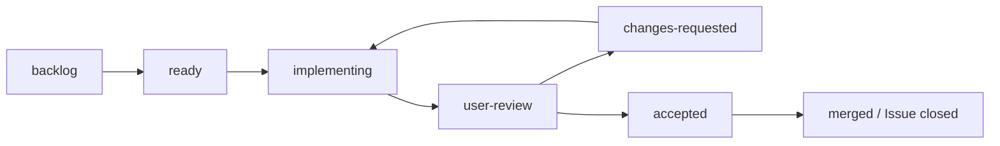

# 実装・ユーザー検査・修正の流れ

ユーザーは **動く区切りごと** に検査する。内部タスクごとの確認待ちは作らない。
親エージェントが分割、実装指示、技術検証、検査準備、修正の取りまとめを担当する。

ユーザーにコード・PR差分・設計書の技術レビューを求めない。チャットでは実際に開けるゲーム画面、今回できるふるまい、短い操作手順と画面上の期待結果を伝える。見た目・押しやすさ・選択の分かりやすさ・操作感も検査対象とする。commit/CI/内部チェックは親がIssue/PRへ記録し、ユーザーの判断材料はUIとふるまいを中心にする。仮表示と完成版の表現も区別する。

## まず使う指示

開始するとき:

> G1を進めて。内部タスクは任せるので、検査できる状態まで実装・検証して、起動手順と検査項目を渡して。

修正するとき:

> G1の修正。自軍を選んで移動先を押しても動かなかった。期待はクリックした場所への移動。ほかの検査はまだしていない。

合格するとき:

> 今回渡されたG1の版は検査OK。マージしてG2へ進めて。

G番号と普通の言葉だけでも受け付ける。情報が不足する場合、エージェントが既存の検査記録や再現調査で補う。
ユーザーにテンプレート記入やGitHub操作を毎回要求しない。
「検査OK」だけの場合は対象版を特定して記録・マージするが、次のGは開始しない。
「G1から順に進めて」の場合も各Gのユーザー検査を挟み、その合格後は既に依頼された次のGへ進む。

## 四つの検査区切り

| 区切り  | ユーザーが確かめること                 | 次へ進める条件                            |
| ------- | -------------------------------------- | ----------------------------------------- |
| G1 / M1 | 開始、部隊選択、移動、カメラ、リセット | 自分の部隊を意図どおり動かせる            |
| G2 / M2 | 制圧、収入、生産、交戦、研究、チケット | NPCが動かなくても手動で戦略ループを試せる |
| G3 / M3 | NPC2陣営、三つ巴、勝敗、結果、再戦     | 一試合を最後まで遊べる                    |
| G4 / M4 | mockに沿うUI、操作ガイド、通しプレイ   | 説明役なしで操作と判断ができる            |

内部タスクと依存は [TASKS.md](TASKS.md) に定義する。ゲームルールの未決定事項は実装時に判断記録へ残す。

## 状態と管理場所

GitHubの各GのIssueを進捗の正とする。Issue番号はTASKSの索引を参照する。
文書には仕様・完了条件を置き、毎日の進捗を二重管理しない。

ラベル・チェックリスト・検査記録は親エージェントが更新する運用とする。
GitHubによる自動状態遷移・ユーザー合格の強制チェックは未導入。

- Issueにはkind:gateと、flow:で始まる状態ラベルを **一つだけ** 付ける。
- G1をready、後続をbacklogで開始する。前のGのマージ後に次をreadyへ変更する。
- 内部タスクのチェックは実装と技術検証の完了を表す。ユーザー合格を意味しない。
- implementing中に自動テスト、独立レビュー、ブラウザ確認を実施する。
- user-reviewへの移行条件は「技術検証済み、起動可能、検査票と対象commitがそろっている」こと。
- ユーザーから問題報告が来たらchanges-requested、対応開始時にimplementing、修正後にuser-reviewへ戻す。
- acceptedはユーザーの明示的な合格がある場合だけ。無回答やCI成功を合格として扱わない。
- マージ後にIssueを閉じる。自動Close用のキーワードはユーザー合格前のPRには使わない。

## 親エージェントの進め方

1. 対象Issue、TASKS、AGENTS、最新のユーザー指示、作業ツリーを確認する。
2. 対象G用のブランチをmainから作る（例: gate/g1-map-movement）。一つのGを一つのPRにまとめるのを基本とする。
3. 内部タスクの依存と共通の型・APIを先に整理する。対象・編集可能なファイル・受入条件を [実装指示テンプレート](templates/IMPLEMENTATION.md) で担当へ渡す。
4. 独立した担当だけ並列化する。子エージェントは担当範囲を実装・検証し、外部Issue編集、マージ、ユーザーへの合格要求は親に任せる。
5. 親が統合と技術検証を行い、内部タスクのチェックと検証証跡をIssue/PRへ記録する。
6. 機能が動く状態で [検査依頼テンプレート](templates/HANDOFF.md) を埋め、user-reviewへ移してユーザーへ渡す。
7. 修正指示を受けたら [修正記録テンプレート](templates/FEEDBACK.md) に整理し、同じIssue・ブランチ・PRで修正する。
8. 合格したcommitに対応する内容をmainへマージし、Issueを閉じる。後続の依頼があれば次のGへ進む。

内部タスクが大きすぎる場合はT101-a等へ分割してよい。Gの完了条件を黙って縮小しない。
基本は同じチャットで進める。別チャットはユーザーが依頼したときだけ作り、通常の分担には子エージェントを使う。

## 検査対象を固定する

検査依頼にはG、Issue、PR、ブランチ、完全なcommit SHAを記載する。
ローカルの検査用作業ツリーに未コミット変更を残さず、検査中はその版を変更しない。
修正作業は別の作業ツリーか、ユーザーの検査が終わった後に同じ作業ツリーで行う。
新しい版を渡すたびに、別の検査回（G1-r01、G1-r02等）として記録する。

起動手順には実際に動作確認したURLとコマンドを載せる。
別チャット・別PCからURLが開けると推測しない。接続できない場合のローカル起動手順も付ける。
コマンドやURLに未実装のseed指定・デバッグ操作を含めない。
seed、初期配置、短時間設定、操作順を再現できる検査シナリオを実装し、その選び方を説明する。
検査用の短時間試合や固定敵は通常プレイと表示・設定を分離し、通常機能の完成と混同しない。

スマホ実機が使えずマウス・エミュレーションのみで確認した場合、その範囲を明記する。
ブラウザ確認を実行できない場合は「確認待ち」とし、技術検証完了とは宣言しない。

## 修正と合格の扱い

不具合、使い勝手の改善、仕様変更を分けて記録する。
不具合は同じGで直す。改善は検査を妨げるものを優先し、後回しにする項目はユーザーに明示する。
仕様変更が完了条件に影響する場合、TASKSとDECISIONSも更新する。
重大なスコープ変更だけは選択肢と影響を整理してユーザーへ確認する。通常の実装判断では停止しない。

修正ごとにR01等のID、再現条件、修正commit、再検査結果を残す。
修正後は該当項目と影響範囲を確認し、何を再検査してほしいか明示する。
前回ユーザーが確認していない項目は未検査のまま残す。

「検査OK」は最後に渡した版に対応させる。複数の版が並行していて特定できない場合だけ確認する。
合格後に実装を変更した場合、以前の合格を流用しない。検証とユーザー検査を改めて行う。
マージ時に競合解消や実装変更が必要なら、最終版を再度検証・検査へ戻す。
accepted/マージ後に不具合が見つかった場合は、元のG・版に紐づけた修正IssueとPRで扱う。

検査待ち中は次のGに依存しない調査・設計だけを進めてよい。未合格の機能を前提とする次段階の実装は始めない。
文書・CIだけの保守はゲーム検査ゲートの対象外とし、通常の技術レビューとCIで扱う。
