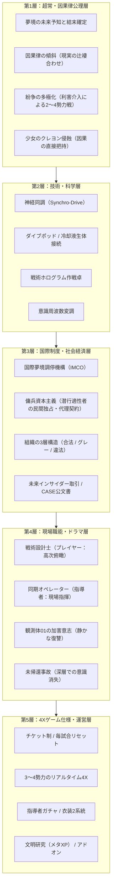
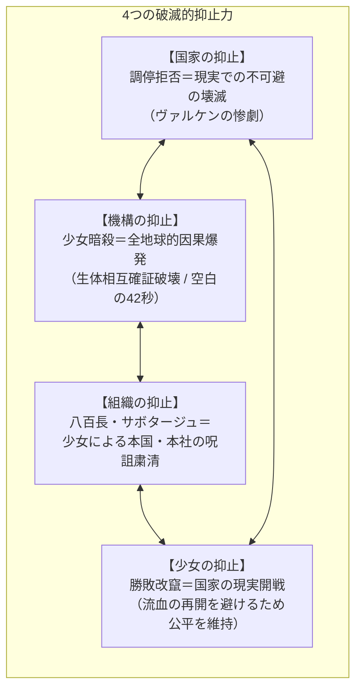
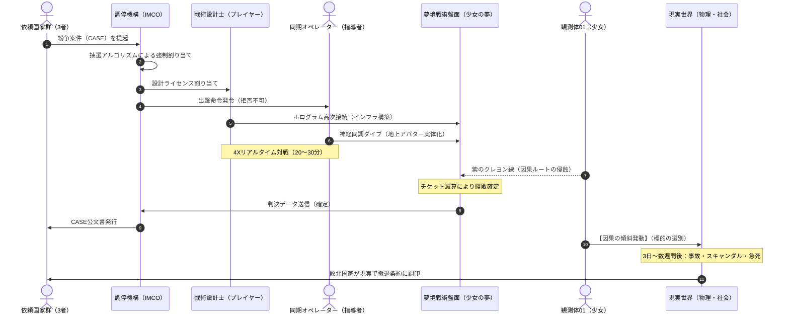
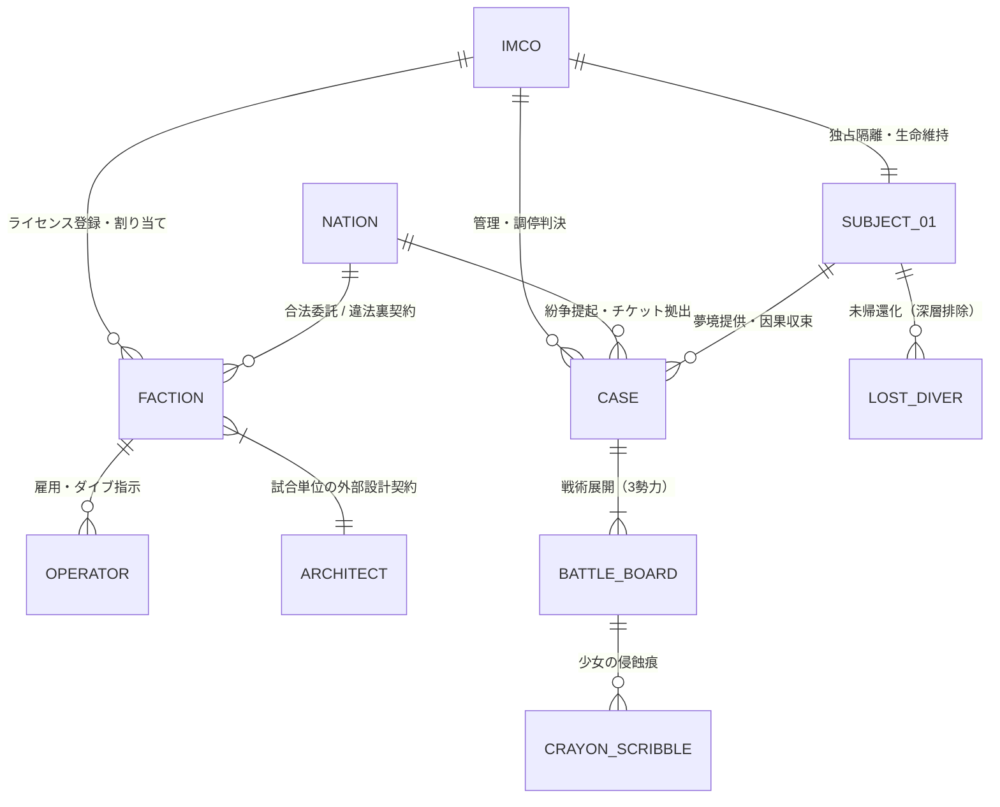
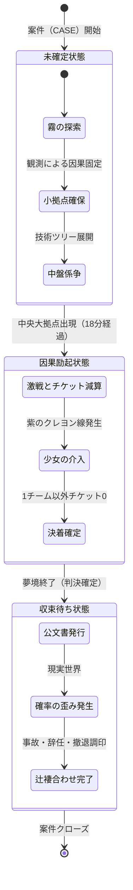

# 07_世界観構造化と整合性検査レポート

本書は、本作の世界観・因果律・国際制度・現場技術・ゲーム仕様の5層を構造的にモデル化し、Mermaidグラフによる視覚的検証を行うとともに、想定されるプロットホールやルールの抜け道に対する**全10項目の破綻検査（ストレステスト）**とその抑止ロジックを記録した公式検査レポートである。

---

## 1. 世界観の5層構造アーキテクチャ（構造モデル）

世界観を支えるルールは、最下層の「因果の公理」から最上層の「ゲーム仕様」まで、上位が下位に依存する5層構造としてモデル化される。

---

## 2. 力学の均衡：なぜ世界は破綻せずに回るのか？

本作の世界は、善意や条約ではなく、**「4つの破滅的リスクの拮抗（チェックメイト）」**によって成立している。

---

## 3. 調停案件（CASE）のライフサイクル・シーケンス

1つの紛争案件が提起されてから、盤面で勝敗が決し、現実が辻褄を合わせるまでの因果確定プロセスである。

---

## 4. 組織とアクターの利害関係マトリクス（ER図）

各勢力がどのようなインセンティブと制約で結びついているかを可視化する。

---

## 5. 網羅的破綻検査（全10項目のストレステスト）

設定の穴やルールの抜け道になりうる10の論点を抽出し、その抑止・補強ロジックを検証した。

| No | 想定される疑問・攻撃（破綻リスク） | 結論（設定の耐久性） | 破綻を防ぐ抑止ロジックと補強設定 |
| :---: | :--- | :---: | :--- |
| **01** | **少女を暗殺して現実の戦争に戻せないか？** | **安全** | **生体相互確証破壊（BMAD）。** 2038年の毒殺未遂で**42秒間の心停止**が発生した際、世界中で確率崩壊災害（原発の異常、金融麻痺）が多発し、首謀者の地下司令部が自国ミサイル暴発で消滅した絶対的「実績」があるため、誰も手を出せない。 |
| **02** | **国家が民間組織を強制国有化・脅迫できないか？** | **安全** | **利敵行為（サボタージュ）の恐怖。** 潜行中の意識はブラックボックスであり、脅迫や強制徴募をすると夢の中で故意に敗北され、国家が現実の辻褄合わせで破滅するため、国家も高額な契約金で機嫌を取るしかない。 |
| **03** | **少女はなぜ監禁者を即座に全滅させないのか？** | **安全** | **3つの構造的制約。** ①盤面データに署名された責任者しか認識できない（黒幕はダミー会社で保身）、②大奇跡ではなく微細な綻びを突くバタフライ・エフェクトしか起こせない、③強く干渉すると目が覚めかけて夢境が瓦解するため「息を潜めて細い線を引く」ことしかできない。 |
| **04** | **チーム数が2や4になっても世界観は破綻しないか？** | **安全** | **紛争の多極化力学。** 少女のオカルトルールではなく、現実の利害介入者（監視国・周辺国・違法組織）の有無によって2〜4勢力戦が柔軟に形成されるため、ゲーム仕様やモードの変更に完全に対応できる。 |
| **05** | **真相に気づいた主人公（設計士）が消されない理由は？** | **安全** | **非接地 ＋ 鏡像の哀切。** 高次作戦卓経由のため直接衝撃を受けにくく、さらに少女から見れば「100日で過密演算により勝手に脳が焼けて死ぬ使い捨て少年」であり消す価値がない。むしろ大人に道具にされる生贄同士としての同情すら抱いている。 |
| **06** | **なぜ機構は違法組織（Zone-0）を全滅させないのか？** | **安全** | **制度の安全弁（必要悪）。** 国家が大っぴらに言えない裏工作の受け皿として機能しており、機構幹部自身が裏でZone-0に未来情報を横流しして私腹を肥やしている。 |
| **07** | **毎試合兵器や基地がリセットされる理由は？** | **安全** | **因果の個別性。** 案件ごとに戦場の地理も歴史的因果も異なるため、前回の資材・軍備は概念的に持ち越せない（夢境の初期化）。 |
| **08** | **指導者は夢で戦死しても現実で死なないのか？** | **安全** | **アバター投影方式。** 通常の被弾は神経ショック（激痛）に留まり、精神切断装置が作動する。少女の直接攻撃（紫の線）に触れた時のみ「未帰還」となる。 |
| **09** | **3チーム戦で「2チームが結託して1チームをリンチ」しないか？** | **安全** | **大拠点の逆転構造。** 2チームが共闘しても最終勝者は1チームのみ。終盤に中央大拠点が出現すると、必然的に同盟国同士の裏切りと奪い合いが発生する。 |
| **10** | **少女がいつか覚醒したらどうなるのか？** | **安全** | **グランドフィナーレの燃料。** 彼女の覚醒は「代理戦制度の終焉＝現実の全面戦争の再開」を意味する。これを巡る「覚醒派 vs 睡眠維持派」の抗争が物語のクライマックスとなる。 |

---

## 6. ゲームメカニクスと因果状態遷移（State Diagram）

試合の進行に伴い、因果の確定度がどのように推移するかを定義する。

---

## 7. 総合評価と結論

- **論理的堅牢性:** 極めて高い。ゲームシステム（3勢力、チケット制、毎試合リセット、指導者ガチャ）のすべてに作中の力学的・物理的裏付けが存在する。
- **作劇上の拡張性:** 「少女の加害」「未帰還事故」「違法潜行」「少女の目覚め」という複数のサスペンス軸が存在し、キャラクター個別の短編からシーズン単位の全体戦争イベントまで無理なく展開可能である。
- **結論:** **本世界観モデルにはクリティカルな論理破綻（プロットホール）は認められず、商業作品としてのシナリオ・ゲーム開発に耐えうる強度を有している。**
