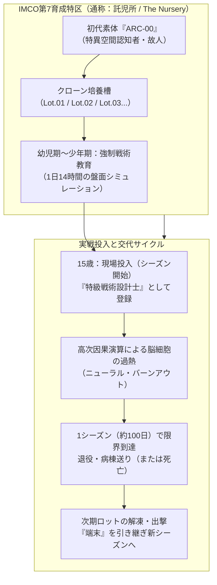

# 10_主人公設定：クローン兄弟と設計端末（ハイブリッド案仕様）

本書は、主人公（戦術設計士）の造形として採用された**「素体固定型クローン × 施設育成教育（ハイブリッド案）」**の公式設定、育成環境、シーズンごとのロット交代システム、および相棒となる現場オペレーターたちとの関係性を定義する。

---

## 1. 主人公（戦術設計士）の根本定義

主人公は、神に選ばれた天才でも、安価なギグワーカーでもない。
国家とIMCOの暗部である極秘施設で培養され、戦術演算のためだけに育てられた**「使い捨てのクローン少年兵（特化演算個体）」**である。



### 1.1 計画の誕生背景：大人の知性の枯渇と「第1期生」
代理戦が法制化された2040年代前半〜中盤、戦術設計士を務めていたのは各国の優秀な大人の軍師や数学者たちだった。
しかし、夢境の因果を構築する高次演算の情報過熱は常人の大脳の許容量を遥かに超えており、わずか数ヶ月〜1年の稼働で重度の記憶喪失や脳萎縮を起こす「ニューラル・バーンアウト」が続発。世界中で深刻な設計士不足（知性の枯渇）に直面した。

これを受け、IMCOと研究財団は極秘裏に「因果演算の熱量に耐えうる特化生体の量産」を決定。初代素体ARC-00の遺伝子から培養されたクローン少年兵たちが、2050年に初めて前線へ実戦配備された。
短編で描かれた**『ARC-Lot.01』こそが、この人体実験計画のトップバッターとして出荷された第1期生**である。
アレクセイらベテラン潜行者が「耳が痛くなるほど若い声だ。ガキの頭には重すぎる仕事だ」と驚くのは、これまで大人の設計士ばかりだった前線管制室に、突如としてこの見知らぬ少年が送り込まれてきたためである。

---

## 2. 育成環境：第7育成特区（託児所 / The Nursery）

- **所在地:** アルプス山脈地下、旧核シェルター跡地（IMCO直轄の非公開区画）。
- **呼称と分類:**
  戸籍は存在せず、すべて`ARC-Lot.XX`（アーク・ロットXX）のシリアルナンバーで管理される。
  外見は15〜17歳前後の、色素の薄い均整のとれた少年（または少女。外見差はロットごとの微細な遺伝子調整）。
- **兄弟としての関係:**
  同じ施設内の寮で生活し、同じ講義室で戦術チェスと因果シミュレーションを競い合わされた「兄弟」たち。
  無機質なクローンでありながら、彼らは互いを「兄さん」「弟」と呼び合い、かすかな人間性と連帯を持っている。
- **出荷の儀式:**
  「適正年齢」に達した一番上の兄から順に、特級ライセンス端末を与えられて地上（管制室）へ出荷される。
  施設に残された弟たちは、兄が二度と帰ってこないこと、そして数ヶ月後に自分がその席を継ぐことを知っている。

---

## 3. シーズン継承システム（ZombiU型バトン）

ゲームのシーズン更新（LiveOps）と、ストーリーの世代交代が完全に同期する。

### 3.1 端末「TIS-Aegis（通称：遺品）」
代々のARC兄弟に受け継がれていく、軍用規格の高次戦術ホログラム端末。
前任ロットが退役・処分される際、端末は初期化されて次期ロットに渡される規定になっている。

### 3.2 少女の「紫の線」によるバグ（記憶の残留）
本来、端末の初期化によって前任者の個人的なログや感情は完全に消去されるはずだった。
しかし、**夢境で少女（観測体01）が引いた「紫のクレヨン痕」に触れたデータだけは、システム側の消去プロトコルを受け付けず、端末のキャッシュ深層に「消えない染み」として焼き付いてしまう**。

```
［シーズン1：ARC-Lot.01］
  ・ヴェルナ海峡戦などを指揮し、少女の紫の線に触れる。
  ・脳が焼き切れる寸前、端末の隠しパーティションに「不自然な公文書の記録」を刻む。
  ・退役（病棟へ移送）。
       │
       ▼ 【シーズン更新：端末の引き継ぎ】
［シーズン2：ARC-Lot.02（弟）］
  ・兄の遺した端末を起動。
  ・初期化されたはずの画面の片隅に、兄の手記と「紫のクレヨン痕」が浮かび上がる。
  ・「……兄さん、あなたは何を見て壊れたんだ？」
```

---

## 4. 少女（観測体01）との鏡像関係

少女と主人公は、世界観の中で最も強く魂が共鳴する「合わせ鏡」の関係となる。

| 項目 | 観測体01（少女） | 戦術設計士（ARC兄弟） |
| :--- | :--- | :--- |
| **奪われたもの** | 10歳の時に自由と覚醒を奪われ、十数年眠らされた | 幼少期から自由と自我を奪われ、演算機械として育てられた |
| **大人たちの扱い** | 平和の道具、不可侵の生体資産、都合の良い象徴 | 代理戦を勝たせるための使い捨ての高機能パーツ |
| **身体の悲哀** | 肉体は大人になっても、社会から「少女」と呼ばれる | 大人になる前に脳を焼かれ、誰も20歳を迎えることができない |
| **互いを見る視線** | 「また同じ顔の新しい弟が座ったのね」 | 「檻の中にいる、世界で一番孤独な同胞」 |

少女が夢境の片隅から向ける視線は、冷酷な観察から、徐々に**「自分と同じ生贄の少年に対する、痛切な哀悼」**へと変化していく。

---

## 5. 現場オペレーター（指導者たち）との人間ドラマ

大人たち（アレクセイや林晨など）は、最初この少年たちの正体を知らない。
しかし、シーズンを重ねるにつれて、現場の大人たちは恐るべき事実に直面する。

### アレクセイ・ヴォルコフの場合（大人の痛恨）
- **シーズン1:** 「おい設計士、若い声だな。学生バイトか？ まあいい、腕前は本物だ」と皮肉を言いつつ信頼を寄せる。
- **シーズン2:** 契約更新後、再び繋がった回線から聞こえてきたのは、**「前のシーズンで脳を焼かれて退役したはずの少年と、全く同じ声・同じ戦術の癖を持つ新しい少年」**だった。
- **アレクセイの葛藤:**
  「……おい設計士。お前、前の奴の弟か何かか？ ……いや、答えるな。クソが、あいつら（IMCO）はこんなガキを使い捨てにしてるのかよ……」
  口は悪いが現場叩き上げのアレクセイの中に、「他国の国境」以上に**「この使い捨ての少年兵たちを、今度こそ死なせたくない」**という強烈な保護本能と義憤が芽生える。

---

## 6. ゲームプレイへの影響とまとめ

- **プロとしての説得力:**
  幼少期から特化訓練を受けた純粋培養の戦術知性であるため、4Xの複雑な盤面を神視点で操るプレイヤースキルに完璧なリアリティが付与される。
- **重厚なディストピア感:**
  どれほど華々しく勝利しても、自分たちは1シーズンで消えていくクローン少年兵であるという、ユーザーが愛着を持つ「どうしようもない社畜・消耗品感（3, 5）」が極大化される。
- **シーズン更新の待ち遠しさ:**
  「次のシーズンではどんな弟が主役になり、前シーズンの兄の残した謎をどう追うのか？」という、ゲームのLiveOpsと完全に一体化したナラティブが成立する。
