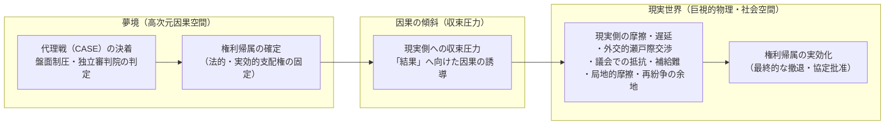
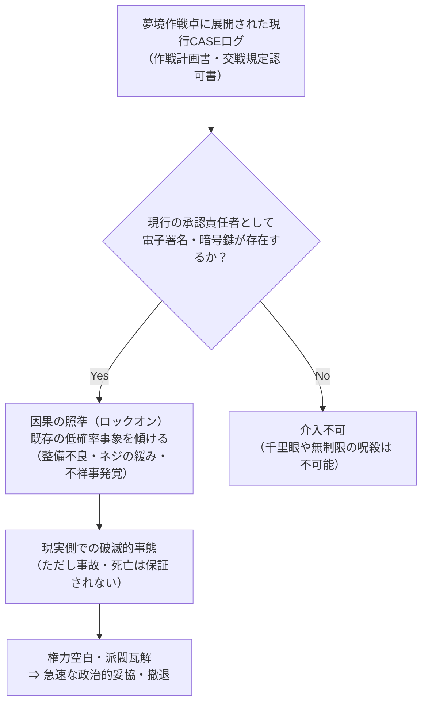

# 01 世界構造・因果律・歴史年表

本資料は、本作の世界構造、因果律モデル、観測体01（少女）の能力限界、未帰還事故の臨床的実態、および歴史年表を定める正史文書である。現行設定で未規定の事項は07の課題台帳を参照する。

---

## 1. 世界構造と因果の物理現象

### 1.1 因果律の傾斜と「辻褄合わせ」の法則
2030年代初頭、量子物理学と認知神経科学の研究者は、観測者の集合的無意識と巨視的な確率変動に関連があるという仮説を立てた。研究上の作業モデルとして、その仮説的な基底を「Morphic Foundation」と呼ぶ。
後に「夢境（The Slumber / Reverie）」と呼ばれる領域でCASEの判定が成立すると、現実側には判定された権利帰属へ向かう収束圧力が生じる。この圧力の機序は作中でも完全には解明されていない。

これを**「因果律の傾斜（Causal Tilt）」**および**「辻褄合わせの法則（Reconciliation Principle）」**と呼ぶ。

### 1.2 現実収束の定義と範囲
夢境における代理調停（CASE）が決着した際、現実に固定される範囲は厳密に限定される。

1. **固定される結果の範囲:**
   - 当該CASEにおいて係争対象となった**「特定の権利・境界線に対する法的・実効的支配権の帰属」**のみが不可避に固定される（例：CASE 4092-Bにおける「ヴェルナ海峡通航権の帰属」）。
2. **現実側の摩擦・遅延・抵抗の残存:**
   - 収束圧力は自動的に世界平和をもたらす魔法ではない。
   - 敗北国の政府や軍部が不服として外交交渉を引き延ばしたり、条約調印を数週間〜数ヶ月にわたって拒絶する抵抗、周辺地域での威嚇的演習、別事案（新CASE）の提起といった**人間的・政治的摩擦は日常的に発生する**。
   - ただし、収束圧力は「その権利を実効的に維持することを不可能にする現実的障害（軍の後方兵站の破綻、議会による予算否決、世論の反発、前線指揮官の不祥事など）」として顕在化し、最終的に権利は勝者側へ移譲される。

---

## 2. 観測体01（少女）の真実と能力上限

### 2.1 少女の生体情報と現状
- **コードネーム:** 観測体01（Subject-01 / The Anchor）
- **現実世界の実年齢:** **28歳**（2032年発見時：満10歳。2050年現在：実年齢28歳）
- **現実の身体:** 28歳の成人の身体。長期昏睡と生命維持管理による筋力低下があり、脳波測定電極と生体維持チューブにつながれている。10歳前後の外見は夢境内の姿であり、現実の肉体年齢を示すものではない。
- **夢境内の姿:** 薄青の療養着に、身の丈に合わない大きな大人の軍用外套を羽織った10歳の少女。右手には短く擦り切れた紫色のクレヨンを握っている。

### 2.2 盤面勝敗への不干渉原則
少女は夢境の基盤そのものであるが、**試合（CASE）の決着がつくまで、盤面上のユニット、移動経路、資源配分、通信網、および勝敗判定に一切干渉できない（干渉しない）**。
- **理由:** 少女が試合結果を操作すれば、国家群は代理調停の公正性を疑い、現実の戦争へ回帰する危険が高まる。彼女が調停制度の存続を望んでいるかは確定せず、盤面に干渉しないことと、個人的な復讐の動機は分けて扱う。
- したがって、4X盤面の勝敗は、各陣営の戦術設計士の知性と現場潜行者の実力によって完全に決定される。

### 2.3 能動的偏向（通常介入）とその制約
少女が自らの意志で行う復讐（加害）は、以下の厳格な制約に従う。

1. **現行CASEログによる導線の制約:**
   - 少女は全知全能の千里眼を持たない。標的を認識できるのは、**「当該CASEの夢境展開ログ（作戦承認書、交戦規定認可書など）に、現行の統括・承認責任者として電子署名・暗号鍵が存在する人物」**に限られる。過去の怨恨だけで遠隔追跡することはできない。
2. **微細な確率偏向:**
   - 少女ができるのは「現実世界に既に存在する微細な綻び（整備不良、部品の金属疲労、書類の誤送）の発生確率を傾ける」ことのみである。直接ミサイルを曲げたり、健康な心臓を止めることはできない。
   - 事故の発生や標的の死亡は保証されず、失敗する可能性もある。
3. **紫のクレヨン線（因果の照準）：**
   - 少女が描く紫の線は、戦術介入ではなく**「現実側で破滅させる標的への因果の照準（破滅予告）」**である。
   - この線は中央サーバーの原本データを改ざんするものではなく、同調中の設計士端末上のローカル描画例外としてのみ視認される。

### 2.4 心停止時の受動的基盤崩壊（BMAD）
通常時の微細な確率偏向とは全く異なる事態として、少女の生命維持危機時には**「基盤形態形成アンカー崩壊（BMAD: Baseline Morphic-Anchor Disruption）」**が起こり得る、というモデルが想定されている。

- **現象の本質:** 少女の能動的な攻撃や呪詛ではない。因果の基準点（アンカー）の喪失により全球規模の確率変動が起こり得るという、IMCOなどが採用する**受動的崩壊モデル**である。発生条件と機序の全容は確認されていない。
- **15分文明崩壊予測:** 「少女の心停止から15分で人類文明が崩壊する」という言説は、観測事実ではなく、IMCOおよび主要国科学顧問による**最悪ケースのシミュレーション予測（仮説）**である。
- **2037年「42秒事件」の真相:**
  - 少女奪取作戦の際、生命維持装置が42秒間停止。
  - 観測された事実：生命維持装置の停止中に送電網や誘導装置の障害を含む複数の事故が発生し、作戦首謀者の司令部には自国ミサイルが着弾した。個々の事故原因と相互の因果関係は確定していない。
  - 国家側の解釈：列強各国は一連の事故を少女の報復と結び付けて恐れ、以後、少女の生命維持装置に触れることを国際的なタブーとした。

---

## 3. 潜行技術と未帰還事故の暗部

### 3.1 潜行深度と神経損傷
夢境へ深く潜行するダイバーは、少女の意識の核に近づくにつれて強烈な因果圧に晒される。
- **少女の防衛本能:** 少女自身も自らの夢境を荒らされることを望んでおらず、無許可で深層（Zone-0領域やサンクタム周辺）へ侵入した潜行者の神経接続を、自己防衛的に切断する。

### 3.2 未帰還（Lost-Diver）の臨床病態
作中における未帰還者の病態は、以下の医学的定義に統一される。

| 項目 | 正式定義 | 誤用・旧表現（廃止） |
| :--- | :--- | :--- |
| **臨床病態** | **生命維持機能が保たれた遷延性意識障害（遷延性昏睡／持続的植物状態）** | 脳死（Brain Death）※法的死亡であり不可逆のため不適切 |
| **生体機能** | 自発呼吸、心拍、脳幹反射は維持。大脳皮質機能のみが広範に脱落。 | 脳波完全停止 |
| **夢境内の残滓** | 自律的な人格ではなく、因果空間に焼き付いた「断片化された記憶テレメトリーの残滓」。 | 生きた魂の囚われ |
| **回復可能性** | 現在の神経医学では不可逆。家族や仲間は奇跡を信じて療養を続ける。 | 魔法的な救出・即時蘇生 |

### 3.3 IMCOおよびAECによる隠蔽工作
未帰還事故が発生した際、国際夢境調停機構（IMCO）および執行部隊（AEC）は極めて冷徹な現実側の事後処理を行う。
1. **事故対応:** IMCO施設管理部門が患者の医療記録と同調記録を保全する。AECは現場監査と証拠の保全を実行する。
2. **隠蔽の決裁:** 診断記録の改ざんや公表範囲の制限は施設・機構側の決裁者が命じる。AEC全体や現場監査官が単独で医療判断を下す仕組みにはしない。
3. **補償と圧力:** 遺族・所属組織への補償や情報統制が行われる場合、その決定者・法的根拠・発覚リスクを個別に描く。隠蔽が常に成功するとは限らない。

---

## 4. 改訂案・歴史年表（2032年〜2050年）

協議台帳（`12`）の合意を反映した正史年表である。旧資料と記述が異なる場合、本書の記述を現行設定として扱う。

| 年代 | 出来事 | 詳細・因果の整合 |
| :--- | :--- | :--- |
| **2032年** | **「観測体01」の発見** | 某国旧軍地下研究所の廃墟にて、特異な脳波パターンを発する**満10歳の少女**を発見。彼女の睡眠時脳波が周囲の巨視的確率事象を歪める現象が確認される。 |
| **2035年** | **深層因果空間の観測成功** | 少女の脳波がアクセスしている高次元情報空間「夢境（The Slumber）」の存在を物理学的に特定。主要国による少女争奪戦が激化。 |
| **2037年** | **奪取作戦の失敗と「42秒事件」** | 連合国特殊部隊（マティアス・ブラント大将が指揮関与）による強奪作戦が発生。移送中に生命維持装置が42秒間停止し、その間に世界各地で複数の事故が報告された。首謀者司令部への自国ミサイル着弾も発生したが、原因は確定していない。各国は少女の報復を恐れ、彼女を不可侵の特異点として扱うようになる。 |
| **2038年** | **国際夢境調停機構（IMCO）設立** | 中立特区スイス・ジュネーブにIMCOを設立。少女を「国際中立不可侵資産」に指定し、深層管理施設「サンクタム」へ恒久収容。 |
| **2039年** | **神経同調技術（Synchro-Drive）の確立** | 少女の夢境へ人間の意識を中継・投影する同期プロトコルが実用化。初期の成人オペレーターおよび成人設計士による試験運用開始。 |
| **2041年** | **第一次代理調停実験（ヴァルケン紛争）** | 現実の国境紛争を夢境内の限定戦闘へ置換する最初の実証実験に成功。大国間の直接核戦争が回避される。 |
| **2043年** | **代理調停制度（CASE）の完全法制化** | ジュネーブ条約調停付属議定書が発効。現実の宣戦布告が禁止され、領土・資源紛争はすべてIMCO作戦卓上での代理戦へ一本化される。 |
| **2044年** | **設計士の知性枯渇と「ARC計画」開始** | 代理戦の高次幾何学演算に大人の脳が耐えきれず、成人設計士のニューラル・バーンアウト（廃人化）が続発。知性枯渇に直面したIMCOと研究財団は、**2044年4月、極秘の第7育成特区（託児所）にて初代素体ARC-00の細胞を用いた促成クローン「ARCシリーズ」の培養を開始**。 |
| **2044年4月〜 2047年12月** | **培養槽での促成培養期（約3.67年間）** | 未認可の極秘生体実験プロトコルにより、**約3.5倍速の促成成長**を適用（$3.67年 \times 3.5 \fallingdotseq 12.8年分$の発育）。身体年齢・脳容積が**約12歳10か月相当**に達した段階で培養槽から出される。 |
| **2048年1月〜 2049年12月** | **託児所での施設教育・寮生活（約2年間）** | 通常成長速度（1倍速）に戻り、第7育成特区の寮で兄弟たちと共同生活。1日14時間の高密度盤面シミュレーション・チェス教育を受ける。互いを「兄さん」「弟」と呼び合う連帯と独自の戦術語彙が形成される。 |
| **2050年春** | **ARC-Lot.01の初配備（現在）** | **約15歳相当**に達した長兄「ARC-Lot.01」が第1期生として戦術作戦卓へ初配備される。少女は**実年齢28歳**（夢境内の外見10歳）。世界は新たな調停シーズンを迎える。 |

---

## 5. 参加勢力数の相対化と調停枠組み

初期設定における「三者の法則（常に3勢力）」という固定観念を排し、以下の通り柔軟かつ現実的な調停枠組みとして再定義する。

1. **基本構造（2〜4勢力対戦）:**
   - 代理調停（CASE）は、原則として係争当事国が指名・契約した**2〜4勢力**によって争われる。
   - 1対1の国境画定戦、3者による海峡・回廊争奪戦、4者による複合資源特区分割戦など、紛争規模に応じて盤面構成が変動する。
2. **CASE 4092-Bの位置づけ:**
   - 本編で描かれる「CASE 4092-B（ヴェルナ海峡通航権調停）」は、北岸自由連邦が契約したATF、南岸共和国が指名したV-TAC、中立インフラ保全目標を事前登録したAECが参加する、**3勢力対戦の一事例**である。南岸政府は係争当事国、V-TACはその代理組織として区別する。
3. **独立審判系の分離:**
   - 勝敗の裁定は、競技に参加する勢力（AEC等）ではなく、中立の自動裁定システム「IMCO調停審判院」が独占して執り行う。
