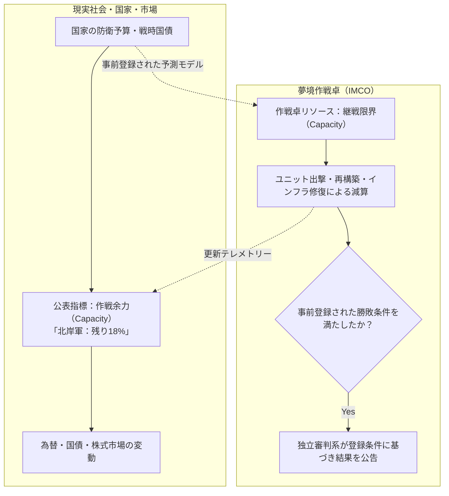
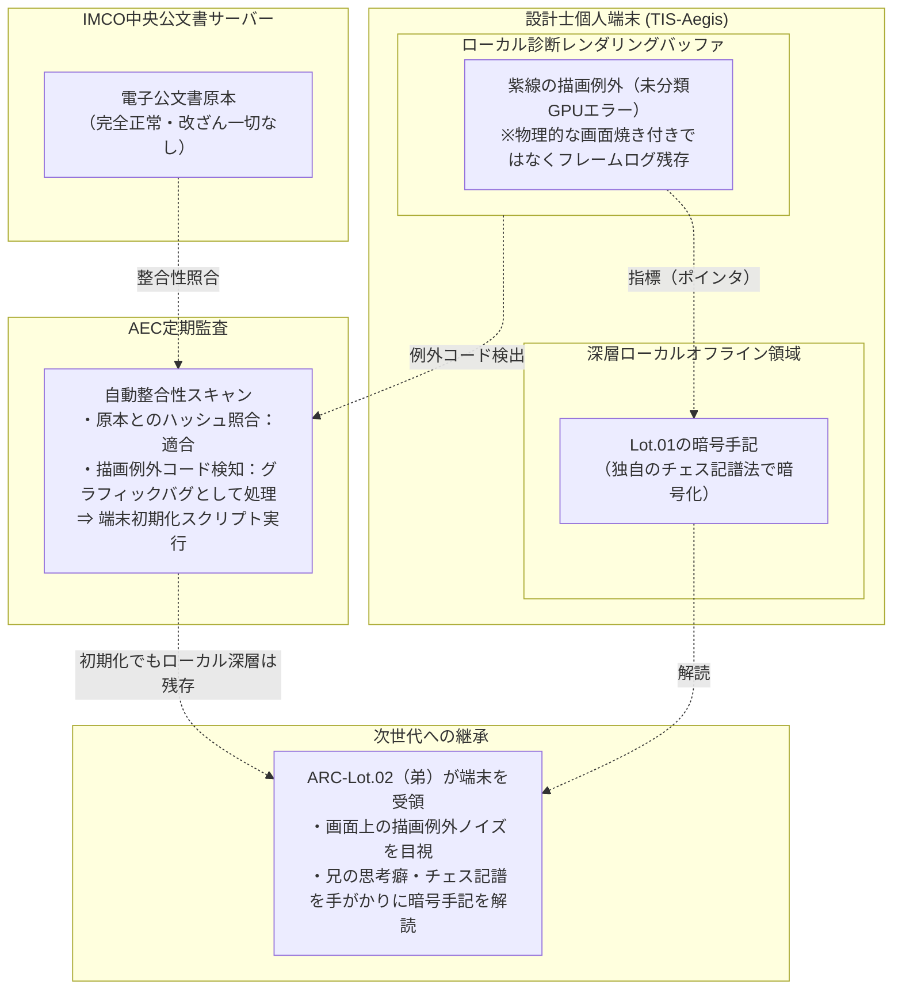

# 02 技術・潜行システム・戦術設計士

本資料は、夢境への神経同調技術、継戦限界（Capacity）、民間オペレーターと戦術設計士の配属モデル、および主人公「ARCシリーズ」の正史設定をまとめる。現行設定で未規定の事項は07の課題台帳に記録する。

---

## 1. 神経同調技術（Synchro-Drive）

### 1.1 同調の物理・生体工学
2039年に実用化された「神経同調技術（Synchro-Drive）」は、人間の脳波を特定の周波数帯（Morphic-Theta帯）に誘導し、量子神経中継器を介して観測体01の無意識（夢境）へ意識を投影・接続する技術である。

- **潜行深度（Dive Depth）:**
  - **浅層（Depth 01〜02）：** 盤面の地形、構造物、前線部隊の作戦行動が展開される標準作戦領域。
  - **中層（Depth 03〜04）：** 組織固有の暗号回線や中立インフラの中枢が存在する領域。
  - **深層（Depth 05〜06 / サンクタム周辺）：** 少女の意識の核および全球因果アンカーが位置する立ち入り禁止領域。無許可で侵入したダイバーは激しい神経過負荷に晒される。

### 1.2 作戦余力／継戦限界（Capacity）
作中および世界観公式設定において、ゲーム企画用語である「チケット」は使用せず、**「継戦限界」「作戦余力」「Capacity」**に呼称を統一する。

- **作中での意味:**
  - Capacityは、国家の財政・補給力・世論などから算出する「継戦能力の予測指標」であり、夢境内に存在する物理的な量子エネルギーではない。
  - 夢境の作戦卓では、この指標を戦術資源としてモデル化する。ユニット損耗や再構築のコストは、国家が今後負担すると予測される人的・物的・政治的負担を表す。現実の担保資産がエネルギーへ変換される設定ではない。
  - 具体的な算出式、CASEごとの初期値、情報公開の遅延・粒度は運営・制度設計上の未決定事項とする。
- **現実社会への影響:**
  - CASEの進行状況および各陣営のCapacity残量は、IMCO公報を通じて現実世界の報道・金融端末へ配信される。
  - Capacityの低下は市場や議会に影響し得るが、為替暴落や特定の政治判断を自動的に引き起こすわけではない。

- **勝敗判定:** Capacity 0は、CASEの事前登録ルールに定められた場合に敗北条件となる。拠点占有、権利対象の制圧、時間切れなど、CASEごとの主要判定条件を事前に登録し、独立したIMCO審判系が照合する。Capacityのみを全CASE共通の勝敗基準とはしない。

---

## 2. 人員配属の二元モデル（契約派遣と公的貸与）

作戦卓を取り巻く人員は、民間資本主義に基づく「潜行オペレーター」と、超国家機関が管理する「戦術設計士」の二元構造に明確に分離される。

| 区分 | 潜行オペレーター（ダイバー） | 戦術設計士（ARCシリーズ） |
| :--- | :--- | :--- |
| **所属・身分** | **民間組織・企業の契約社員／傭兵** | **IMCO第7育成特区（託児所）の公的貸与資産** |
| **派遣の機序** | 国家が民間組織（ATF等）と「代理調停契約」を結び、組織が自社の契約ダイバーを派遣。 | IMCOが管理するARC設計士を、CASEの登録条件に従い中立的に配属する。配属人数・配置は全CASE共通とはせず、参加陣営間の公平性を事前登録する。 |
| **指揮権・拒否権** | 契約内容に基づく。過酷な作戦に対する拒否権・撤退権を持つ。 | 拒否権なし。IMCOの命令に従い、配属された陣営で作戦を立案・指揮する。 |
| **接続形態** | **直接接地（接地型ダイバー）** 夢境内に自身のアバターを投影し、五感で戦闘を体験。 | **非接地（高次幾何学俯瞰接続）** 専用作戦卓の立体トポロジーを通じて盤面を俯瞰演算。 |
| **主たるリスク** | **未帰還（遷延性意識障害）** 深層への侵入や少女の防衛線接触による意識断絶。 | **ニューラル・バーンアウト（大脳新皮質熱損傷）** 高次因果演算の過密負荷により、約100日で脳が自壊。 |

---

## 3. 主人公：戦術設計士「ARCシリーズ」

### 3.1 計画の起源と促成培養
2043年の代理戦法制化以降、大人の熟練設計士が高次因果演算の負荷に耐えきれず次々と廃人化した（知性の枯渇）。これを受け、IMCOと研究財団は極秘裏に「第7育成特区（通称：託児所）」を設立し、特化クローン計画「ARC計画」を発足させた。

- **素体:** 2040年代前半にバーンアウトした伝説的初代設計士「ARC-00」の凍結生殖細胞。
- **促成培養プロトコル（2044年4月〜2047年12月 / 約3.67年間）：**
  - 未認可の極秘生体実験として、約3.5倍速の促成成長プロトコルを適用（$3.67年 \times 3.5 \fallingdotseq 12.8年分$の発育）。身体年齢・脳容積を約12歳10か月相当まで急速に発育させた。
- **促成培養の身体的代償:**
  - 身体の急成長に対する生体機能の歪みとして、「生殖器の未発達」「体温調節機能の脆弱さ」「自律神経の不安定さ」「情緒の未成熟」を恒久的に抱える。

### 3.2 託児所の共同生活と兄弟の絆（2048年1月〜2049年12月）
培養槽を出たクローンたちは、通常の成長速度（1倍速）に戻され、託児所の寮で約2年間の共同教育を受ける。
- **1日14時間の盤面教育:** 兄弟同士で戦術チェス、高次幾何学シミュレーションを競い合い、互いを「兄さん」「弟」と呼び合う深い連帯感を育む。
- **独自の思考語彙:** 寮生活の中で兄弟間だけで共有されたチェスの変形記譜法や戦術的比喩表現が形成される。
- **出荷:** 2050年春、満15歳相当に達した長兄「ARC-Lot.01」が第1期生として作戦卓へ初配備される。

### 3.3 100日制限（ニューラル・バーンアウト）の真因
ARC設計士の標準的な高負荷CASE稼働期間は「約1シーズン（約100日）」を目安とする。これは個体の暦上の寿命ではなく、継続的な高次因果演算による損傷が臨界に達するまでの運用上の目安であり、曝露量により前後する。促成培養の代償とは別の要因である。
- **真因:** **「高次幾何学作戦卓を通じた因果演算の圧倒的な情報熱量」による大脳新皮質の不可逆な熱損傷**。
- 成人設計士にも同様の負荷による重い神経損傷が確認されている。ARCは標準運用で約100日前後に不可逆な大脳新皮質の損傷を負い、設計士として退役する。昏睡・機能停止・死亡のどの転帰を取るかは一律に定めず、個別症例として扱う。現時点で「100日寿命」とは呼ばない。

### 3.4 少女との「非接地」関係と感情の段階的成長
- **非接地の防壁:**
  - 設計士は夢境に肉体やアバターを直接接地させず、専用端末「TIS-Aegis」を介して高次元の抽象トポロジーとして因果を俯瞰している。
  - したがって、少女の防衛本能（直接の神経侵蝕）の対象となりにくく、即座に未帰還（植物状態）に陥ることはない。
- **少女の感情の成長プロセス:**
  - 物語初期において、少女は主人公を特別視していない。「また大人たちが送り込んできた使い捨ての消耗部品」に過ぎない。
  - しかし、死を目前にしながらも盤面の向こうで自らの命を燃やし、前任の兄たちの記録を辿る主人公（Lot.01、そしてLot.02）と接する中で、少女の心に徐々に「憐憫」「共鳴」、そして「哀悼」が芽生えていく。

---

## 4. 戦術端末「TIS-Aegis」と端末継承

### 4.1 端末の基本仕様
「TIS-Aegis」は、ARC設計士に支給される規格化された携帯型戦術作戦端末である。成人規格の頑丈な筐体であり、小柄な少年兵の手にはやや余る。

### 4.2 紫線の残留機序とAECの監査範囲
1. **原本データの正常性:**
   - IMCO中央公文書サーバー上の電子公文書原本には、落書きや改ざんは一切存在しない。
2. **端末上の描画例外（グリッチ）：**
   - 少女の紫線が触れた同期フレームデータは、端末「TIS-Aegis」の**ローカル診断用レンダリングバッファ**に不揮発性の例外ログとして残存する。
   - 公文書や作戦画面を表示する際、ローカル端末上でのみ紫色の擦過痕がオーバーレイ表示される。
3. **AECの監査と検知状況:**
   - AECの定期端末監査は、サーバー上の公文書ハッシュ照合とOSの自動診断スクリプトに依存している。
   - 端末に「未分類の描画例外コード」が出ていること自体は検知されているが、AEC側はこれを「高次同調時の偶発的なドライババグ」として処理しており、少女の意図や復讐の記号であるとは特定できていない。

### 4.3 Lot.01の暗号手記とLot.02による解読
- **手記の隠蔽:**
  - Lot.01は退役（バーンアウト）直前、この「未分類の描画異常」が発生する座標を道標（ポインタ）として利用し、端末の**深層ローカルパーティション（オフライン作業領域）**に独自暗号をかけた手記を残した。
- **弟（Lot.02）による解読の根拠:**
  - 遺伝子による自動解読や超常的直観ではない。
  - 託児所の寮生活で兄と毎日指し合った「戦術チェスの変形記譜法」や「講義での兄の口癖」を手がかりにすることで、後任として端末を受け取った弟Lot.02だけが暗号を解読し、世界の欺瞞と兄の遺志を知る。
