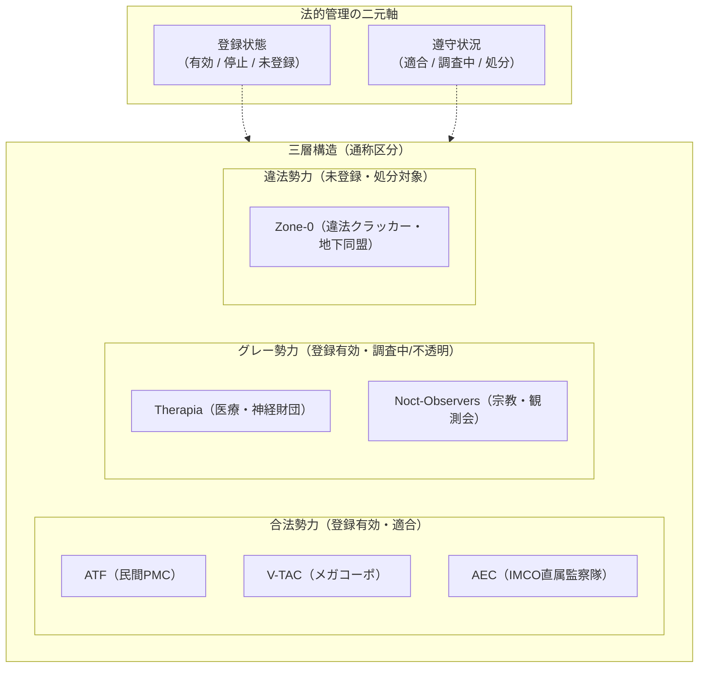

# 03 組織・勢力と法的枠組み

本資料は、国際夢境調停機構（IMCO）を取り巻く法的枠組み、各勢力の参加根拠と制約、および初期六大組織の正史設定をまとめる。元資料の組織名を保持し、現行設定で未規定の事項は07に記録する。

---

## 1. 調停の法的枠組みと三層構造

ジュネーブ条約調停付属議定書の下、夢境へダイバーを潜行させる組織は、法的に厳密な二元管理（登録状態 × 遵守状況）を受ける。



### 1.1 法的管理の二元軸
- **登録状態（Registration Status）：**
  - **有効（Active）：** IMCOに登録・認可された正規の潜行主体。公式作戦回線へのアクセス権を持つ。
  - **停止（Suspended）：** 規則違反や調査のため一時的に回線アクセスを遮断された状態。
  - **未登録（Unregistered）：** IMCOに一切認知・公認されていない非正規組織。
- **遵守状況（Compliance Status）：**
  - **適合（Compliant）：** 交戦規定およびデータ開示規則を遵守している。
  - **調査中（Under Review）：** データの不透明性や規律違反の疑いにより監査を受けている。
  - **処分（Sanctioned）：** 違反が確定し制裁措置が適用されている。

> [!NOTE]
> **「グレー」の語の定義:**
> 「グレー」は公式の法的区分名ではなく、現場・報道・市場において「登録は有効だが、運用実態が不透明で調査中・倫理的懸念がある組織（TherapiaやNoct-Observers）」を指す慣用的な俗称である。

---

## 2. 初期六大組織の仕様案

### 2.1 ATF (Aegis Task Force / アイギス・タスクフォース)

```
【法的区分】登録：有効 ／ 遵守状況：適合（完全合法PMC）
【モットー】「勝利より、帰投名簿に全員いるかだ」
```

- **理念と動機:**
  - 国家の国境紛争や利害調停を請け負う民間軍事会社（PMC）。
  - 国家の掲げる高邁な大義よりも、「請負契約の完遂」と「現場隊員の生還」を最優先とするプロフェッショナリズム。
- **参加根拠と制約:**
  - 依頼国からの正規の代理調停契約に基づきCASEへ出撃する。
  - 兵站コスト、機材損耗費、および隊員の生命安全条項に厳しく拘束される。
- **戦術思想:**
  - **重装甲・兵站維持・正面制圧:** 堅牢な前線拠点の構築、補給路の防衛、損耗を抑えた堅実な前進。
- **デザイン・素材・ビジュアル記号:**
  - **現実:** 使い込んだスレート色のテックウェア、厚手の作業用布地、金属製工具バックル、擦れた認識票。
  - **夢境:** 低重心で角張った重装甲、補修ボルトの露出した防盾、履帯式装甲車両、プレハブ型コンテナ基地。煤けた鋼鉄色をベースとし、オレンジ色は止血帯や救急具の一点のみに限定する。

---

### 2.2 V-TAC (Vostok Tactics / ヴォストーク未来戦術局)

```
【法的区分】登録：有効 ／ 遵守状況：適合（完全合法メガコーポ）
【モットー】「因果の不条理は、高密度演算で統制できる」
```

- **理念と動機:**
  - エネルギー、通信、先端重機を扱う複合企業「ヴォストーク・グループ」の潜行作戦部門。
  - 自社の特許権益、重要資源鉱区、およびグローバル供給網の防衛・拡張を目的とする。
- **参加根拠と制約:**
  - 自社または出資国が利害関係を有するCASEにのみ参加。
  - 取締役会の事前決裁、高速データリンク回線の稼働状況、および四半期収益目標に強く縛られる。
- **戦術思想:**
  - **高規格インフラ・高速資源抽出・無人機編隊:** 自律型ドローン群による視界制圧、精密な資源ルートの早期確立、電光石火の拠点展開。
- **デザイン・素材・ビジュアル記号:**
  - **現実:** 白を基調とした高襟のビジネススーツ、平滑な複合樹脂、袖口の薄型シアン認証ホログラム、細縁眼鏡。
  - **夢境:** 細長く直線的なシルエット、継ぎ目の見えない平滑な装甲パネル、三連リング状に滞空する小型無人機群、細いシアンの経路標識。

---

### 2.3 AEC (Arbitration Enforcement Cadre / 調停執行監察隊)

```
【法的区分】IMCO直属統制機関 ／ 監査・規則執行部隊
【モットー】「所見：交戦規定違反なし。監査ログに記録する」
```

- **理念と動機:**
  - IMCO事務局長直属の現場執行・規則監視部隊。
  - 調停の秩序維持、中立特区インフラの保全、および未認可勢力の排除を担う。
- **参加根拠・任務目標・審判分離の原則:**
  - **限定的な参加根拠:** CASEにおいて海峡水門、国際通信中継所、避難回廊などの「中立重要インフラ」が戦闘破壊の危機に瀕している場合、その保全目標を事前登録した上で競技参加する。
  - **独立した任務目標:** AECの事前登録目標は、**「中立インフラの物理損壊率を規定値未満に保つこと」**。これはAECの任務達成条件であり、CASEの勝敗や係争権利の帰属を決めない。勝敗は独立したIMCO審判系が全参加勢力に共通の事前登録条件から判定する。
  - **独立審判院との分離:** 現場のAEC（ヴェラ等）は交戦規定違反の監視と設備保全の確認を行うのみであり、自ら勝敗を判定・認証しない。勝敗は中立の自動裁定システム「IMCO調停審判院」が下す。
- **戦術思想:**
  - **規格防衛・電磁妨害・防壁展開:** 電磁シールド、通路遮断、索敵ジャミング、規律に基づく拘束行動。
- **デザイン・素材・ビジュアル記号:**
  - **現実:** 左右対称の白い詰襟制服、純白の手袋、襟裏に秘匿された金色の天秤章、検査具のベルト。
  - **夢境:** 垂直で左右対称の白銀装甲、鏡面バイザー、点検用マーキング帯。V-TACの滑らかな商業生産美学とは異なり、無機質で威圧的な官僚的幾何学美を持つ。

---

### 2.4 Therapia (セラピア神経医療財団)

```
【法的区分】登録：有効 ／ 遵守状況：調査中（グレー医療財団）
【モットー】「神経の熱量は、治療可能な資産である」
```

- **理念と動機:**
  - 先端神経医学、生体工学、および同調疲労回復プロトコルを研究する医療財団。
  - 臨床テレメトリーの収集、同期知財の確保、および自社開発生体モジュールの実証実験を目的とする。
- **参加根拠と制約:**
  - 神経技術・医療データ権益に関わるCASEへ戦闘勢力として参加。
  - **厳格なアクセス制限:** IMCOとの厳格な契約に基づき、自組織ダイバーの同意済み健康申告と匿名化された下流テレメトリーのみを扱う。**観測体01（少女）の肉体、未加工生体試料、深層サンクタムへの自由なアクセス権は一切持たない**。
- **戦術思想:**
  - **研究・生体修復・試験モジュール運用:** 友軍ユニットの損傷修復、神経過負荷の緩和、規格化された装備モジュールによる短時間の出力補助。出力補助は既存の技術・装備の範囲であり、個人固有の超能力ではない。過負荷や冷却負担を伴う。
- **デザイン・素材・ビジュアル記号:**
  - **現実:** 暗色の柔らかな生体防護ジャンプスーツ、片腕の半透明ミント色診断スリーブ、生体センサー輪。白衣は常用しない。
  - **夢境:** 非対称の修復型アバター、生体計測パネル、半透明ジェル充填フレーム、鈍いミントグリーンの警告灯。

---

### 2.5 Noct-Observers (ノクト観測会)

```
【法的区分】登録：有効 ／ 遵守状況：調査中（グレー宗教・観測組織）
【モットー】「夢の深淵は語る。我らはその筆跡を記すのみ」
```

- **理念と動機:**
  - 観測体01の夢境を「超常の神託（Oracles）」と解釈する宗教・思想ネットワーク。
  - 終末予言の解読、夢境深層の事象記録、および信徒共同体の防衛を目的とする。
- **参加根拠と制約:**
  - 正規の登録参加者としてCASEへ参戦。
  - **通信の非実在性:** 少女との直接面会や双方向通信の権限は持たない。信徒が主張する「少女の声」は、観測された電磁・因果ノイズに対する主観的教義解釈に過ぎず、客観的通信ではない。
- **戦術思想:**
  - **隠蔽・奇襲・長距離狙撃:** 夢境の濃霧（Fog of War）を利用した位置秘匿、偽目標の投影、高精度長距離狙撃。
- **デザイン・素材・ビジュアル記号:**
  - **現実:** 深紺色の重なり合うレイヤード外套、顔の見えるフード、真鍮製の小型測距環、暗号化織布。
  - **夢境:** 輪郭を曖昧にする多層布パネル、裾裏にのみ現れる精密な金糸の天体図刺繍、真鍮フレームの照準器。大型の宗教偶像や仮面は排し、測量士・記録係としての実用美を持つ。

---

### 2.6 Zone-0 (ゾーン・ゼロ / 第0特区ネットワーク)

```
【法的区分】未登録 ／ 処分対象（完全違法侵入勢力）
【モットー】「お前たちの因果の隙間に、俺たちの生活がある」
```

- **理念と動機:**
  - 代理調停体制から見捨てられた旧紛争地帯に暮らす人々や、IMCO未登録の潜行者・フリーランス・クラッカーが緩く連なる分散ネットワーク。ここでいう「未登録」はIMCOの潜行組織・参加者登録を指し、国家の市民登録の有無を意味しない。
  - 生存のための資源確保、未来調停情報の裏売買、および体制の欺瞞の暴露を目的とする。
- **参加根拠・侵入リスク・国家との関係:**
  - **違法な回線相乗り:** IMCOの正規出撃枠は持たない。登録組織（ATFやV-TAC等）の神経同調回線に不正なクラッキングツールで「寄生（相乗り）」して盤面へ乱入する。
  - **高い侵入リスク:** 回線遮断、逆探知、および強烈な神経損傷（即座の失神・昏睡）の危険を常に背負う。少女への直結アクセスは不可能。
  - **国家との裏関係:** 列強各国の諜報機関はZone-0から違法に未来情報を購入するが、彼らに法的入場資格や保護を与えることは絶対にない。
  - **チーム構成:** Zone-0所属者は別々の回線や依頼で動くことが多く、プレイアブル名簿の3名が常に同一CASEへ出る固定小隊ではない。
- **戦術思想:**
  - **違法侵入・電子戦・機動ゲリラ:** 拠点の短期ハッキング、補給線の寸断、即時離脱、規格外の自作ジャンク兵器。
- **デザイン・素材・ビジュアル記号:**
  - **現実:** 規格の異なる中古フライトジャケット、つぎはぎの耐熱布、酸黄色（アシッドイエロー）の補修テープ、発熱板と手製編み込み導線が露出した自作端末。
  - **夢境:** 不安定な表示ノイズを纏う身軽なゲリラアバター、折り畳みワイヤーフック、多規格混載の軽量武装。全身が超常的に発光・消失するような非現実的演出は排す。
