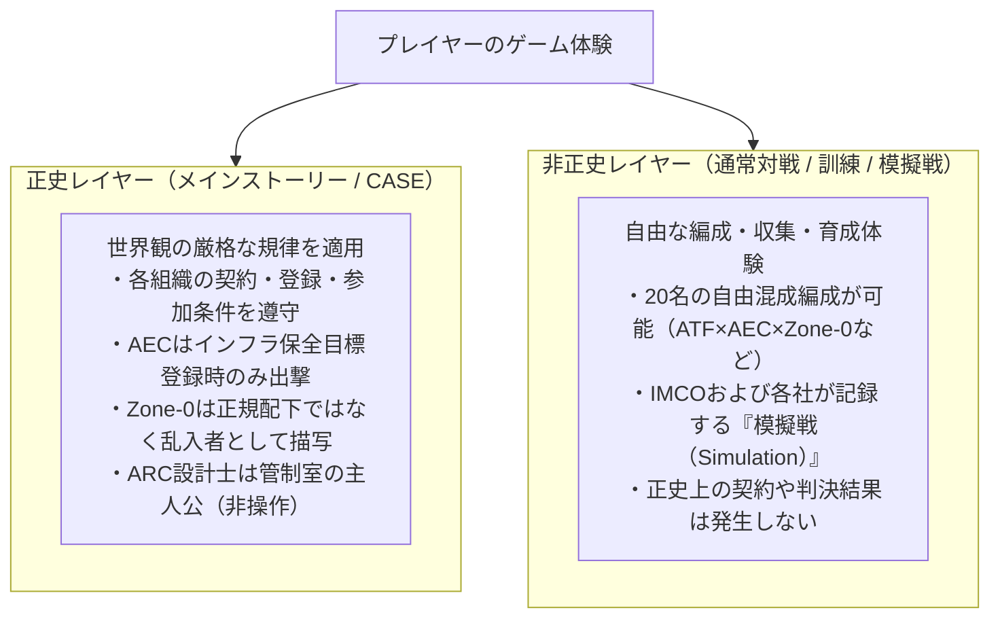

# 04 プレイアブル名簿・ペルソナバイブル

本資料は、スマートフォンゲームにおける第一期プレイアブル設計プール20名のプロフィール、運用設定、および関係性フックを定める正史文書である。名簿の基本設計は協議で確定した男女比・年齢範囲を反映する。

---

## 1. 名簿規模と二層運用アーキテクチャ

### 1.1 名簿規模と人口構成
第一期プレイアブル設計プールは**20名、男性4名・女性16名（比率 2:8）**で構成される。女性キャラクターは全員**18〜29歳**の範囲内に設計されている。
物語の主人公である戦術設計士「ARC-Lot.01」および「観測体01（少女）」、ならびに制度決裁者・事件関係者は**物語専用NPC**として別枠管理され、プレイアブル20名には含まれない。

| 勢力 | 合計 | 男性 | 女性 | 女性年齢 | 主な役割・戦術記号 |
| :--- | :---:| :---:| :---:| :---:| :--- |
| **ATF** | 4 | 1 | 3 | 23〜29歳 | 重装甲、現場兵站、工兵遮蔽、長距離観測 |
| **V-TAC** | 4 | 0 | 4 | 21〜28歳 | ドローン編隊、資源抽出、契約回線中継、特命執行 |
| **AEC** | 3 | 1 | 2 | 25〜28歳 | 規格防衛、電磁妨害、施設保全、現場監査 |
| **Therapia** | 3 | 0 | 3 | 22〜29歳 | 生体修復、装備適合補修、臨床安全監視 |
| **Noct-Observers** | 3 | 1 | 2 | 19〜24歳 | 霧中隠蔽、長距離狙撃、地形観測、星図記録 |
| **Zone-0** | 3 | 1 | 2 | 21〜28歳 | 違法回線相乗り、電子撹乱、逃走回収 |
| **合計** | **20** | **4** | **16** | **18〜29歳** | **男女比 2:8** |

### 1.2 正史CASEと非正史模擬戦の二層分離
世界観の厳格なリアリティと、スマートフォンゲームとしての編成・育成の自由度を両立させるため、以下の**二層分離運用**を定義する。

- **制作・運営項目の保留:**
  - サービス初日（Day 1）の実装人数、レアリティ（★3〜★5等）、ガチャ排出率、およびスキル数値バランスは、世界観設定から独立した運営設計事項として取り扱う。本名簿は「第一期設計プール」の全体像を規定する。

---

## 2. 勢力別プレイアブル20名の詳細プロフィール案

### 2.1 ATF (Aegis Task Force)

#### 01 アレクセイ・ヴォルコフ (Aleksei Volkov)
- **属性:** 男性、38歳 ／ ATF現場指揮官
- **外見・素材:**
  - **現実:** 幅広い肩と低い重心。短く刈った濃い髪に灰色の混じるこめかみ、無精髭。擦れたスレート色の作業ジャケット、使い古した認識票。止血帯などの救急具にのみ救難オレンジを使用。
  - **夢境:** 角張った重装胸甲と、補修ボルトの露出した巨大な盾役アバター。煤けた鋼鉄色で統一。
- **日課・趣味:** 出撃前後に隊員数と医療キットの実数を二度数える。非番時は基地の整備場で壊れたラジオや電動工具を修理する。食堂では部下の食事時間を守るため自らは端の席で手短に済ませる。
- **思想と内的矛盾:** 国家の掲げる高邁な大義を信用せず、契約の完遂と隊員の生還のみを信じる。しかし、契約を守ること自体が部下を死地に追いやる局面において、指揮官としての責任を引き受けるために契約書を破棄できない自らの立場に深い葛藤を抱える。未帰還となった元副官エレナを見舞うが、彼女を一方的な「救出目標」として扱い本人の尊厳を傷つけることを恐れている。
- **戦術役割・物語フック:** 前線維持と味方の損耗抑制。ARC設計士が論理的・具体的に危険を指摘した時のみ信頼して指示を変更する。
- **ボイス・口調:** 低く乾いた現場指揮官の口調。「勝利の報告書より、帰投名簿に全員の生体反応があるかだ」。

#### 02 マラ・ヴコヴィッチ (Mara Vuković)
- **属性:** 女性、27歳 ／ 補給・工兵班長
- **外見・素材:**
  - **現実:** 筋肉質で長身。黒髪を後頭部で短く束ね、左頬に薄い作業古傷。肘当てのある作業服、頑丈な工具ベルト。
  - **夢境:** 片側に資材ラックを備えた角形装甲、折り畳み式遮蔽板、黄色い荷札クリップ。背負った長方形のコンテナがシルエットを形成。
- **日課・趣味:** 始業前に倉庫の在庫実数を帳簿と突き合わせ、出撃後は余剰資材で簡易遮蔽物を作る。休日は蚤の市を歩き、小さな素焼きの動物陶器を探す。妹から贈られた一体を皮切りに、同じ型でも釉薬のムラを鑑賞するのが唯一の息抜き。
- **思想と内的矛盾:** 「補給物資の数字は嘘をつかない」と言い、資材不足を精神論で誤魔化す軍官僚を軽蔑する。一方で、自分の班員を守りたい一心で余剰在庫を密かに抱え込み、他班の融通を滞らせてしまう矛盾を抱える。
- **戦術役割・物語フック:** 施設修復、遮蔽設置、味方の補給効率向上。資材の配分優先順位を巡ってアレクセイと激しく衝突する。
- **ボイス・口調:** 数量と締め切りを先に告げる硬質な実務口調。「装甲板の残数は3枚。文句があるなら12分以内に届けて」。

#### 03 タムシン・コール (Tamsin Cole)
- **属性:** 女性、23歳 ／ 前線偵察歩兵
- **外見・素材:**
  - **現実:** 小柄で脚の長い軽快な体躯。赤褐色の細かな三つ編み、鼻梁にそばかす。反射を抑えた防寒インナー、膝に防水地図ポーチ。靴紐にのみ細い救難オレンジ。
  - **夢境:** 肩幅を低く抑えた軽量スカウト装甲、首元に折り畳み式の光学観測鏡。
- **日課・趣味:** 毎朝の5km不整地走。任務後は食堂の窓辺で破れた和紙と竹ひごの小さな凧を直す。休日は風が吹き抜ける高台で自作の凧を揚げ、風向の切り替わりを肌で読む。
- **思想と内的矛盾:** 「前線で見た事実だけを報告する」が信条。だが過去に報告を躊躇したことで友軍が孤立したトラウマから、現在は確証が薄い兆候でも過剰に警告を発して前線を混乱させてしまう自分を制御できない。
- **戦術役割・物語フック:** 視界確保と危険ルートの早期警戒。不確かな観測をどこまで公式記録に乗せるべきか、AECのレイラやヴェラと議論を交わす。
- **ボイス・口調:** 風の動きを比喩に使う早口。「谷あいの風が止まった。向こうの茂みに伏せてる、たぶん2機」。

#### 04 イマニ・オカフォー (Imani Okafor)
- **属性:** 女性、29歳 ／ 重機・防壁オペレーター
- **外見・素材:**
  - **現実:** がっしりとした頑丈な骨格。剃り上げた側頭部と編み込んだ短髪、片耳に小型防音具。泥汚れに強い厚手の作業オーバーオール。
  - **夢境:** 油圧アームを模した巨大な接地シールド、小型杭打ち具。泥色に塗られた装甲板に、白いペンキで手書きされた修理管理番号。
- **日課・趣味:** 交代勤務の冒頭に機材の駆動部を木槌で叩いて異音を聴く。非番時は基地の共同菜園で土を耕し、週末に仕込む発酵野菜の瓶を煮沸消毒する。塩分濃度と温度を実験ノートに几帳面に記録する。
- **思想と内的矛盾:** 「現場の人間は自分で直せる範囲を持つべき」と考え、過度な依存を嫌う。しかし過去の事故で孤立した経験から、他人のSOSには過剰に介入して世話を焼き、自分自身の身体の不調だけは絶対に申告しない。
- **戦術役割・物語フック:** 範囲防壁の展開と後退路の防護。無理な突撃命令を体を張って制止する。
- **ボイス・口調:** ゆったりとした落ち着きのある重低音。「焦って叩くとボルトが折れるよ。私が壁を立てるから、息を整えな」。

---

### 2.2 V-TAC (Vostok Tactics)

#### 05 林晨（リン・チェン / Lin Chen）
- **属性:** 女性、26歳 ／ 特命潜行執行官
- **外見・素材:**
  - **現実:** 顎のラインで切り揃えた艶のある黒髪、極細の銀縁眼鏡。白い高襟のテーラードジャケット、袖口に明滅するシアンの認証ホログラム。
  - **夢境:** 直線的で細長い輪郭、背面に展開する流線型のデータ制御マント、周囲を旋回する超小型ドローン群。顔を隠すバイザーは着用しない。
- **日課・趣味:** 毎朝6時に為替・特許・機材稼働率のダッシュボードを精読。夜間はかつて連続製品リコールで倒産した実家の古い帳簿を整理する。深夜、一日の終わりに「数値で換算できない言葉」を毛筆で書道半紙に一文字だけ書く。
- **思想と内的矛盾:** 因果の不条理を激しく恐れ、「すべての変数を数値化・モデル化すれば破滅は防げる」と信じる。しかし、理不尽に倒産した実家を救ったのが数式ではなく債権者の個人的な温情であった記憶が、彼女の冷徹な合理主義の底で澱のように揺れている。
- **戦術役割・物語フック:** 拠点拡張とドローンによる索敵・迎撃。重要案件にのみ出撃する希少適性者。企業の冷酷な利益追求と現場の人間性の間で板挟みになる。
- **ボイス・口調:** 数値を理路整然と並べる洗練された企業エリート口調。「誤差は0.4%未満です。感情を挟む余地はありません」。

#### 06 ユ・イェリン (Yoo Ye-rin)
- **属性:** 女性、24歳 ／ 自律機群管制員
- **外見・素材:**
  - **現実:** 丸みのある頬に鋭い眼光。黒髪を低い位置でお団子にまとめ、耳元に透明な骨伝導イヤホン。白いポロシャツに多数のポケットを縫い付けた実務ベスト。
  - **夢境:** 3機の小型無人機を光の輪のように従える軽量スーツ。シアンの識別発光は機体の縁のみ。
- **日課・趣味:** 朝一番の機体センサー較正と飛行ログ精査。退勤後は自室で昔の料理バラエティ番組を観ながらレシピをメモする。休日は見た目の不格好な手料理を作り、味の失敗を一人で笑う。
- **思想と内的矛盾:** 無人機を「部下」ではなく「感情を持たない予測可能な道具」と呼んで割り切る。しかし以前、自らがプログラムした安全リミッターが原因で友軍の救出が遅れた経験から、機械の限界を責めることで自己の責任から目を背けてしまう。
- **戦術役割・物語フック:** 自律機による連携射撃と索敵。機体には冷淡に型番で呼びかけるが、帰投後にこっそり愛称で呼んでいる現場を仲間（アンケ等）に見咎められる。
- **ボイス・口調:** 機動的で早口なオペレーター口調。「Unit-03、ポイントCを確保。……よく戻ったね、チビ」。

#### 07 ソラ・ミン (Sora Min)
- **属性:** 女性、21歳 ／ 資源抽出アナリスト
- **外見・素材:**
  - **現実:** 小柄で柔らかな輪郭。短髪の毛先をわずかに青く染め、片目に薄型の拡張現実コンタクト。白い作業ベストに現場用防水ブーツ。
  - **夢境:** 腰部に折り畳み式の地質測量ユニットを装着した細身のアバター。
- **日課・趣味:** CASEごとに採取ポイントの資源純度を採点。趣味は社内の自動販売機や非常用レーションの味・価格・カロリーを採点表にまとめること。休日は遠方の姉に採点表を送るが、姉からは「点数より顔が見たい」と返信される。
- **思想と内的矛盾:** 「資源データは全人類で共有されるべき公共財」と主張するが、社内査定で評価されたい野心から、重要資源の発見座標を自分だけのレポートに抱え込んでしまうことがある。
- **戦術役割・物語フック:** 中立資源拠点の急速測量・抽出効率の向上。チーム内での情報共有ルールを巡り、同僚や他組織と摩擦を起こす。
- **ボイス・口調:** 環境音や数値を例えに用いる軽快な口調。「この鉱脈、レーションの当たり枠くらい密度が高いですよ！ すぐ押さえましょう」。

#### 08 ファラー・クレシ (Farah Qureshi)
- **属性:** 女性、28歳 ／ 契約交渉・前線通信官
- **外見・素材:**
  - **現実:** 長身でしなやかな身のこなし。黒髪を細い編み込みでまとめ、左眉に小さな切り傷。白いテーラードスーツに耐摩耗性の通信スカーフ。
  - **夢境:** 胸元に展開式の高出力データ中継器、腕に沿って走る細い青白い通信回線表示。襟裏に手書きの交渉注意書き。
- **日課・趣味:** 日中は契約条項の文面照合と作戦回線の暗号鍵更新。通勤時間に文芸短編を読み、趣味として過去の調停公文書の文面を匿名化して政治的レトリックを解体・比較する。
- **思想と内的矛盾:** 「契約の文面だけが、暴力の世界で人間を守る唯一の盾」と信じる。しかし、自分が完璧な条項を組むことで、交渉相手の逃げ道を完全に塞ぎ、現実側での絶望的な暴発を招いてしまった過去に苦悩する。
- **戦術役割・物語フック:** 回線中継による味方の連携強化、CASE交戦規定のリアルタイム解析。リンと勝利報告書の記載方針を巡って対立する。
- **ボイス・口調:** 相手の条件を正確に復唱してから返す理知的な交渉口調。「貴国の要求は第4項に抵触します。妥協案は二つ、選択してください」。

---

### 2.3 AEC (Arbitration Enforcement Cadre)

#### 09 監査官ヴェラ (Auditor Vera)
- **属性:** 女性、28歳 ／ AEC現場監察官
- **外見・素材:**
  - **現実:** 透き通るような淡い肌、襟足に沿ってきつく束ねた銀髪。左右対称の美しい立ち姿。純白の詰襟制服、白手袋、内側にのみ配された金色の天秤章。
  - **夢境:** 鏡面加工のバイザーで目元を覆った垂直な白銀装甲、細い点検帯。目を覆う装具は戦闘時のみ。
- **日課・趣味:** 始業時に作戦卓の時刻同期ズレをミリ秒単位で確認。現場監査を終えると手袋を指先からゆっくり外し、所見を読み上げる。非番時は下町の小劇場の市民劇で**舞台照明と場面転換の裏方**を手伝う。自らは舞台に立たず、袖から照明の光量を冷徹に制御し、予期せぬトラブルを裏方として処理する。
- **思想と内的矛盾:** 公平と正義は「厳格な手順と規則の遵守」からしか生まれないと信じる。しかし、制度自体の存続を守るため、上層部による隠蔽（未帰還事故の診断偽装）の事実を把握しながらも、それを公表できない自らの立場に沈黙の苦痛を感じている。
- **戦術役割・物語フック:** 規格防壁の展開、敵の規律違反行為の妨害。中立インフラ保全目標が登録されたCASEにのみ出撃。勝敗は判定せず、所見のみを独立審判院へ送る。
- **ボイス・口調:** 感情を削ぎ落とした硬質な監査口調。「所見：バイパス占有プロトコルに違反なし。保全目標の損壊率0%。記録します」。

#### 10 オーレン・ヴァルガ (Oren Varga)
- **属性:** 男性、34歳 ／ 施設保全・防衛指揮官
- **外見・素材:**
  - **現実:** 大柄で太い首、濃い髭に一本の白い筋、左手に古い高圧アーク火傷痕。白い作業服に点検ポーチを提げる。
  - **夢境:** 建築用リブ構造を露出させた重防護アバター。AECの幾何学的意匠の中に、使い込まれた工具の摩耗と点検札が覗く。
- **日課・趣味:** 始業前に水門や中立中継所の配管・回線を巡回し、設備の停止時間を最小化する保全スケジュールを組む。休日は木工で小さなスツール（椅子）を作る。図面の寸法通りではなく、座る相手の体重や姿勢の癖に合わせて脚の長さを微調整する。
- **思想と内的矛盾:** 「中立インフラは全人類が平等に利用できる状態にあるべき」と信じる。しかし、設備を守るという名目のために、一般市民や敗走兵の避難通路を物理的に遮断する命令を下してきた経験から、「誰のための保全なのか」という問いに答えを出せない。
- **戦術役割・物語フック:** 範囲防御、通路封鎖、インフラ設備の耐久値回復。AECの参戦動機を現場の保守責任として体現する。
- **ボイス・口調:** 短く無駄のない職人気質の口調。「この配管に傷をつけたら承知しないぞ。壁を固める、下がっていろ」。

#### 11 レイラ・ダーハン (Leila Dahan)
- **属性:** 女性、25歳 ／ 電子妨害分析官
- **外見・素材:**
  - **現実:** 小柄で敏捷。耳の後ろで切り揃えた黒髪、鋭い琥珀色の瞳。白いショート丈ジャケットに精密測定器のショルダーストラップ。
  - **夢境:** 両肩に小型のアンテナブレードを整列させた電子戦スーツ。武器よりも計測器と周波数スキャナーが際立つシルエット。
- **日課・趣味:** 朝の回線ノイズサンプリング。勤務後に誤検知ログと見落としログを別々に集計する。趣味は新聞の暗号クロスワードパズル。唯一の正解が論理的に定まる問題を好み、解けない日は答えを見ずに翌朝まで持ち越す。
- **思想と内的矛盾:** 「ノイズの中にこそ真実がある」と考え、ジャミングを行う側の説明責任を追求する。一方で、自分の分析精度を過信するあまり、未確定のノイズを敵の攻撃と断定して過剰な警報を発してしまう恐怖を抱え、重大な違法兆候を一人で抱え込んでしまう。
- **戦術役割・物語フック:** 敵の通信・索敵の短時間ジャミング、友軍回線の防護。妨害の持続時間よりも「安全な解除条件」を徹底する。
- **ボイス・口調:** 音の隙間や周波数の揺らぎを指摘する分析口調。「14メガヘルツ帯に不自然な沈黙があります。……ノイズではなく、意図的な遮断です」。

---

### 2.4 Therapia (セラピア神経医療財団)

#### 12 サミラ・ヴォス博士 (Dr. Samira Voss)
- **属性:** 女性、29歳 ／ 神経研究者・認証ダイバー
- **外見・素材:**
  - **現実:** 直線的な眉、肩で切り揃えた濃茶の髪、袖を捲り上げる癖。暗色の柔らかな生体防護服、片腕に半透明ミント色の診断スリーブ。白衣は着用しない。
  - **夢境:** 肩口に細い生体センサー輪を配した修復型スーツ。
- **日課・趣味:** 午前中は匿名化された下流テレメトリーを精査し、午後は同意済みダイバーの健康診断。夜間は地域の市民室内楽サークルでチェロを演奏する。完璧な音程よりも、アンサンブルの他の弦楽器の呼吸に合わせる調和を愛する。
- **思想と内的矛盾:** 神経同調による損傷を防ぐ臨床データを広く公開して人々を救いたいと願う。しかし、財団の知財独占戦略と患者の個人情報保護の狭間で葛藤し、自らの研究が兵士を再び戦場へ送り出すための延命処置に使われている現実に耐えている。少女の身体にはアクセスできない。
- **戦術役割・物語フック:** 味方ユニットの神経過負荷緩和、損耗抑制。医療の倫理と企業の利権の境界に苦悩する。
- **ボイス・口調:** 落ち着きと温かみのある臨床医の口調。「深呼吸してください。バイタル同期の乱れを整えます。無理は禁物ですよ」。

#### 13 アンケ・フライ (Anke Frey)
- **属性:** 女性、22歳 ／ 義肢・装備修復技師
- **外見・素材:**
  - **現実:** 低身長に丸眼鏡。淡い金髪を三角巾でコンパクトにまとめる。ポケットが無数についた暗色のジャンプスーツ、指先に精密作業用リング。
  - **夢境:** 片腕に大型のマルチツール・ガントレットを装着した非対称シルエット。
- **日課・趣味:** 前夜の故障報告を優先度順に並べ替え、日中は神経接続義肢や潜行スーツの適合調整を行う。休日はローラースケートを履いて川沿いの遊歩道を滑走し、風を切る身体のバランス感覚を楽しむ。
- **思想と内的矛盾:** 「直せるものを簡単に廃棄するのは技術者の傲慢」と信じる。しかし、機材を直す技術があるからこそ、使用者の肉体的・精神的な限界を無視して「まだ戦える」と現場へ送り出してしまう構造に加担しているのではないかと自責する。
- **戦術役割・物語フック:** 装備の再稼働、装甲修復。万能の回復魔法ではなく、予備パーツと修理時間を消費する泥臭い工兵医療を担う。
- **ボイス・口調:** 早口で親しみやすい職人娘の口調。「ちょっとそこ動かないで！ 駆動軸がズレてるから、30秒で締め直すよ！」。

#### 14 ミコ・サトウ (Miko Sato)
- **属性:** 女性、27歳 ／ 臨床安全監視官
- **外見・素材:**
  - **現実:** 長身で細身。耳の下で切り揃えた黒髪に一筋の白髪、目の下に小さな泣きぼくろ。暗色の検査服にミントグリーンの安全腕章。
  - **夢境:** 透明なバイタル計測プレートを前腕に重ねた軽量スーツ。装飾は体温・脳波負荷を示す小さな目盛りのみ。
- **日課・趣味:** 潜行前後のダイバーの神経負荷申告を審査し、安全基準を満たさない作戦計画に「中止勧告」を突きつける。趣味は手製のハーブティーの調合。天候や相手の睡眠時間に合わせて茶葉を選び、香りでリラックスさせる。
- **思想と内的矛盾:** 「持続不可能な働き方を英雄視してはならない」が信念。しかし過去、強く作戦中止を勧告した同僚が、評価を恐れて別部署で隠れて無理を重ね、結果として重度の未帰還（植物状態）に陥った経験から、止めることの難しさに苦悶している。
- **戦術役割・物語フック:** 友軍ユニットの過負荷予兆の検知、緊急撤退支援。健康管理をゲーム内の数値と物語の両面で機能させる。
- **ボイス・口調:** 静かで断固とした安全管理官の口調。「脳波負荷がリミットを超えています。これ以上の進軍は許可できません。即時後退を」。

---

### 2.5 Noct-Observers (ノクト観測会)

#### 15 ナディヤ・オルロヴァ (Nadiya Orlova)
- **属性:** 女性、24歳 ／ 記録係・潜行者
- **外見・素材:**
  - **現実:** 痩身で長身。濃紺のレイヤード外套、顔の見える浅いフード、淡い金髪を低い位置で編み込む。真鍮製の小型測距環と記録ペンを携帯。
  - **夢境:** 輪郭を曖昧にする多層布アバター。裾の裏側にのみ、極細の金糸で夜空の天体図が刺繍されている。
- **日課・趣味:** 毎朝、前夜の潜行観測記録を「客観的事実」「機器ノイズ」「信徒の神託解釈」の3列に厳密に分けて日誌に清書する。趣味は都市の廃ビル屋上から肉眼で見える星をスケッチし、教団の伝承名と天文学の国際名称を並記すること。
- **思想と内的矛盾:** 少女の夢を神聖視する教団の信仰を胸に抱きながらも、科学的・客観的な観測事実を何よりも重んじる。仲間が「少女の声を聞いた」と興奮する際、それが機器の電磁ノイズに過ぎない事実を告げるべきか、信仰の熱狂を守るべきかで常に引き裂かれている。
- **戦術役割・物語フック:** 霧を利用した部隊隠蔽と中距離支援。少女との直接対話権は持たず、観測者としての矜持を貫く。
- **ボイス・口調:** 静謐で詩的ながら、記録の正確さを崩さない口調。「天球の傾きを確認。……これは神託ではなく、敵部隊の熱源反応です」。

#### 16 ローワン・ヴェイル (Rowan Vale)
- **属性:** 男性、25歳 ／ 偽装・狙撃支援
- **外見・素材:**
  - **現実:** 細身で猫背。黒髪の一部を銀色に脱色し、感情を読ませない灰色の瞳。深紺のロングコートに真鍮の留め具。
  - **夢境:** 周囲の風景に溶け込む偽装布パネルと、長大な折り畳み式照準器。
- **日課・趣味:** 交代制の観測訓練の合間に、懐から一口サイズの乾燥ナッツを取り出して食べる。趣味は手影絵。指先と薄明かりだけで鳥や建物の形を作り、教団の孤児たちを無言で笑わせる。
- **思想と内的矛盾:** 「素性を明かさないことこそが、無力な自分と仲間を守る唯一の盾」と考える。しかし、他人に自分の素顔を見せない一方で、仲間に対しては絶対的な信頼と透明性を求めてしまう矛盾を自覚している。
- **戦術役割・物語フック:** 射線外からの狙撃支援、デコイ（偽目標）の展開、撤退路の偽装。
- **ボイス・口調:** 抑揚の少ない低音。「影の中にいれば撃たれない。……動くな、照準が合っている」。

#### 17 イネス・コヴァチ (Ines Kovács)
- **属性:** 女性、19歳 ／ 地形観測見習い
- **外見・素材:**
  - **現実:** 低身長で頬にそばかす。短い栗色の髪を左側だけ三つ編みにする。支給された紺の外套の袖を折り返して着用。真鍮製の小型定規がトレードマーク。
  - **夢境:** 足元に小型の測距標を展開する軽快なスカウトアバター。
- **日課・趣味:** 訓練後に地形観測の誤差をノートに書き留め、夕方は教団の図書室で古い測量図面を修復する。趣味は色付きの麻紐で複雑な結び目飾りを作ること。同じ模様を二度と作らないルールを自分に課している。
- **思想と内的矛盾:** 早く一人前の観測者として認められたい一心で、未確認の観測データを大発見のように誇張して報告してしまい、ナディヤに窘められる。教団の教えを信じたい純粋さと、幼さゆえの功名心が衝突している。
- **戦術役割・物語フック:** 射線の測距補助、地形変化の早期発見。ナディヤから「事実と解釈を分けること」を学ぶ。
- **ボイス・口調:** 負けず嫌いで少し背伸びした口調。「子供扱いしないでください！ ほら、この座標、等高線が3メートルズレてます！」。

---

### 2.6 Zone-0 (第0特区ネットワーク)

#### 18 カイ (Kai)
- **属性:** 男性、21歳 ／ フリーランス・クラッカー
- **外見・素材:**
  - **現実:** 痩せ型で落ち着きのない立ち姿。ボサボサのプラチナブロンド、首筋に非正規の同調端子インプラント痕。黒い中古フライトジャケットに酸黄色（アシッドイエロー）の補修テープ。発熱板と手製編み込み導線がむき出しの自作端末を操る。
  - **夢境:** 不安定な走査線ノイズを纏う身軽なクラッカーアバター。
- **日課・趣味:** 夜間に正規回線の空き帯域をスキャンし、昼間は睡眠を細切れに取りながら端末の発熱部品をハンダ付けする。趣味はジャンク端末から断片的な環境音や短いボイスメモを復元し、元の持ち主の手がかりを探すこと。
- **思想と内的矛盾:** 合法組織や国家の欺瞞を激しく憎悪し、スラムの自由を誇る。深層に囚われた双子の妹レンの夢境痕跡を「彼女がまだ生きている証拠」と思い込み救出に執着するが、その痕跡が自我のない単なる記憶の残滓である現実に直面し、妹の尊厳と自己の執着の間で引き裂かれる。
- **戦術役割・物語フック:** 敵拠点の短時間ハッキング、索敵網の寸断。正規回線への相乗りは常に回線切断と神経損傷のハイリスクを伴う。
- **ボイス・口調:** 皮肉屋で攻撃的な早口。「お行儀のいい正規軍の皆さん、回線お借りするぜ。文句なら機構のサーバーにでも言いな」。

#### 19 スリ・タン (Suri Tang)
- **属性:** 女性、22歳 ／ 回線侵入・ハードウェア担当
- **外見・素材:**
  - **現実:** 中背で引き締まった肩幅。黒髪を片側だけ大胆に刈り上げ、目元に黄色い作業保護ゴーグル。つぎはぎの耐火シャツ、腰に多規格ケーブルを巻き付ける。
  - **夢境:** 背面にリング状の手製通信アンテナを背負った機動スーツ。
- **日課・趣味:** 侵入機材の物理接点をアルコールで清掃し、地下サーバーのバックアップを暗号化保存する。趣味は自作のエフェクターでインダストリアル・ノイズ音楽を作り、地下の海賊ラジオ局から超短波でゲリラ放送すること。
- **思想と内的矛盾:** 「テクノロジーは独占企業ではなく、使う人間すべてに開放されるべき」と主張する。しかし、同盟の回線防衛のため、仲間の端末を相談なしに強制遮断したことがあり、「開放と防衛の独裁」の矛盾に苦しむ。
- **戦術役割・物語フック:** 敵の防壁や自動砲台の短期停止。カイとは侵入ログの保存方針（公開か隠蔽か）を巡って頻繁に対立する。
- **ボイス・口調:** ハスキーで淡々とした技術屋の口調。「ポートのこじ開け完了。維持できるのは90秒。それ以上は回線が焼き切れるよ」。

#### 20 ニナ・レイエス (Nina Reyes)
- **属性:** 女性、28歳 ／ 逃走路設計・回収役
- **外見・素材:**
  - **現実:** 小柄だが強靭な脚力。黒い巻き毛をバンダナでまとめ、鼻梁に擦り傷。大きめの中古ジャケットに色褪せた反射テープ。
  - **夢境:** 軽量チェストリグと多目的グラップリングフックを装備した機動アバター。
- **日課・趣味:** 仲間の出入りログを指差し確認してから眠りにつき、起床後は最新の安全退避ルートを更新する。夕方はスラムの**食料配布所を手伝い、地域の年長者から古い土地の労働歌を教わって仲間たちと短く歌う**。過酷な現実の中で生活の体温を守る時間を大切にしている。
- **思想と内的矛盾:** 「明日の朝、全員が生きてスープを飲むことが最優先」と語る。過去に仲間を置き去りにされたトラウマから、「誰も見捨てない」と誓うあまり、すでに助からない状況の回収に突入して部隊全体を危機に晒してしまう危うさを持つ。
- **戦術役割・物語フック:** 離脱経路の確保、味方ユニットの緊急回収、機動展開支援。
- **ボイス・口調:** 陽気で頼もしい姉御肌の口調。「撤収ルートは3つ用意した！ 走れるヤツから私のフックに掴まりな！」。

---

## 3. キャラクター相関・関係性設計フック

各キャラクターの孤立を防ぎ、宿舎会話、戦闘掛け合い、および親密度エピソードへ展開するための**7大関係性グループ**を定義する。

| 関係グループ | 登場人物 | 衝突・摩擦の核 | 展開できる会話・シナリオの種 |
| :--- | :--- | :--- | :--- |
| **① 現場のリアリズム** | アレクセイ × マラ × イマニ | 人命の生還 vs 補給の公平性 vs インフラ保全の優先順位 | 限られた装甲板を、前線部隊・仮設防壁・救護所のどこへ最優先で回すべきか。三者とも現場の正論を譲らない。 |
| **② 観測の境界線** | タムシン × レイラ × ヴェラ | 不確かな前兆をいつ公式記録・警告にするか | タムシンの直観的な前兆報告を、レイラがノイズと判定し、ヴェラが監査基準に照らして却下する会議。 |
| **③ 企業統制と数値** | リン × ファラー × ソラ | 成果指標 vs 契約条項 vs データ共有 | 抽出資源のデータを公開すべきとするソラと、特許保護を主張するリン、そして契約書に落とし込むファラーの駆け引き。 |
| **④ 稼働率と人間性** | イェリン × アンケ × ミコ | 機械の故障 vs 人間の過負荷 vs 修理の限界 | 無人機・義肢・人間の生体をすべて同一の「稼働率」という指標で管理しようとする企業方針に対する共同反発。 |
| **⑤ 信仰と客観の狭間** | ナディヤ × イネス × ローワン | 観測事実 vs 教団の神託伝承 vs 身元の秘匿 | 神託とされる現象を客観的ノイズとして記録しようとするナディヤと、信仰の奇跡を信じたいイネスの対話。 |
| **⑥ 境界線の生存権** | カイ × スリ × ニナ | 証拠ログの保存 vs 回線防衛 vs 仲間の回収 | 妹の痕跡ログを持ち出そうとするカイと、回線露見を防ぐため遮断したいスリ、全員の生還を叫ぶニナの修羅場。 |
| **⑦ 制度の守秘と説明責任** | サミラ × ヴェラ × ファラー | 医療同意 vs 監査可能性 vs 企業守秘義務 | 匿名化された臨床データが、本当に個人を特定できない水準にあるのかを巡る、医療・監査・法務の三者面談。 |
