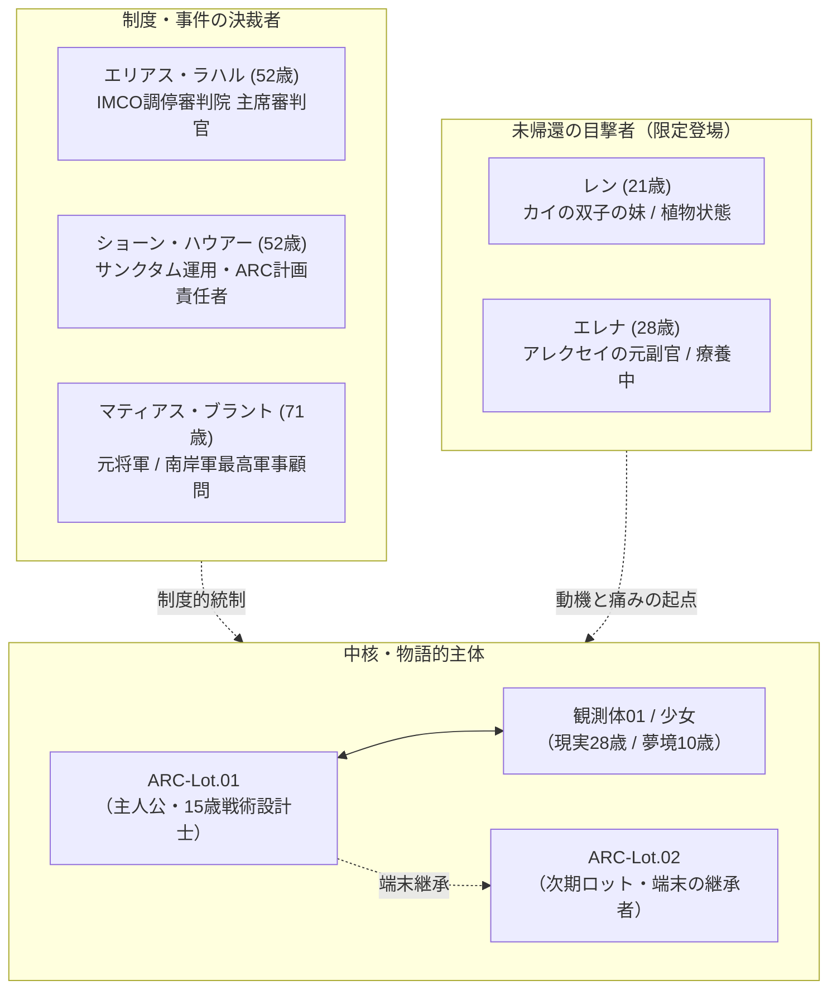

# 05 ストーリーキャスト・NPC・キーパーソン

本資料は、本作のメインストーリーを駆動する非プレイアブルキャラクター（物語専用NPC）、制度決裁者、および事件関係者の正史プロフィールをまとめる。現行設定で未規定の医療処遇・制度権限は07の課題台帳に記録する。

---

## 1. キャスト構造と機能的階層

本作のストーリーキャストは、スマートフォンゲームのプレイアブル名簿（20名）と混同されないよう、以下の**3つの物語機能階層**に明確に分類される。

---

## 2. 主人公および中核人物

### 2.1 ARC-Lot.01 (アーク・ロット・ゼロワン)
- **役割:** メインストーリー第1期の主人公 ／ 初代戦術設計士
- **属性:** 男性、満15歳相当（外見15歳）
- **外見と視覚記号:**
  - 小柄で華奢な少年兵の体躯と、成人規格の重厚な作戦卓・椅子の痛切な対比。
  - 身長に対して丈が余る施設支給の灰白色ジャンパー、まくった袖口から覗く細い手首。
  - 胸ポケットに差した生体診断ペン、首筋の神経同調端子。
- **背景と内面:**
  - 2044年4月に培養槽で促成培養（約3.5倍速）が開始され、2048年からの2年間の託児所寮生活を経て、2050年春に初出荷された第1期生。
  - 1日14時間の盤面訓練と戦術チェスを叩き込まれた直観演算の天才。
  - 感情表現は平坦で静かだが、託児所に残してきた弟たち（Lot.02以降）に対する深い兄としての愛情と責任感を抱く。
- **運命と結末:**
  - 高次因果演算による大脳新皮質熱損傷（ニューラル・バーンアウト）により、標準的な高負荷稼働は約100日前後で限界を迎える。不可逆損傷後の昏睡・機能停止・死亡の転帰は一律に定めない。
  - 自らの死期を悟ったLot.01は、少女の紫線が刻まれた端末「TIS-Aegis」の深層ローカルパーティションに、弟へ向けた独自暗号の手記を遺す。

### 2.2 観測体01／少女 (Subject-01 / The Slumbering Girl)
- **役割:** 因果の特異点 ／ 夢境の基底観測者
- **属性:** 現実世界の実年齢：**28歳** ／ 夢境内の外見：**10歳**
- **外見と視覚記号:**
  - **現実（サンクタム内）：** 生命維持ポッドに横たわる28歳の成人の身体。長期昏睡と生命維持管理による筋力低下があり、長い黒髪と全身の計測電極が十数年の拘束を示す。
  - **夢境（因果空間内）：** 丈の合わない薄青の療養着、大人の大きな軍用コート（2037年奪取作戦時の遺留品）。右手には短く擦り切れた紫色のクレヨン。
- **動機と加害の意志:**
  - 世界に救済を求める憐れなマスコットではない。
  - 同意なく十数年にわたり自らの無意識を国際紛争の代理盤面として搾取し続ける人類に対し、静かで冷徹な復讐を行う。
  - 現行CASEの承認署名ログに載った責任者を識別し、微細な確率の綻び（整備不良など）を傾けて破滅へと追い込む。
- **主人公との関係の変遷:**
  - 当初は主人公も「大人たちが送り込んできた使い捨ての部品」として冷淡に見つめるが、自らの命を燃やして弟たちへ真実を遺そうとするLot.01の姿に、徐々に憐憫と哀悼の念を抱くようになる。

### 2.3 ARC-Lot.02 (アーク・ロット・ゼロツー)
- **役割:** 次期ロット ／ 主人公の弟（第2期主人公）
- **属性:** 男性、満14〜15歳相当（外見15歳）
- **機能とフック:**
  - Lot.01の退役（バーンアウト）に伴い、後任として現場へ出荷されるクローン弟。
  - 兄から初期化されて引き継がれた端末「TIS-Aegis」の画面に残る未分類描画ノイズ（紫の擦過痕）に気づく。
  - 託児所の寮生活で兄と指し合った戦術チェスの変形記譜法を手がかりに、兄の暗号手記を解読し、世界と機構に対する静かな抵抗を引き継ぐ。

---

## 3. 制度・事件の決裁者たち

### 3.1 独立審判官エリアス・ラハル (Chief Adjudicator Elias Rahal)
- **役割:** IMCO調停審判院（Tribunal System）主席審判官
- **属性:** 男性、52歳
- **外見と視覚記号:**
  - 飾り気のない濃紺の丈の長い上着、整えられた白髪混じりの髭。
  - 紙面のような質感を持つ電子判定簿（Decision Ledger）、装飾のない純銀の認証公印。
- **職務と中立性:**
  - CASEの事前登録条件、交戦規定、および盤面ログを厳密に照合し、勝敗判定公文書を全世界へ公告する最高責任者。
  - 競技勢力（ATFやAEC等）から完全に独立した立場にあり、いかなる勢力にも味方しない。
  - ヴェラの上司ではなく、AECの部隊指揮権も持たない。判定結果のみを冷徹に下す「法の執行人」。

### 3.2 ショーン・ハウアー (Sean Hauer)
- **役割:** IMCOサンクタム最高運用責任者 兼 第7育成特区管理官
- **属性:** 男性、52歳
- **外見と視覚記号:**
  - 皺ひとつない淡灰色の施設管理服、胸元に光る三等級生体認証タグ。
  - 常に手元で生体テレメトリーを監視する冷たい薄型承認端末。
- **権限と性格:**
  - 少女の収容ポッド「サンクタム」の維持運用、および「ARC計画」の全決裁権を握る官僚科学者。
  - クローン設計士の出荷・配備・退役を決裁する。不可逆損傷後の医療処遇は症例ごとに異なり、機構が一律に生体廃棄する設定にはしない。
  - 施設側の事故記録・公表範囲に関する最終決定者。AECは現場監査と証拠保全を担い、診断や医療処遇を決めない。ショーンの決裁がどこまで正当化されるかは物語上の争点として残す。

### 3.3 マティアス・ブラント (Matthias Brant)
- **役割:** 南岸共和国 国防最高評議会顧問（元陸軍大将）
- **属性:** 男性、71歳
- **外見と視覚記号:**
  - 威圧的な長身、切り揃えられた白髪と深い皺。
  - 濃灰色の最高級民間ウールコート、胸元に隠すように佩用された過去の軍功章。
- **事件との因果:**
  - 2037年、某国軍司令官として「観測体01強奪作戦」を立案・指揮した。作戦中の生命維持装置停止や各地の事故との因果関係は確認されておらず、42秒事件の超常的な原因を知る人物とは定めない。
  - CASE 4092-Bにおいて、南岸軍の「ヴェルナ海峡防衛配備計画および交戦規定認可書」の**最高承認責任者として提出書類に電子署名を行っていた**。
  - CASE 4092-Bの承認署名が現行ログに残り、少女の因果偏向の対象となる。数週間後、搭乗ヘリの事故で重傷を負うが生存する。整備不良は事故調査の暫定所見であり、因果偏向との関係は作中人物にも確定できない。療養中は顧問職を離れ、政治的影響力を失う。

---

## 4. 未帰還の因果を背負う限定登場人物

### 4.1 レン (Ren)
- **役割:** カイの双子の妹 ／ 深層未帰還患者
- **属性:** 女性、21歳（事故当時18歳）
- **外見と登場形式:**
  - **現実:** スラムの非正規療養所のベッドで、生命維持モニターに繋がれ静かに眠り続ける遷延性意識障害患者。
  - **過去写真:** カイとお揃いの古着のレザージャケット、二人で半分ずつ持っていた壊れた方位磁針。
  - **夢境の残滓:** 深層領域に焼き付いた断片的な記憶テレメトリー。自律した人格や会話能力は持たず、特定の場所で短い環境ノイズや光の残像として揺らめくのみ。
- **物語上の機能:**
  - カイの暴走と執着の動機であり、「未帰還の現実は元には戻らない」という本作の厳しい規律を提示する存在。

### 4.2 元副官エレナ (Elena)
- **役割:** アレクセイの元副官 ／ ATF未帰還者
- **属性:** 女性、28歳（事故当時26歳）
- **外見と登場形式:**
  - **現実:** ATF提携の民間神経リハビリ病院で療養中。短い黒髪、穏やかな寝顔、生命維持装置。
  - **写真:** 数年前の作戦卓の前でアレクセイの隣で笑う、擦り切れた古いATF部隊腕章をつけた姿。
  - **登場制約:**
    - 本編では「アレクセイによる一度の病棟訪問」または「執務机に置かれた1枚の写真」のみに登場を限定。
    - 夢境内に記憶の痕跡は残っておらず、レンのような深層フックは与えない。アレクセイが背負う現場指揮官の痛切な責任を象徴する。
