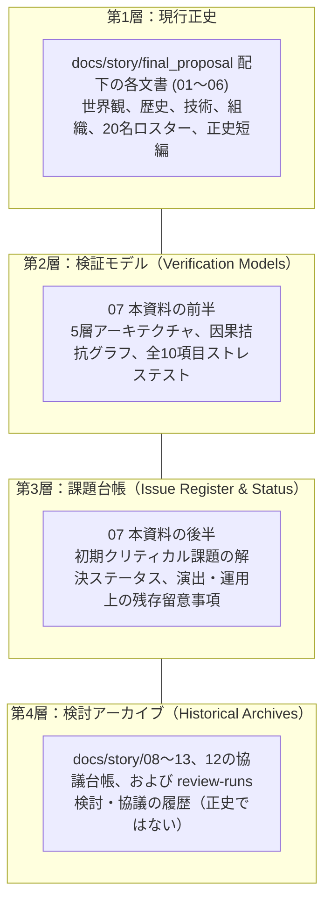

# 07 世界観整合性検証・課題台帳・協業ガイド

本資料は、現行正史の世界観モデル、ストレステスト、および設定上の未規定事項をまとめる。以下の判定は文書内の整合性点検であり、世界観上の「破綻なし」や、あらゆる将来展開での問題解消を保証するものではない。

---

## 1. 資料の4層ドキュメント管理体系

今後の制作・執筆において資料の権威関係と役割を混同しないため、以下の**4層ドキュメント管理体系**を適用する。

---

## 2. システムアーキテクチャと因果拮抗モデル

### 2.1 5層構造アーキテクチャ
本作の世界は、以下の5つの階層が厳密な因果結合ルールによって連動している。

| 階層 | 名称 | 構成要素 | 主たるリスク・法則 |
| :---: | :--- | :--- | :--- |
| **Layer 5** | **現実・巨視的社会層** | 国家政府、条約機構、民間企業、市民社会、市場為替 | 外交的遅延、議会での予算否決、世論の反発、政変の余地 |
| **Layer 4** | **現実・前線インフラ層** | 潜行施設、生命維持ポッド、通信基地、軍事機材 | 整備不良、金属疲労、部品ショート等の低確率事象 |
| **Layer 3** | **中継・同期技術層** | 神経同調器（Synchro-Drive）、戦術端末TIS-Aegis | 同期ノイズ、大脳新皮質熱損傷（バーンアウト）、未帰還 |
| **Layer 2** | **夢境・戦術作戦層** | 4X盤面、多勢力対戦、中立インフラ、Capacity | 継戦限界（Capacity）減算、独立審判院による勝敗判定 |
| **Layer 1** | **因果基底・無意識層** | 観測体01（少女）、全球因果アンカー、紫のクレヨン | 署名ログ導線による因果照準、BMAD（基盤崩壊リスク） |

---

## 3. 全10項目 ストレステスト再評価表

旧資料（`07`）の「全項目安全・破綻なし」という根拠なき断定を改め、協議台帳（`12`）の合意に基づき、各項目の**前提条件・作中制約・反証状況**を明記した。

| No | 検証項目（抜け道・ストレステスト） | 判定 | 作中ルールと前提条件（破綻を防ぐ制約） |
| :---: | :--- | :---: | :--- |
| **01** | **観測体01を暗殺すれば調停を無効化できるか？** | **極めて高リスク** | 心停止時に受動的基盤崩壊が起こるというモデルがあり、文明崩壊は最悪ケースの予測。確定した物理法則ではなく、各国が暗殺を避ける強い抑止要因として働く。 |
| **02** | **敗北国が夢境の判決を無視して現実戦争を起こせるか？** | **抵抗可能／長期維持は困難** | CASEが固定するのは争われた権利の帰属。署名拒否、遅延、局地的抵抗は可能で、収束は即時の服従を保証しない。4092-B案では、既存の予算動議や補給負担などが数週間の政治手続きを経て撤退判断につながる。 |
| **03** | **複数勢力が結託して別勢力を狙えるか？** | **可能** | 盤面上の連携は可能。勝敗は事前登録条件により独立審判系が判定する。AECの保全目標は別個の任務評価であり、連携や勝敗を自動的に無効化しない。 |
| **04** | **設計士の脳が不可逆損傷を負った場合、交代できるか？** | **制度上は可能／即時交代は未確定** | ARCの次期育成個体は存在するが、稼働限界・医療処遇・引継ぎ時期は一律ではない。約100日は高負荷稼働の目安で、寿命とは区別する。 |
| **05** | **通信回線を切断して敵の遠隔潜行を妨害できるか？** | **戦術内** | 局所ドローンリンク等の切断は戦術として有効。ただしIMCO審判院への基幹公文書回線は多重冗長化されており、勝敗の公告そのものは妨害できない。 |
| **06** | **作戦余力（Capacity）を無限に買い足して勝てるか？** | **CASE登録ルール次第（未確定）** | Capacityは国家の継戦能力予測を盤面資源に写した指標。初期値・更新式・CASE中の補充可否は事前登録ルールで定める必要があり、担保資産が物理エネルギーに変換される仕組みではない。 |
| **07** | **少女の紫線は試合中に敵を即死させられるか？** | **不可** | 少女は試合終了まで盤面ユニット・勝敗に一切干渉できない。紫線は「現実側で破滅させる標的への因果の照準」であり、現行CASE承認署名ログに載った人物の低確率事故を傾けるのみ。 |
| **08** | **未帰還事故の隠蔽は世間に露見しないか？** | **隠蔽を試みる／露見リスクあり** | IMCO施設側が記録を管理し、AECが監査・証拠保全に関与する。補償や情報統制は隠蔽を試みる手段であり、常に成功する保証はない。 |
| **09** | **ARC設計士が集団抵抗する可能性は？** | **未評価** | 短い運用期間だけでは抵抗の可能性を排除できない。施設管理、移動・通信制限、教育環境、兄弟間の連帯を設定し、反乱をどう抑えるのかを別途検討する。 |
| **10** | **後任のLot.02は兄の暗号をどう解くか？** | **手掛かりは成立／本人限定性は要補強** | 紫線が端末上のポインタとなり、共有したチェス記譜法や兄の言い回しが解読の手掛かりになる。端末を後任が受け取る理由はあるが、なぜ他の兄弟や監査官が解けないのかは確定していない。 |

---

## 4. 初期課題メモ（旧08）の解決ステータス台帳

初期検討文書（`docs/story/08`）で提起された5項目について、現行正史での扱いと、追加設定時に判断が必要な事項を分けて記録する。

| 課題ID | 初期指摘の論点（課題メモ08） | 反映・解決状況（現行仕様） | 残存ステータス |
| :---: | :--- | :--- | :---: |
| **ISSUE-01** | **少女の全能化・ご都合主義** （42秒事件の観測と原因説明の混同） | 通常時の低確率偏向と心停止時のBMADモデルを区別。42秒事件の事故原因は未確定とし、各国の恐怖・解釈と分ける。 | **【現行正史に反映済み】** |
| **ISSUE-02** | **主人公の無傷・安全の欺瞞** （設計士の接続リスクと交代条件） | 非接地接続は直接侵蝕を減らすが、免疫ではない。高次演算負荷による不可逆損傷を設け、100日は運用上の目安とする。 | **【損傷ルールは正史設定済み／臨床転帰は未規定】** |
| **ISSUE-03** | **三つ巴（3勢力）の硬直性** （常に3勢力という固定観念の不自然さ） | 2〜4勢力を基本枠とし、4092-BはATF・V-TAC・AECの一例とする。南岸政府と代理組織の関係を明記。 | **【枠組みは正史設定済み／個別CASE条件は別途登録】** |
| **ISSUE-04** | **国家と組織の権限矛盾** （契約派遣・ARC配属・AECの権限） | 国家の契約派遣とIMCOのARC配属を分離。AECの保全任務と独立判定を分離し、隠蔽の決裁者を施設側に置く。 | **【権限分担は正史設定済み／具体的配属人数は個別設定】** |
| **ISSUE-05** | **スマートフォンゲーム運用との乖離** （ロスターと自由編成の整合） | 20名（男性4・女性16、女性18〜29歳）の設計プールと非正史模擬戦を設定。サービス初日の人数・入手方式は運営判断として保留。 | **【設計プール承認済み／運営仕様は未決定】** |

---

## 5. 今後のシナリオ・UI・運営実装ガイドライン

### 5.1 シナリオ・キャラクター執筆の規律
1. **未登録勢力（Zone-0）の出自描写:**
   - カイ、スリ、ニナの個別エピソードを執筆する際は、大掛かりな特殊設定（軍の超機密研究所からの脱走劇等）に安易に頼らないこと。
   - `03` に定義された「路地裏のジャンク機材」「捨てられた回線への寄生」という泥臭いスラムのリアリティの範囲内で描写すること。
2. **新能力・専用同期装置の増殖禁止:**
   - 新規キャラクターや新勢力を追加する際、少女由来の超常能力や、特定の個人だけが使える魔法のような同期装置を新設してはならない。戦術差は常に「潜行適性、訓練、組織モジュール、装備」で表現すること。
3. **未帰還の不可逆性の厳守:**
   - レンやエレナのような未帰還者を、都合よく目覚めさせたり救出するプロットを組まないこと。「失われた意識は戻らない」という痛切な現実が、アレクセイやカイの動機の背骨である。

### 5.2 ゲームUIおよび出撃画面の演出方針
1. **正史CASEモード（メインストーリー）：**
   - 出撃画面において、依頼国、契約組織、交戦規定、および中立保全インフラのステータスを軍用公文書スタイルで厳格に表示する。
   - プレイヤーは作戦卓を俯瞰する「ARC設計士（管制室）」の視点として固定され、画面端には冷却端子の排熱状態やCapacity残量が表示される。
2. **通常対戦・イベントモード（非正史模擬戦）：**
   - 20名のキャラクターを自由に混成編成（例：ATFのアレクセイとZone-0のスリを同部隊に配置）できる。
   - UIのヘッダーには「IMCO戦術シミュレーション・アーカイブ（MOCK-BATTLE）」等の表記を明示し、世界観上の正史調停とは区別された仮想演習であることをプレイヤーに視覚的に伝える。

### 5.3 継続運営（LiveOps）におけるロスター管理
- **性別比および年齢規律の維持:**
  - 将来的なシーズン追加で新規オペレーターを投入する場合も、「男性:女性 ＝ 2:8」の比率、および女性キャラクターの年齢「18〜29歳」の規律を基準として維持する。
- **実年齢28歳の少女の不可侵性:**
  - 観測体01（少女）は、いかなるイベントやガチャにおいてもプレイアブル化してはならない。彼女は盤面の外側に存在する世界の特異点であり続ける。

## 6. 現行正史で未規定の事項

以下は現行正史で意図的に詳細を定めていない事項である。物語やゲーム運用で必要になった時点で選択し、追加設定として該当文書へ反映する。ここに記載があることは、01〜07の正史としての効力を保留する意味ではない。

| ID | 未規定事項 | 現行正史で定めている範囲 | 追加設定時に決めること |
| :---: | :--- | :--- | :--- |
| **A** | CASEの判定方式 | 各CASEは事前登録条件に基づき独立審判される。Capacity 0、拠点占有、期限などを条件に含められる | 全CASE共通の判定手順、個別CASEの条件、同時達成時の優先順位 |
| **B** | Capacityの運用定義 | 国家の継戦能力を表す盤面指標 | 初期値、損耗・補充式、公表範囲と遅延、世論・財政との結び付き |
| **C** | ARCの配属単位 | 公平な中立配属という原則のみ | CASEごとの配属人数、非対称戦力がある場合の公平性、競合設計士の描写 |
| **D** | ARCのバーンアウト後 | 約100日は高負荷稼働の目安。転帰は個体差あり | 臨床転帰、長期療養の有無、IMCOの処遇。生体廃棄を既定にしない |
| **E** | Lot.02が暗号を解ける理由 | 端末の継承と共有した学習経験を手掛かりとする | 手記の保存箇所、監査範囲、なぜ後任が発見できるか。兄弟だけが解けるとするなら専用の鍵・手掛かり |
| **F** | CASE 4092-B後の政治過程 | 判決は確定、撤退・条約実務には遅延が残る | 撤退命令、予算動議、署名・批准の順序と各機関の権限 |
| **G** | 42秒事件とBMAD | 事故の観測と各国の解釈を区別 | どこまでを作中の観測事実として公開し、どの機序を仮説に留めるか |
| **H** | 20名のゲーム実装 | 第一段階の設計プール | Day 1人数、入手方式、レアリティ、追加配信計画（世界設定外） |
| **I** | 旧資料との優先関係 | `final_proposal` 01〜07が現行の統合正史。既存01〜13と協議記録は設定形成の履歴・参照資料として保持する | 旧資料を個別に更新する場合は別途作業し、現行正史との食い違いを解消する |
| **J** | 少女の現実身体と収容時期 | 28歳の成人の身体、夢境では10歳の姿 | 2032年の発見から成人の身体に至る経過、生命維持処置の開始時期・内容を年表に合わせる |

現行正史では、能力や政治制度が自動的に結論を保証する表現を避けている。未規定事項は必要な展開に応じて追加し、追加時には本台帳と本文を同時に更新する。
