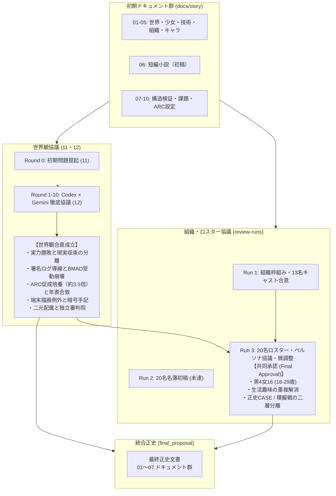

# ワールドバイブル統合正史

本書および本ディレクトリ配下の01〜07は、多チーム制リアルタイム4X対戦スマートフォンゲームの世界観、歴史、技術、組織、キャラクター、短編小説、および運用設計をまとめた**最終正史文書**である。`docs/story/final_proposal` を現行の統合設定として扱い、そこに明記のない事項は未規定として扱う。

本書は、初期設定、修正案協議、組織・ペルソナ・プレイアブル名簿のレビューを踏まえて整理した現行正史である。既存の `docs/story/01`〜`13` と協議・レビュー記録は変更せず、設定形成の履歴・参照資料として保持する。現行正史で未規定の事項は `07_世界観整合性検証・課題台帳・協業ガイド.md` に記録する。

---

## 1. トーン＆マナーの三原則

1. **清潔で冷徹な近未来官僚社会 × 現場の労働者のリアリティ**
   - 泥臭いポストアポカリプスや魔法ファンタジーではなく、極限まで合理化された近未来の企業・官僚・傭兵資本主義社会を描く。
   - 戦場に立つ潜行者（ダイバー）たちは超常の英雄ではなく、「他国の国境紛争のために戦わされる現場会社員・請負傭兵・研究員」としての疲弊、プロ意識、生活の体温を持つ。
2. **少女を単なる被害者やマスコットにしない**
   - 「観測体01」の少女は、同意なく十数年眠らされてきた被害者であると同時に、**自分を利用する世界に対して静かな報復（因果の偏向）を行う冷酷な執行者**である。
   - 性的・扇情的な演出やメルヘン調の甘い救済を完全に排除し、不可侵の因果の特異点として描く。
3. **ゲーム仕様と世界設定の整合**
   - 盤面上の継戦限界（Capacity）、アドオン、霧、多勢力対戦、盤面リセットを、世界設定上の制度・情報モデルと対応づける。説明が未確定の仕組みは07に明記する。
   - 世界観の厳格な制約（正史CASE）と、プレイヤーの自由な収集・編成・対戦体験（非正史模擬戦）を明確に二層分離し、双方の価値を損なわない。

---

## 2. ドキュメント体系とファイル構成

本ディレクトリ内の各ドキュメントは以下の役割を担う。相互整合の未解決点は07に記録する。

| ファイル | タイトル | 概要・統合範囲 |
| :--- | :--- | :--- |
| **[01_世界構造・因果律・歴史年表.md](01_世界構造・因果律・歴史年表.md)** | **世界構造・因果律・歴史年表** | 元資料と世界観協議を参照した世界法則・年表案。未確定の因果モデルは07に明記。 |
| **[02_技術・潜行システム・戦術設計士.md](02_技術・潜行システム・戦術設計士.md)** | **技術・潜行システム・戦術設計士** | 神経同調、Capacity、民間派遣とARC配属、ARCの育成・負荷、TIS-Aegisと端末継承の設定。 |
| **[03_組織・勢力と法的枠組み.md](03_組織・勢力と法的枠組み.md)** | **組織・勢力と法的枠組み** | 組織の法的位置づけ、六勢力の目的・参加条件・戦術・外観。元資料の組織名を保持。 |
| **[04_プレイアブル名簿・ペルソナバイブル.md](04_プレイアブル名簿・ペルソナバイブル.md)** | **プレイアブル名簿・ペルソナバイブル** | 共同承認された20名の設計プール（男性4名・女性16名、女性18〜29歳）。Day 1の配信人数は未決定。 |
| **[05_ストーリーキャスト・NPC・キーパーソン.md](05_ストーリーキャスト・NPC・キーパーソン.md)** | **ストーリーキャスト・NPC・キーパーソン** | ARC-Lot.01、観測体01、判定・施設関係者、ブラント、未帰還患者の正史プロフィール。 |
| **[06_短編小説_境界線のクレヨン_改稿決定版.md](06_短編小説_境界線のクレヨン_改稿決定版.md)** | **短編小説：境界線のクレヨン** | 4092-Bを題材にした正史短編。バイパス制圧による実力勝利、AECの任務達成、独立判定、政治的余波を描く。 |
| **[07_世界観整合性検証・課題台帳・協業ガイド.md](07_世界観整合性検証・課題台帳・協業ガイド.md)** | **検証・課題台帳・協業ガイド** | 正史で確定したルールと、現行設定で未規定の事項を区別する。 |

---

## 3. 合意と統合の系譜

本書の形成に用いた検討・協議プロセスを以下に示す。これらは設定形成の履歴であり、現行正史の参照元・根拠記録として保持する。

---

## 4. 正史文書の取り扱い基準

- **正史の参照:** 物語・ゲーム設定の執筆では、本ディレクトリ内の01〜07を現行正史として参照します。記載のない事項は未規定であり、必要に応じて設定を追加します。
- **正史に沿った執筆:** キャラクターのセリフ、イベントシナリオ、フレーバーテキストは、各プロフィールとトーン＆マナーに準拠します。少女の万能化やキャラクター固有の説明されない超能力は避けます。
- **アート・グラフィックデザイナーへ**: 各勢力およびキャラクターのデザイン、Live2D、3Dモデル発注の際は、本書のシルエット・素材・配色パレットの規律を参照してください。勢力ごとの世界観的機能美と現場労働者の生活痕を最重要視してください。
- **ゲームプランナー・エンジニアへ**: ユニットスキル、編成画面UI、出撃演出を実装する際は、「正史CASE（ストーリーモード）」と「模擬戦（通常対戦・イベント）」の演出上の区分を明確に保持してください。
