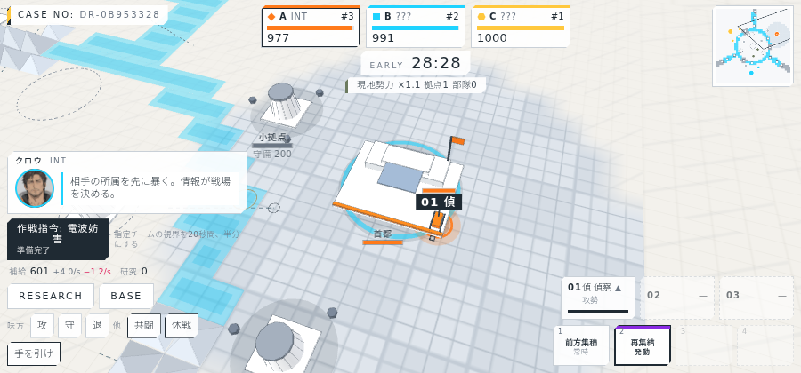

# 課題の洗い出しと修正レポート 2026-10-05

M1〜M2 と盤面の3D化までに判明していた課題を全て洗い出し、修正した。検証は typecheck、サーバーのヘッドレステスト(16件)、クライアントのビルド、実サーバー(10倍速)での headless Chrome 撮影(`docs/screens/`)で行った。

## 洗い出しの方法

- 各担当の報告に残っていた「既知の制限」を集約。
- 未検証だった「試合中のリロード復帰」「連戦」を実サーバーで実際に操作して確認。この過程で、リロード後に自動再接続しない不具合を新たに発見した。
- 全ボット戦のシミュレーションでチケットの推移を4つの seed で計測し、バランスの問題を数値で確認。

## 修正一覧

### 不具合

| # | 課題 | 修正 | 検証 |
| --- | --- | --- | --- |
| 1 | 試合中にリロードするとタイトルに戻り、ボタンを押すまで再接続しない | 保存済みの名前と playerId があれば起動時に自動接続し、サーバーが試合中なら試合へ、そうでなければロビーへ。切断中は HUD に「再接続中」バナー | 実サーバーでリロード後に同じ CASE NO の試合へ復帰(`08b_match_resume.png`) |
| 2 | チケットの減りが厳しく、ボット戦で複数チームが終盤に0になる | 減少式を「他チームの合計との差」から「他チームの平均との差(上限3)」に変更。ボットの退避/復帰のしきい値も調整 | 4 seed の全ボット戦で0のチームなし、1位は465〜702残。何もしないチームは21〜25分で0または脱落。テスト追加 |
| 3 | 試合が無効になったとき、消費した使い切りアドオンが戻らない | 人間全員が切断して60秒(開始3分以内なら即)で試合を無効化し、報酬なし・在庫を返却。再接続時はロビーへ | テスト追加。WS で切断→再接続で在庫が戻ることを確認 |
| 4 | 中規模拠点3つ分の予告・出現イベントで同文トーストが3連続 | サーバーは予告を tier ごとに1件に。クライアントは同文トーストを6秒以内なら1件にまとめる | テスト追加、モックで確認 |
| 5 | 放置判定が試合の内部時間基準で、倍速時に早すぎる | 実時間(Date.now)基準に変更 | テスト追加 |
| 6 | 画面端のラベル(「中規模拠点 出現」など)が切れて見える。トーストとも重なる | ビューポート端にかかるラベル、トーストとカットインの矩形に入るラベルを非表示 | 撮影で確認 |
| 7 | SOC の指導者ポートレートが落書き部分だけで顔が入らない | 文明ごとに切り抜き位置を指定 | 選択画面で6人とも顔が入る(`07_pick.png`) |
| 8 | 日替わり判定が UTC | 日本時間(+9h)で切り替え。オフセットは shared の定数 | テスト更新 |
| 8b | 部隊トークンのタグとHPバーが重なる(ユーザー指摘) | ラベルの子要素ごとに「自分の高さ分」上にずらしていたため、背の高いタグだけ大きく動いてバーに重なっていた。親要素を基準に下端をアンカーする方式に変更 | 2倍スケールの拡大キャプチャで確認(`08c_label_closeup_2x.png`) |

### 仕様の明確化・整理

| # | 課題 | 修正 |
| --- | --- | --- |
| 9 | 複数人チームで拠点の収入の帰属が曖昧 | 収入は拠点の所有プレイヤーへ(首都=建てた人、制圧拠点=制圧した人)。1人チームでは挙動不変。テスト追加 |
| 10 | 初期在庫・称号・レート定数がサーバー内に散在、レート定数が重複 | shared の meta.ts に統一。リザルトに称号獲得を表示 |
| 11 | DESIGN.md が実装とずれていた(脱落条件、首都そばの回復、予告の集約など) | 実装どおりに更新し、M2 の節を追加 |
| 12 | 試合中の不正操作のエラー文言が英語 | 日本語に |

### 改善

| # | 課題 | 修正 |
| --- | --- | --- |
| 13 | ポートレート画像が1枚2〜3MB | headless Chrome で幅512pxに縮小。合計 13.4MB → 3.0MB。元画像は `artwork/` に残る |
| 14 | コールサインを変える手段がない | ロビーのプロフィール帯で編集 |
| 15 | 実機の性能を測る手段がない | `?fps=1` で fps・フレーム時間・描画コール数・三角形数を表示。README に記載 |
| 16 | 縦持ちオーバーレイが resize だけで判定 | orientation のメディアクエリ、orientationchange、visualViewport でも判定 |
| 17 | 探索済みで見えていない拠点が現在の状態に見える | ラベルを薄くして「最終確認」表示 |

## 残っている制限(修正しない判断)

- 水路・ブロックは装飾のみで当たり判定なし(企画書の「自由行軍」を優先。障害物の導入はマップ設計と合わせて決める)。
- 霧は床に重ねた平面1枚のため、未探索の拠点は模型を出さず図面上の点線で表す(背の高い模型が霧を突き抜けるのを避けるため)。
- ラベルの非表示は矩形判定のみで、部隊が密集したときのラベル同士の重なりは残る。
- 選択画面に味方の選択状況は出していない(現在は1人チームのため)。
- 休戦などの他チームへの合図はゲーム上の拘束力を持たない(企画どおり)。
- 実機の fps は未計測。`?fps=1` で測れる。

## 検証結果

| 項目 | 結果 |
| --- | --- |
| typecheck(shared / server / client) | 成功 |
| サーバーのテスト | 16件すべて成功(バランス、無効化と返却、収入の帰属、予告の集約、称号、永続化) |
| クライアントのビルド | 成功 |
| 実サーバーでの撮影 | 19枚(`docs/screens/`)。リロード復帰の画面を追加 |

## 画面(抜粋)

部隊ラベルの拡大(2倍スケール)。タグの上にHPバーが独立して並ぶ。

リロード後の復帰。同じ CASE NO の試合に戻っている。

選択画面。6人とも顔が入ったポートレート。

リザルト。称号獲得の表示。

