# 進捗報告 2026-10-05: M1(試合コア)+ M2(メタ要素)+ 盤面の3D化

実サーバー(10倍速)に headless Chrome で接続して撮影した画面。横持ちスマホ相当(900×420)。再撮影の手順は `tools/capture/README.md`。

## 状態

| 項目 | 状態 |
| --- | --- |
| typecheck(shared / server / client) | 成功 |
| サーバーのヘッドレステスト | 8件すべて成功 |
| クライアントのビルド | 成功(JS 約560KB、gzip 約153KB。Three.js 込み) |
| 実サーバーでの通し確認 | タイトル→ロビー→選択→試合→リザルト(報酬付き)まで確認 |

## 画面

### 1. タイトル

イラストなしの公文書風パネル1枚。コールサインを入れて「ゲストで潜行」。playerId はブラウザに保存され、次回も同じプロフィールに戻る。

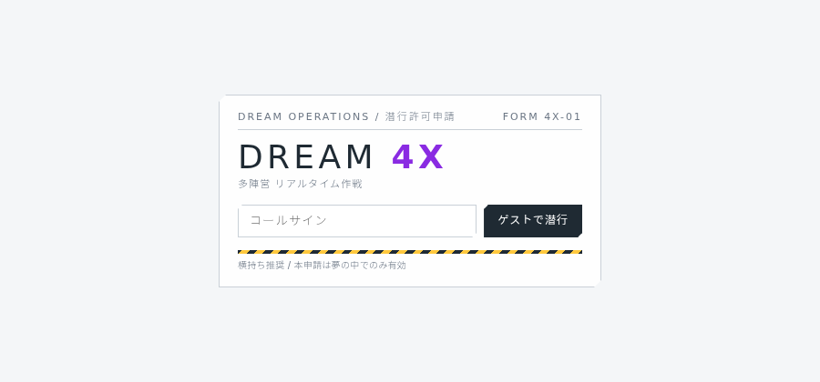

### 2. ロビー(待機)

上段にプロフィール(名前・レート・試合数/勝利数・パス段階)。「キューに入る」で待機、「ボットで今すぐ開始」は開発用。

### 3. ロビー(文明研究)

6文明のレベルとXP。試合ごとに使った文明へXPが入り、レベルで永続アドオンと物語の断章が開放される。

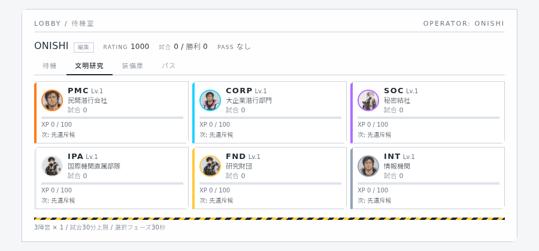

文明を開くと、開放済み永続アドオンと物語の断章(未開放は「—」)。

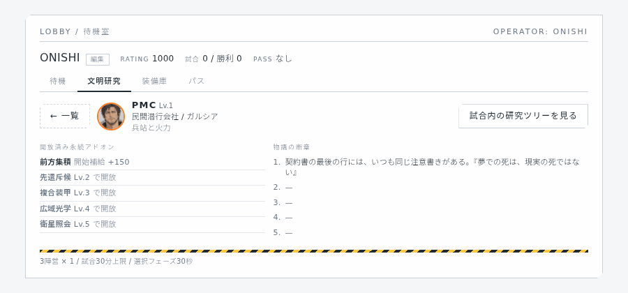

### 4. ロビー(装備庫・パス)

使い切りアドオンの在庫(種類ごと上限10)と、今日のドロップ残り。パスは開発用に切り替え可能で、変わるのは1試合のドロップ数と1日の上限だけ(確率は変えない)。

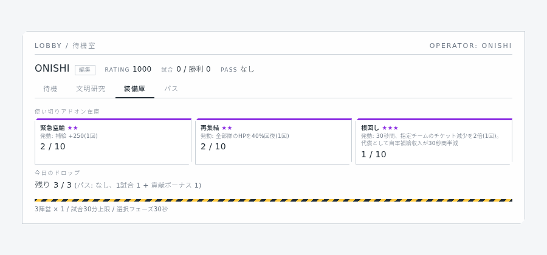

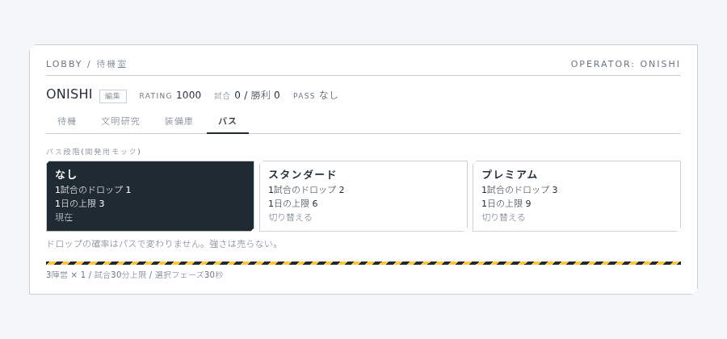

### 5. 文明・アドオン選択(30秒)

文明カード6枚とアドオン4枠(使い切りは2枠まで)。未開放の永続アドオンは開放レベルを表示してロック、使い切りは在庫を表示。サーバー側でも同じ検証を行う。

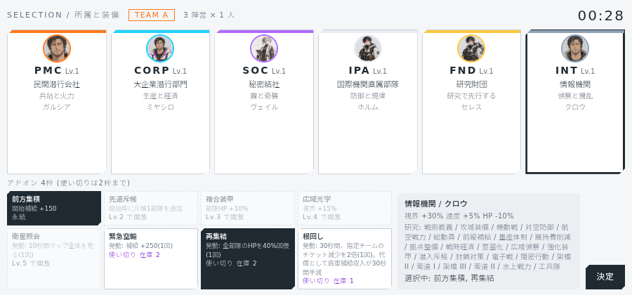

### 6. 試合HUD(序盤)

上: CASE NO / 3チームのチケットバー(色+シンボル、判明した所属、暫定順位)/ 残り時間とフェーズ / ミニマップ。左下: 指導者の通信窓と無線字幕、補給と研究ポイント、RESEARCH/BASE、合図。右下: 部隊 01〜03 とアドオン4枠。

盤面は Three.js(WebGL)の3D。斜め見下ろしのカメラで、スレート色のタイル床、半透明シアンの水路、低ポリの模型(首都=台座+庁舎+チーム色の旗、小拠点=冷却塔、中規模=コンテナ+クレーン、大拠点=水門)。部隊は発光するベースプレートに乗ったトークン(強襲=多脚、斥候=ドローン、攻城=砲身付き)。霧は製図用紙のテクスチャで、未探索は不透明、探索済みで見えていない範囲は半透明。モバイル向けに影なし・pixelRatio 上限2・模型の差分更新で軽くしている。

### 7. 部隊の移動(ドラッグ&ドロップ)

部隊トークンか右下のチップを目的地へドラッグ。ドラッグ中は破線と十字マーカーを表示し、離した地点へ行軍する。

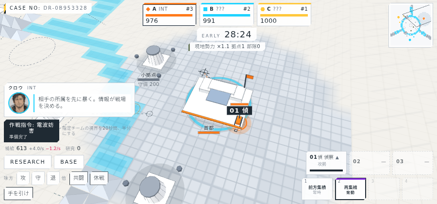

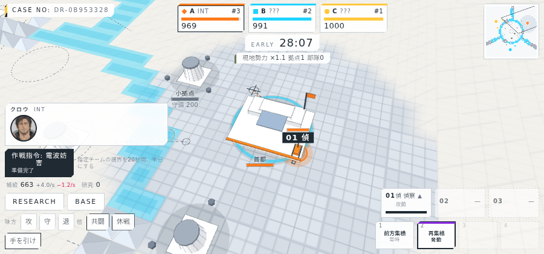

### 8. 部隊の移動(目的地を先に指定)

盤面をタップすると目的地マーカーとヒントが出る。続けて部隊トークンかチップをタップすると、その部隊がマーカーへ向かう。複数の部隊を順にタップして同じ目的地へ送れる。

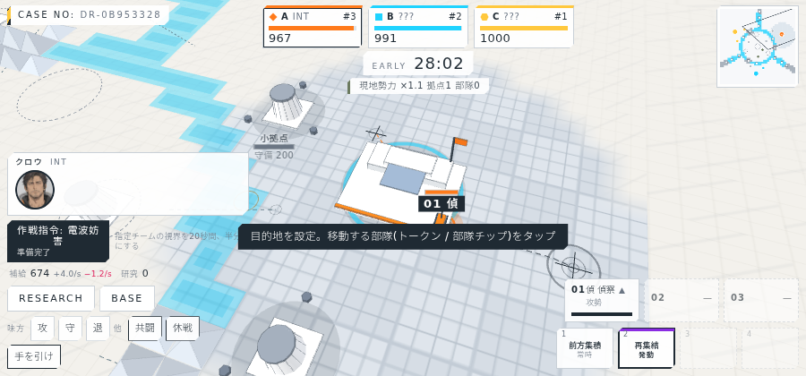

### 9. 研究パネル / 生産パネル

研究は文明ごとに2分岐×3段。資源は係争地(小・中・大拠点)でしか手に入らない。生産は強襲/斥候/攻城で、攻城は研究で開放。

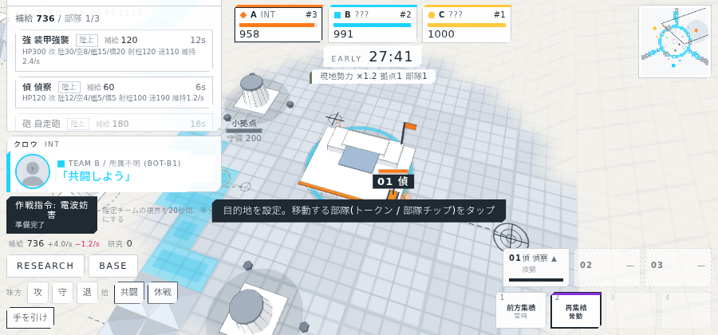

### 10. 合図

他チームへは「共闘/休戦/手を引け」の定型合図のみ。送信先チームを選ぶ。送信後は指導者が無線で一言。

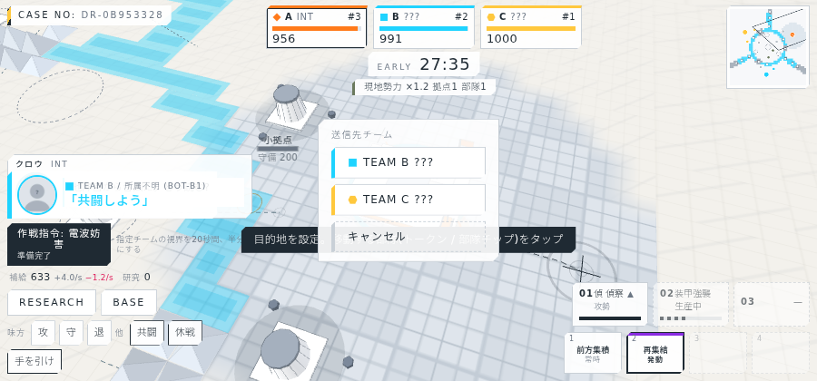

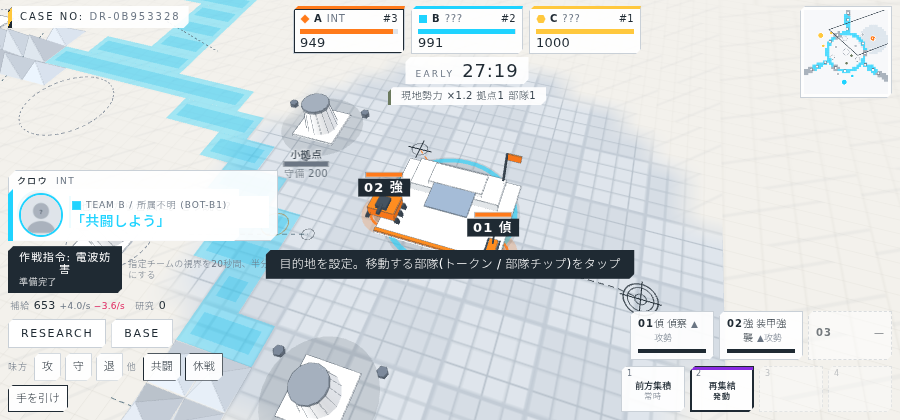

### 11. 中盤・終盤

中盤に中規模拠点、終盤に中央の大拠点が予告付きで出現。終盤はチケットの減りが2倍になり、画面の四隅から紫のクレヨン線が侵蝕する。

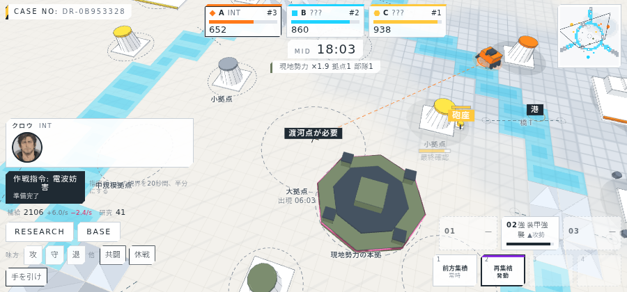

### 12. リザルト(戦闘詳報)

順位、チケット、分野別スコア(制圧/チケット削り/NPC討伐/撃破/損失)、MVP、レート変動。報酬欄に文明XPとレベル、開放された永続アドオン、ドロップ、今日の残り。レベルが上がった試合は物語の断章も表示する。

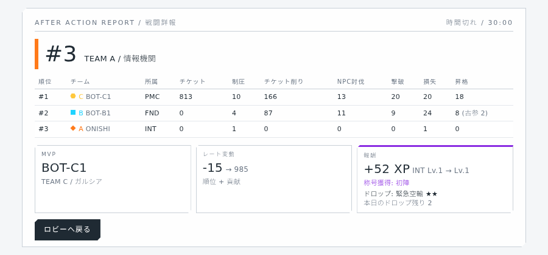

## 課題

課題の洗い出しと修正は `課題修正レポート_2026-10-05.md` にまとめた。残っている制限もそこに記載。
