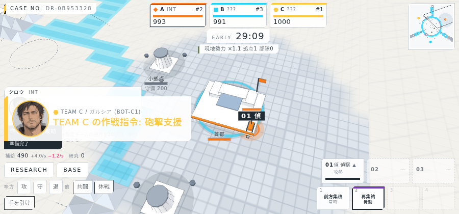
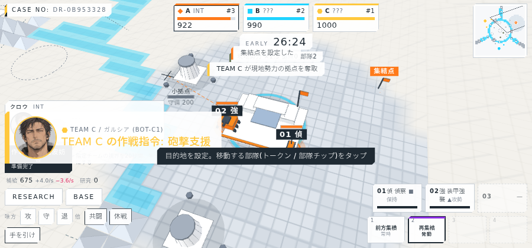
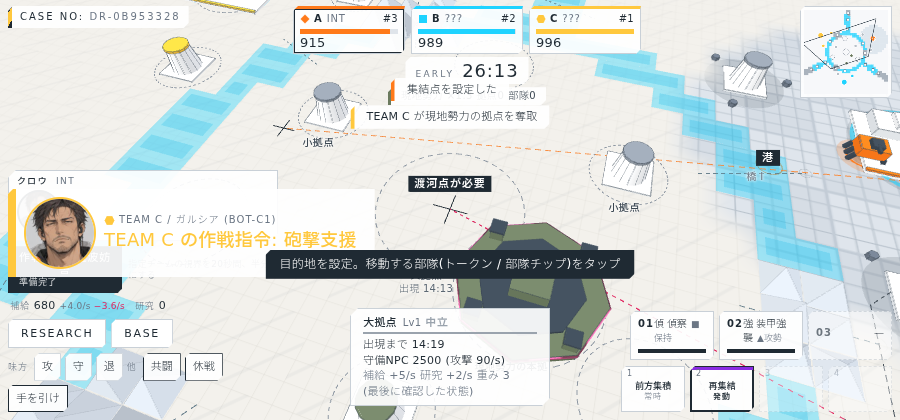
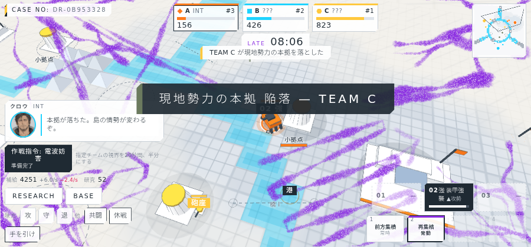

# 進捗報告 M3: 地形と渡河点(川・山・橋・索道)2026-10-05

提案「川や山は渡河点(橋・索道)を建てないと渡れない。渡河点は駐留拠点として奪取・破壊でき、所有チーム以外は通れない。建設には川幅・標高の等級ごとの研究が要る」を実装した。実サーバー(10倍速)に headless Chrome で接続して撮影。

## ルール(実装したもの)

| 項目 | 内容 |
| --- | --- |
| 地形 | 川(幅等級1〜3)と山(標高等級1〜2)。全員に既知の図面として常に見える。徘徊NPC(現地勢力)だけは地形を無視する |
| マップ | 中央の島を囲む環状の川(等級1)。陣営を区切る放射状の川(内側は等級2、外側は等級3)。環の上の山塊(索道I)と、境界の外端の山塊(索道II) |
| 渡河点 | 生成時に位置と等級が決まる予定地。各陣営に橋I・索道I、境界ごとに橋II・橋III・索道II |
| 建設 | 自部隊を端点に隣接させ、補給を払って建設。部隊が隣接している間だけ進む。橋Iは研究不要、他は工兵の研究(架橋II/III、索道I/II)が必要 |
| 通行 | 所有チームのみ。索道は攻城部隊が乗れない(首都攻めには橋が要る) |
| 奪取 | 敵は端点から射程内で渡河点のHPを削り、0で奪取(所有が移り、旧所有者は通れなくなる) |
| 解体 | 所有チームは解体でき、数秒後に予定地へ戻る。解体中に奪取されると中止 |
| 研究資源 | 自陣の小拠点は研究収入が3割。中央の島の拠点だけが本格的に出す(渡らないと研究が進まない) |
| 経路 | 部隊は格子のA*で経路を取り、到達不能なら最も近づける地点で待機。渡河点ができれば自動で進む |

## バランス計測(全ボット、4 seed)

| 項目 | 結果 |
| --- | --- |
| 橋Iの完成 | 2.1〜2.2分 |
| 初接触(相手の所属が判明) | 2.4分 |
| 渡河点の奪取 | 2/4 の試合で発生(7.2分、11.3分) |
| 首都陥落 | 1/4 の試合で発生(26.9分) |
| 終了時のチケット | 0のチームなし。1位は545〜734 |

初接触をさらに遅らせたい場合は、`packages/shared/src/config.ts` の `CROSSINGS.bridge1`(現在 補給200・90秒)を上げるか、橋Iにも研究を要求する。首都攻めが終盤に寄るようになり、陥落の頻度は下がった。

## 画面

### 序盤: 地形と予定地

環状の川(シアンの帯)と山塊、ミニマップにも川・山・渡河点。右上の「要: 架橋 II」は境界の橋IIの予定地で、研究が必要なことを示す。

### 渡河点の情報ポップ

予定地をタップすると等級・耐久・視界と「建設(補給 / 秒)」。満たしていない条件(研究、部隊の隣接、補給)を表示する。所有している渡河点には解体ボタン。

### 経路プレビュー

目的地を指定すると経路を描き、渡河点が無くて到達できない場合は赤の点線と「渡河点が必要」。

### 研究パネル(工兵の分岐)

作戦・防護に加えて工兵の列。架橋II/III、索道I/II。

### 終盤

## 検証

| 項目 | 結果 |
| --- | --- |
| typecheck | 成功 |
| サーバーのテスト | 23件すべて成功(マップ検証4 seed、建設・奪取・解体・索道の制限・NPCの直進を追加) |
| クライアントのビルド | 成功 |
| 実サーバーでの撮影 | 21枚(`docs/screens/`)。渡河点ポップと経路プレビューの手順を追加 |

## 既知の制限

- 山の標高等級は地形セルに持たせていないため、模型の高さは周囲の山セル数で決めている(等級は渡河点側に持つ)。
- 霧は床の平面1枚なので、川と山は未探索でも図面として見える(設計どおり)。
- 経路プレビューは選択中の部隊(無ければ01)の種別で計算する。目的地先指定の時点では送る部隊が未確定のため。
- 建設した部隊のプレイヤーは内部でのみ保持。クライアントの「建設者」表示は未対応。
- ボットは奪取した敵の渡河点を保持して使い、解体はしない。

## 動画

`docs/video/dream4x_match_2026-10-05.webm`(約3分、1280×600、約20fps、45MB)。10倍速の試合1本を、自分の席をAI代行に任せて収録したもの。選択画面から始まり、橋Iの建設、中央の島の制圧、中規模拠点の攻防、終盤の紫の侵蝕、リザルトまでが映る。カメラは6秒ごとに自部隊へ追従する。作り方は `tools/capture/README.md`。

動画で気づいた点(未修正):
- 補給と研究ポイントが終盤に大きく余る(補給1万超、研究3千超)。収入に対して部隊の生産上限と研究の総量が小さい。使い道(部隊の上限、追加の研究段、拠点の強化など)か収入の調整が必要。
