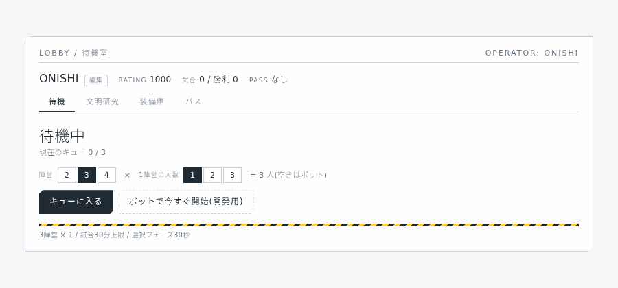
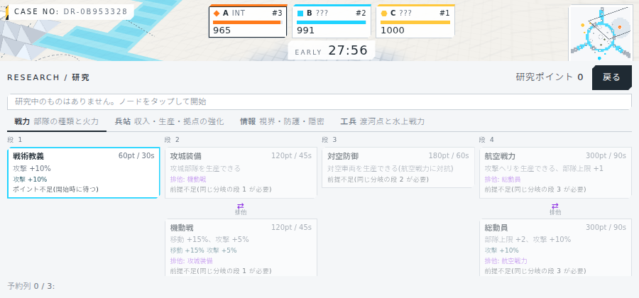
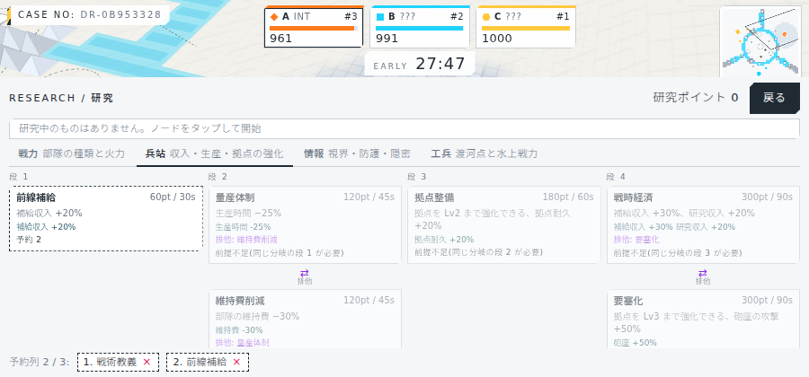
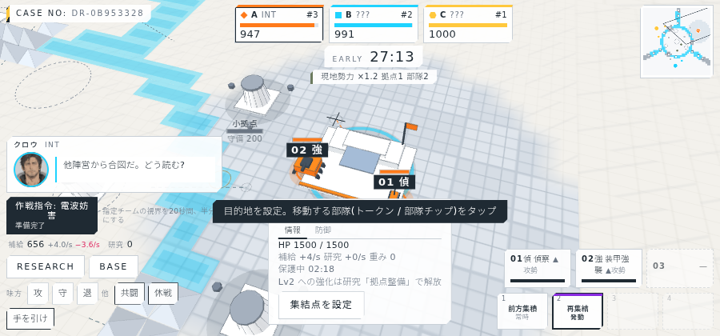
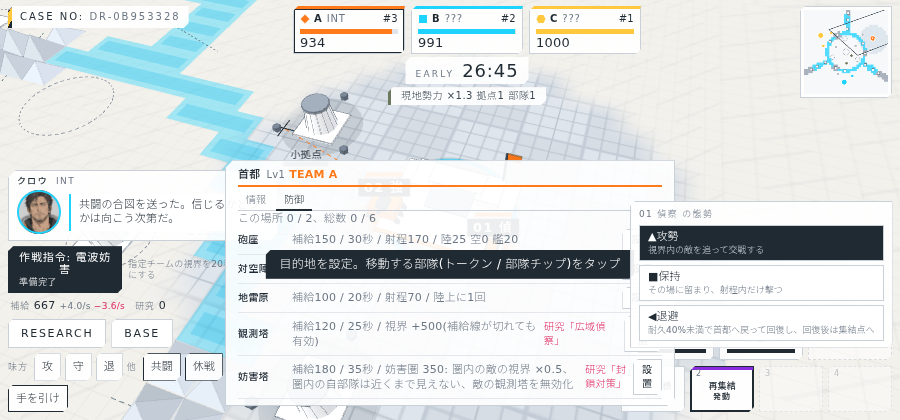
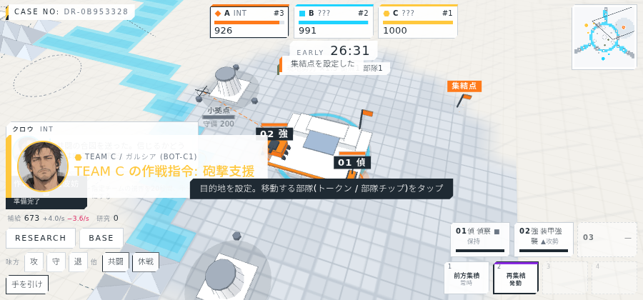

# 進捗報告 M4 段階1: 構成の可変、研究ツリーと研究画面、維持費と拠点強化、態勢と集結点、クレヨン描画 2026-10-05

実サーバー(10倍速)に headless Chrome で接続して撮影。画面は `screens/`、動画は `video/dream4x_m4_2026-10-05.webm`(約3分、AI代行で1試合)。

## 実装したもの

| 項目 | 内容 |
| --- | --- |
| 構成の可変 | 試合ごとに陣営数2〜4 × 1陣営の人数1〜3。ロビーで選び、同じ構成どうしでマッチ。マップ(放射状の川、渡河点、中規模拠点、自陣の小拠点)は陣営数と人数に合わせて生成。チケットはチーム合計のまま、部隊損失は人数で割る |
| 研究ツリー | 4分岐(戦力・兵站・情報・工兵)× 4段、文明ごとに名称と効果の一部を差し替え。段2と段4に排他の二択(例: 攻城装備 ⇄ 機動戦、航空戦力 ⇄ 総動員)。研究には時間がかかり、同時に1つ、予約列は3つまで |
| 研究画面 | HUD の RESEARCH から全画面へ遷移(試合は進行、上部にチケットと残り時間を残す)。分岐タブ、段ごとのカード、状態(研究済み/研究中/予約/可能/前提不足/排他)、予約の取り消し。ロビーの文明詳細からも閲覧できる |
| 維持費 | 部隊ごとに補給/秒の維持費(強襲2.4、斥候1.2、攻城3.6)。資源表示に「+収入 −維持費」 |
| 拠点の強化 | 所有拠点を補給で Lv2・Lv3 に強化(研究「拠点整備」「要塞化」で上限解放)。収入と耐久が上がり、Lv2 以上は砲座が射程内の敵を自動攻撃。制圧されると Lv1 に戻る |
| 態勢 | 部隊ごとに攻勢(視界内の敵を追う)/保持(その場で射程内だけ撃つ)/退避(耐久40%未満で首都へ戻り、回復後に集結点へ)。チップ長押しか部隊ポップで切替 |
| 集結点 | 首都ポップから盤面に設定。以後に生産した部隊が自動で向かう |
| クレヨン描画 | 紫の侵蝕を粒状スタンプの筆跡に作り直し。幅の揺らぎ・かすれ・縁の濃淡・紙目の抜け。記号は×印、曲げられた矢印、検閲線、塗りつぶしに限定 |
| 情報分岐の新効果 | 電子戦(5分ごとに10秒の全域可視)、隠密行動(非戦闘・停止中の部隊は敵が半分の距離まで近づかないと見えない) |

## バランス計測(全ボット、4 seed)

研究コストを3倍、研究収入を約1/3、維持費を4倍、強化コストを2倍に調整した後の値。

| 構成 | 終了時に0のチーム | 1位の残りチケット | 備考 |
| --- | --- | --- | --- |
| 3×1 | なし | 648〜778 | 部隊損失は維持費で減少(34〜76) |
| 2×1 | なし | 507〜586 | |
| 4×3 | 最大1 | 335〜773 | 人数で損失を割る前は全チーム0だった |

残る課題: 補給は中盤以降も余りやすい(段階2の航空・水上・対空の部隊種で吸収する前提)。研究は収入を下げたことで、平均的なプレイヤーは2分岐を段4まで、全分岐の制覇は難しい見込み。

## 画面

### ロビーの構成選択

### 研究画面

分岐タブと段1〜4。排他のペアは「⇄ 排他」で縦に並ぶ。予約列は下部。

### 拠点ポップ(強化・集結点)と資源の内訳

### 態勢の切替(チップの長押し)と集結点

### 終盤のクレヨン侵蝕

## 検証

| 項目 | 結果 |
| --- | --- |
| typecheck | 成功 |
| サーバーのテスト | 30件すべて成功(構成2×1/4×3/3×2のマップ検証、研究の前提・排他・予約列、維持費、強化と砲座、退避の往復、集結点を追加) |
| クライアントのビルド | 成功 |
| 実サーバーでの撮影 | 25枚(研究画面、強化、態勢、集結点の手順を追加)と動画1本 |

## 既知の制限

- 研究の「航空戦力」「対空防御」「水上戦力」は研究できるが、部隊種は段階2で追加するまで効果がない。
- 砲座の射撃エフェクトは未実装(模型のみ)。
- 収入の表示は概算(複数人チームの配分と係争地の係数を含まない)。
- 部隊セレクターは6枠固定の2段組み。
