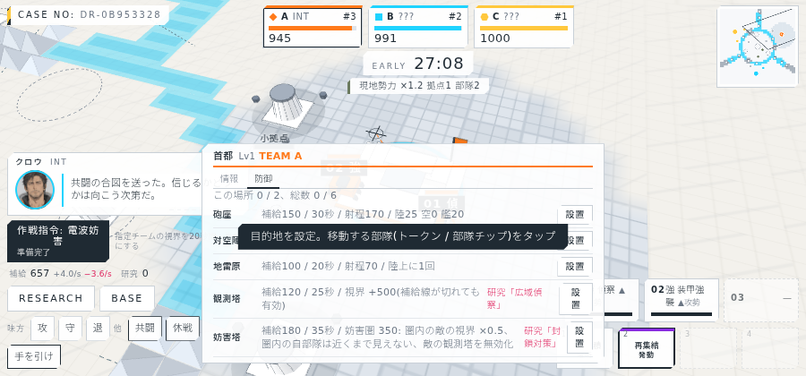
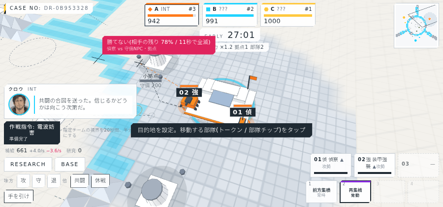
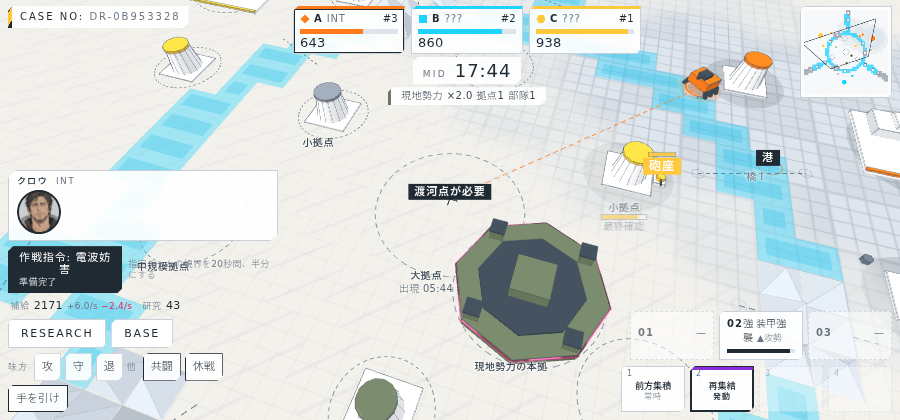

# 進捗報告 M4 段階2: 部隊種の拡張、防御施設、補給線、戦闘予測 2026-10-05

実サーバー(10倍速)に headless Chrome で接続して撮影。画面は `screens/`、動画は `video/dream4x_m4-2_2026-10-05.webm`(約3分、AI代行で1試合)。

## 実装したもの

| 項目 | 内容 |
| --- | --- |
| 部隊種(6種) | 装甲強襲・偵察・自走砲・対空車両(陸上)、攻撃ヘリ(航空)、哨戒艇(水上)。対象の種類(陸/空/艦/構造物)ごとの毎秒ダメージ行列で攻撃可否を表す |
| 領域ごとの移動 | 陸上は渡河点が必要。航空は地形を無視して直線。水上は川のセルだけを移動し、首都に最も近い川の岸(港)に出現 |
| 制圧の制限 | 拠点を制圧できるのは陸上のみ。航空・水上は拠点の耐久を削れるが所有は変わらない。水上が渡河点の耐久を0にすると予定地に戻る |
| 対空 | 対空車両・対空陣地は航空に大ダメージ。守備NPC・砲座・徘徊NPCは航空にも半分のダメージ |
| 防御施設 | 所有拠点・所有渡河点に砲座・対空陣地・地雷原を設置(1か所2つ、1人6つまで)。敵は施設を攻撃でき、アンカーを失うと消滅。地雷原は敵の陸上部隊が踏むと一撃で消滅し、所有チームにしか見えない |
| 補給線 | 所有者の首都から陸路(所有渡河点経由)でつながっていない拠点は収入半減・回復なし・砲座半減。橋を奪われると島の拠点が「補給線 断」になる |
| 戦闘予測 | 部隊を敵拠点・渡河点・敵部隊にかざすと「勝てる見込み 約N秒 / 損耗M%」または「勝てない」。ボットの判断も同じ関数 |
| 攻撃可否のヒント | 対象のポップに「有効: 対空車両 60/s … / 無効: 自走砲」と、航空・水上は制圧不可の注記 |

## バランス計測(3×1 全ボット、4 seed)

| 項目 | 結果 |
| --- | --- |
| 終了時に0のチーム | 最大1 |
| 1位の残りチケット | 559〜729 |
| 生産数(4試合合計) | 強襲145、攻撃ヘリ77、対空63、自走砲39、偵察19、哨戒艇4 |
| 防御施設 | 1試合あたり35〜45基を建設、20〜46基が破壊 |
| 研究の完了 | 6〜16ノード(収入を下げたので取り切れなくなった) |

残る課題: 哨戒艇の生産が少ない(工兵の段4のため、ボットの研究が届きにくい)。補給は拠点を多く持つ1人に偏って余る。

## 画面

### 生産パネル(6種と攻撃可否)

### 防御施設の設置タブ

### 戦闘予測(偵察を守備つきの小拠点にかざした例)

### 中盤(港、砲座、敵の中規模拠点)

### 補給線の断

## 検証

| 項目 | 結果 |
| --- | --- |
| typecheck | 成功 |
| サーバーのテスト | 37件すべて成功(攻撃可否、航空の直線移動と制圧不可、哨戒艇の港と川限定、防御施設の条件・地雷・破壊・消滅、補給線、戦闘予測、全部隊種の生産を追加) |
| クライアントのビルド | 成功 |
| 実サーバーでの撮影 | 28枚と動画1本 |

## 既知の制限

- 戦闘予測の攻撃側は文明・研究の攻撃係数を反映していない(係数1)。
- ヘリのローター回転、砲座と対空陣地の射撃エフェクトは未実装。
- 防御施設の個別ポップ(耐久の確認、撤去)はない。
- ボットは地雷原を使わない。
