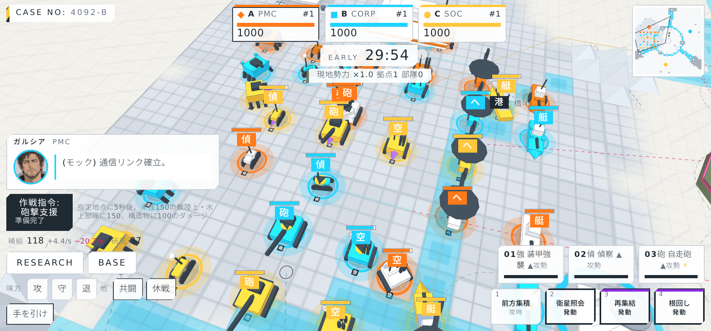
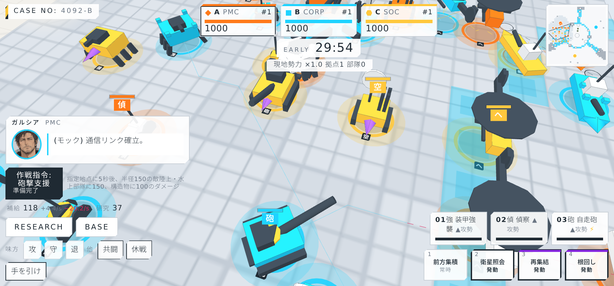
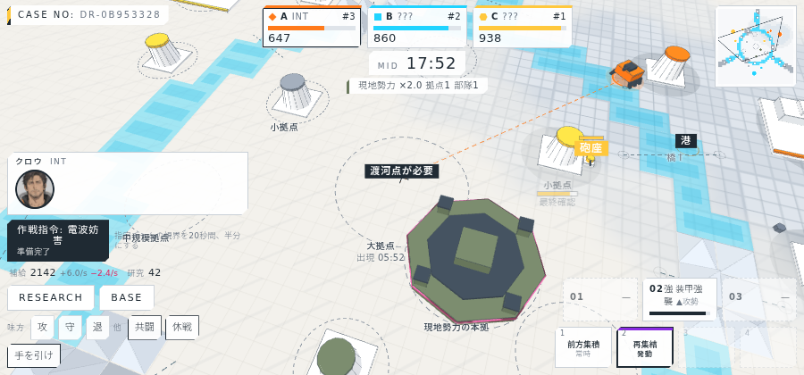
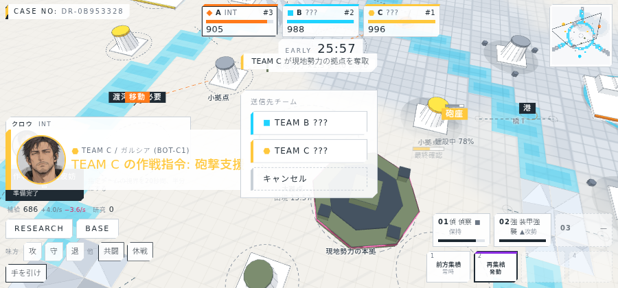
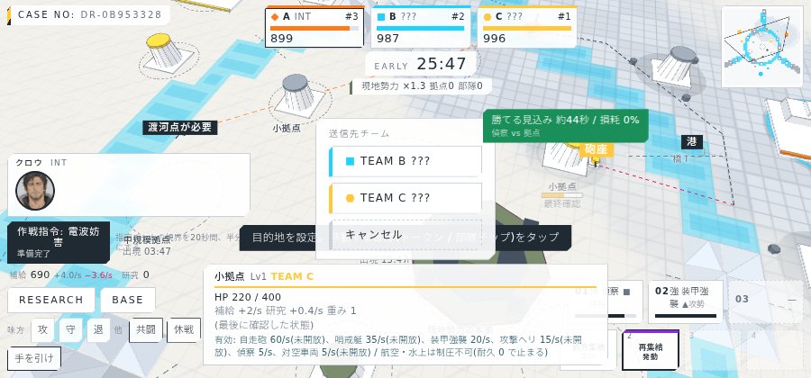

# 進捗報告 M4 段階3: NPC文明、指導者の作戦指令、部隊模型の差別化 2026-10-05

実サーバー(10倍速)に headless Chrome で接続して撮影。画面は `screens/`、動画は `video/dream4x_m4-3_2026-10-05.webm`(約3分、AI代行で1試合)。

## 実装したもの

| 項目 | 内容 |
| --- | --- |
| 部隊模型の差別化 | 6種のシルエットを大きく明確に(装甲強襲=幅広の車体と6本脚、偵察=細い車体とセンサーポール、自走砲=長砲身、対空車両=レーダーマストと縦ランチャー、攻撃ヘリ=長い機体と大ローター、哨戒艇=低い船体と艦橋)。表示倍率2.0、ベースプレートに種類の記号。文明ごとの意匠(PMC 装甲板、CORP 角のキャップ、SOC 尖った先端、IPA 白基調、FND 八角バッジ、INT 低い薄板)とアクセント色を部隊と首都に付け、敵は所属が判明した時点で意匠が出る |
| NPC文明(現地勢力) | 中央の島に本拠(耐久6000)を持ち、島の小拠点1つを初期保有。2分から部隊を生産(間隔は45秒→40秒、終盤はヘリも混ざる)、時間とともに強くなる。最寄りの非NPC拠点を地形無視で攻めて制圧する。NPC拠点を奪うと報酬(補給150・研究30)、本拠を落とすと NPC は壊滅し、落としたチームの各プレイヤーに補給400・研究100。NPC拠点はチケット減少の平均に入れない。徘徊NPCはこれに統合 |
| 指導者の作戦指令 | 文明ごとに1種、クールダウン付き。PMC 砲撃支援(5秒後に着弾)、CORP 緊急増産、SOC 煙幕、IPA 鉄壁、FND 全域観測、INT 電波妨害。発動で大きめのカットイン。他チームの指令もカットインで通知(位置は伏せ、砲撃だけ着弾点が見える) |
| HUD | 上部に現地勢力の概況「×1.4 拠点3 部隊5」、本拠陥落のバナー、通信窓の下に作戦指令ボタン(残りクールダウン、効果中の表示) |

## バランス計測(3×1 全ボット、4 seed)

| 項目 | 結果 |
| --- | --- |
| 本拠の陥落 | 4試合すべて(12.4 / 15.0 / 19.1 / 22.1分)。調整前は11〜20分 |
| NPC の生産 | 15〜28体/試合、制圧 0〜2件 |
| 作戦指令 | 27〜39回/試合 |
| 終了時に0のチーム | 最大1。1位は559〜832 |

本拠は中盤〜終盤に落ちる。落としたチームの報酬が大きいので、「共闘して落とし、直後に奪い合う」場面を作れるが、ボットは共闘せず単独で落としている。本拠をさらに硬くするか、初期戦力を置くかは実機の手応えで決める。

## 画面

### 部隊模型の比較(6文明 × 6種、2倍スケール)

### NPC文明の本拠と概況

### 作戦指令(ヒントとカットイン)

## 検証

| 項目 | 結果 |
| --- | --- |
| typecheck | 成功 |
| サーバーのテスト | 44件すべて成功(本拠の配置と保護、生産と成長、NPC の制圧と報酬、本拠陥落、チケット平均からの除外、6指令の効果とクールダウン、全ボット戦を追加) |
| クライアントのビルド | 成功 |
| 実サーバーでの撮影 | 31枚と動画1本。模型比較はモックの showcase で撮影 |

## 既知の制限

- ヘリのローター回転、砲の射撃エフェクト、本拠の崩壊アニメーションは未実装。
- 作戦指令の効果表示は位置を受け取ったチームにのみ出る(煙幕・観測は自チームのみ)。
- 砲撃支援の構造物ダメージ(100)はサーバー側の定数。
- NPC は渡河点と防御施設を攻撃しない。
