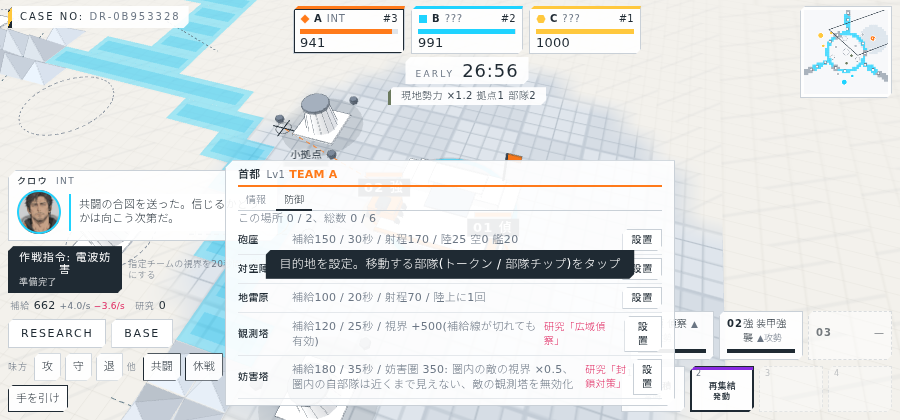
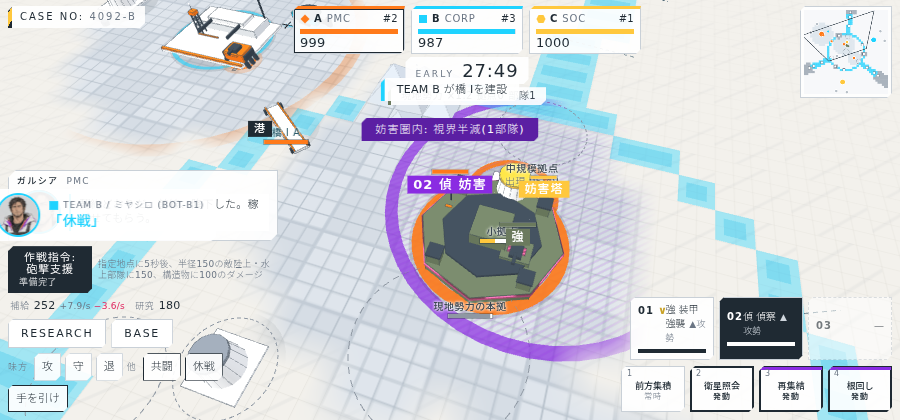
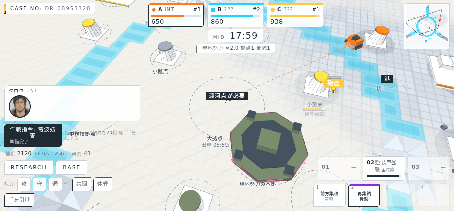

# 進捗報告 M5 段階1: 偵察塔と電子戦 2026-10-05

実サーバー(10倍速)に headless Chrome で接続して撮影。画面は `screens/`、動画は `video/dream4x_m5-1_2026-10-05.webm`(約3分、AI代行で1試合)。

## 実装したもの

| 項目 | 内容 |
| --- | --- |
| 観測塔 | 防御施設として所有拠点・渡河点に設置(補給120、25秒、耐久200)。所有チームに半径500の固定視界。補給線が切れていても機能し、敵の妨害圏内では無効。研究「観測網」が必要 |
| 妨害塔 | 防御施設(補給180、35秒、耐久220)。半径350の妨害圏で、圏内の敵部隊・敵拠点・敵渡河点の視界を半分にし、圏内の敵観測塔を無効化。圏内の自部隊は敵が半分の距離まで近づかないと見えない。研究「封鎖対策」が必要。作戦指令「電波妨害」とは乗算 |
| 表示 | 観測塔=格子マストと箱、妨害塔=皿アンテナと回転リング。自分の観測塔の視界円(細い線)、妨害圏(斜線の円。自分は青、敵は紫)。自部隊が敵の妨害圏内にいると部隊ラベルに「妨害」、HUD 上部に「妨害圏内: 視界半減(n部隊)」 |
| ボット | 「観測網」取得後に係争地の拠点か橋Iへ観測塔、「封鎖対策」取得後に首都へ妨害塔 |

## 画面

### 防御タブ(5種)

### 敵の妨害圏と警告(モックで再現)

### 中盤(現地勢力の本拠と作戦指令の通知)

## 検証

| 項目 | 結果 |
| --- | --- |
| typecheck | 成功 |
| サーバーのテスト | 49件すべて成功(観測塔の視界と破壊、補給線に依存しない、妨害圏での視界半減と自部隊の秘匿、敵観測塔の無効化、研究要件、電波妨害との乗算、全ボット戦で両施設が建つ) |
| クライアントのビルド | 成功 |
| 実サーバーでの撮影 | 36枚と動画1本。妨害圏の画面はモックで再現 |

## 既知の制限

- 妨害圏の表示判定はクライアント側の幾何計算(表示のみ。実効果はサーバー)。
- 敵の妨害圏は妨害塔が見えているときだけ表示する(見失うと消える)。
- 観測塔のアンテナは静止。

## 文書の更新

- 機能仕様書 3.14 に観測塔・妨害塔を追加、3.4 の可視の注記。
- 計算モデル 14章(可視判定)・16章(ボット)・28章(防御施設)。
- 画面とダイアログ一覧(防御タブの2種、妨害圏と警告の表示)、アセット一覧(2種の模型、視界円と妨害圏、妨害の記号)。
