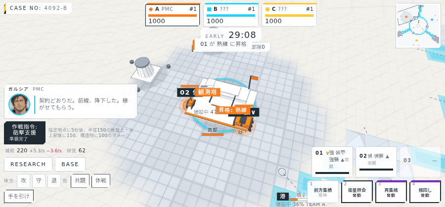
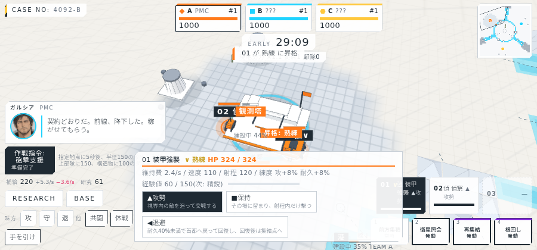
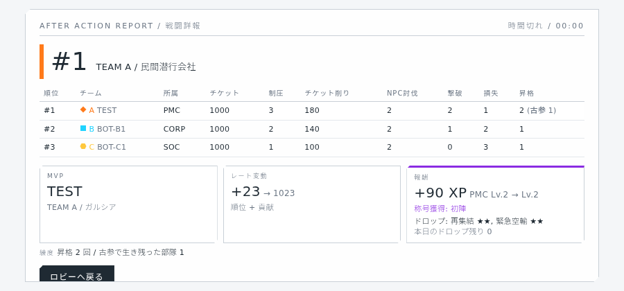

# 進捗報告 M5 段階2: 部隊の練度 2026-10-05

実サーバー(10倍速)に headless Chrome で接続して撮影。画面は `screens/`、動画は `video/dream4x_m5-2_2026-10-05.webm`(約3分、AI代行で1試合)。

## 実装したもの

| 項目 | 内容 |
| --- | --- |
| 経験値 | 与ダメージ(1につき0.02)、敵部隊のとどめ(相手のコスト×0.25)、拠点・渡河点の制圧(20)、防御施設の破壊(10)。NPC部隊の撃破も同じ。守備NPC・砲座・NPC・砲撃支援は対象外 |
| 段階 | 新兵 → 熟練(60)→ 精鋭(150)→ 古参(300)。段階ごとに攻撃+8%、最大耐久+8%、視界+5%。失うとチケット損失が段階ごとに+10% |
| 陥落時 | 首都陥落で失う半数は練度の低い方から |
| 表示 | 記章(金色のV字1〜3本)をラベル・チップ・ポップに。ポップに段階名、補正、経験値バー。昇格時のマーカー・トースト・指導者の一言。戦闘予測の攻撃側に練度と文明・研究の攻撃係数を反映 |
| リザルト | 「昇格」列(古参で生き残った部隊数を併記)と自分の練度の行。MVP の式に昇格回数を加算 |
| ボット | 精鋭以上は退避のしきい値を50%に(大事に使う) |

## バランス計測(3×1 全ボット、4 seed)

| 項目 | 結果 |
| --- | --- |
| 昇格回数 | 33〜49回/試合(プレイヤーあたり10〜21) |
| 古参に到達した部隊 | 5〜8体/試合。終了時に生存3〜5体 |
| 終了時に0のチーム | 最大1。1位は507〜839 |

練度で優勢側がさらに強くなるため、チケット差は広がりやすい。逆転の余地を保つなら、古参の損失倍率を上げるか、陥落時に練度を失う(現状は保持)案がある。

## 画面

### 昇格の瞬間(モック)

### 部隊ポップ(記章、補正、経験値バー)

### リザルトの昇格列

## 検証

| 項目 | 結果 |
| --- | --- |
| typecheck | 成功 |
| サーバーのテスト | 54件すべて成功(経験値と昇格、倍率、損失倍率、陥落時の順、スコア集計、全ボット戦で昇格) |
| クライアントのビルド | 成功 |
| 実サーバーでの撮影 | 37枚と動画1本。昇格の画面はモックで再現(実サーバーの撮影では自部隊が受け身で昇格に至らないため) |

## 既知の制限

- 記章はフォントの「∨」を重ねている(アイコン化は未)。
- 戦闘予測の防御側(敵部隊)には練度を掛けていない。
- 経験値バーはポップを開いた時点の値。

## 文書の更新

- 機能仕様書 3.18「部隊の練度」を追加、MVP の式を更新。
- 計算モデル 32章「部隊の練度」を追加、8・11・17章を更新。
- 画面とダイアログ一覧(記章、部隊ポップ、昇格のトーストとマーカー、リザルトの列)、アセット一覧(記章、経験値バー)。
